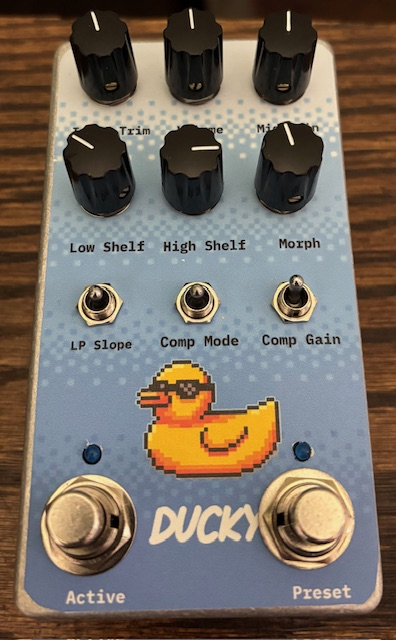
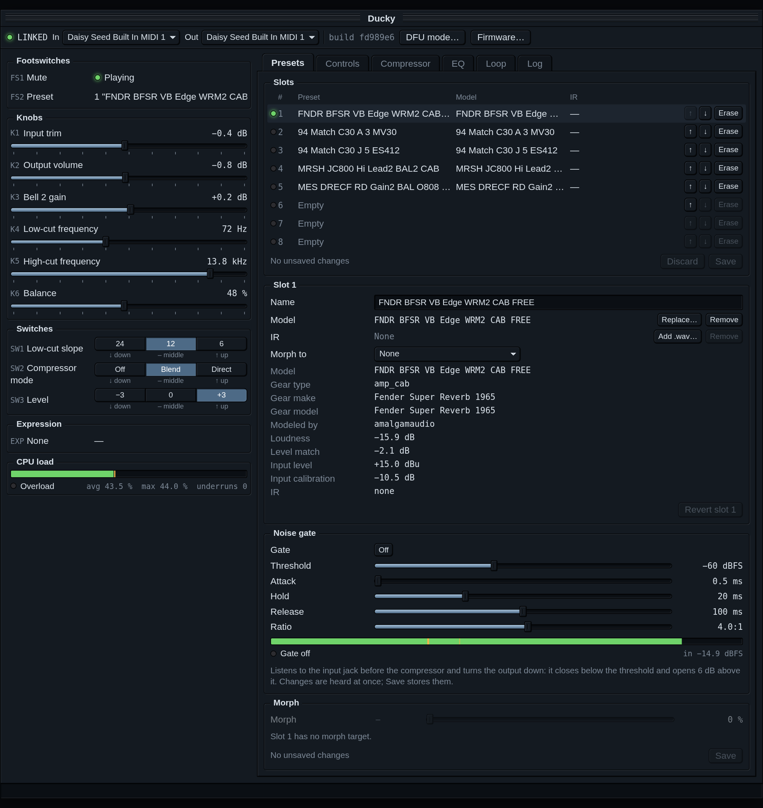
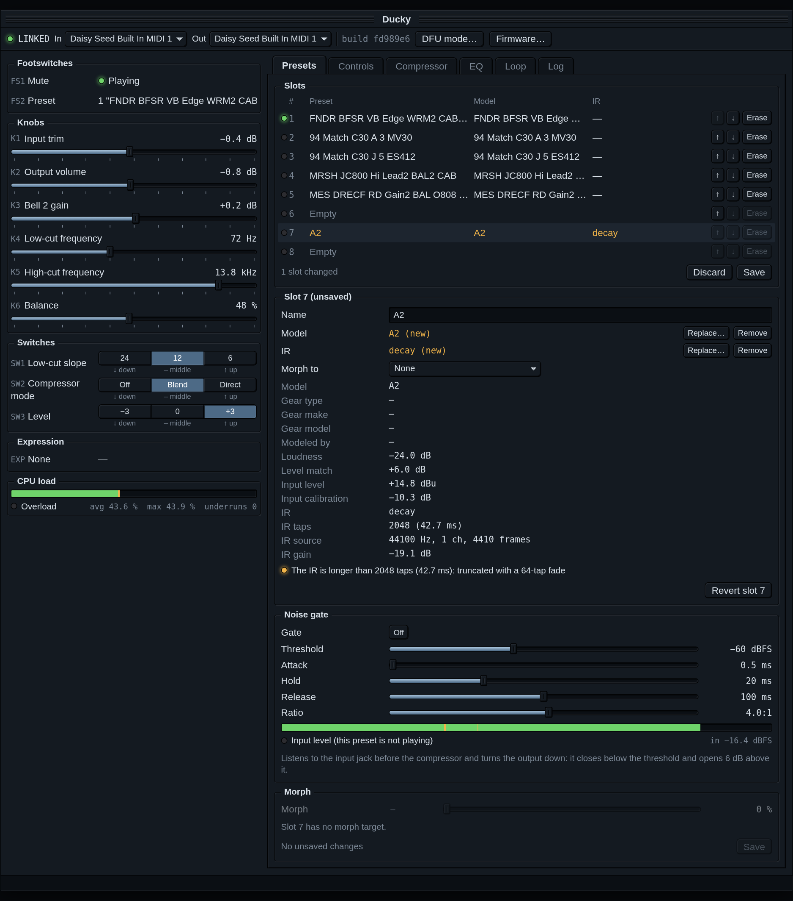
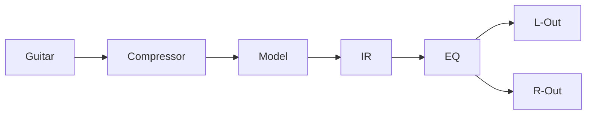
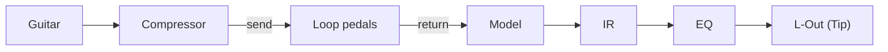
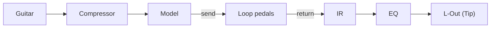
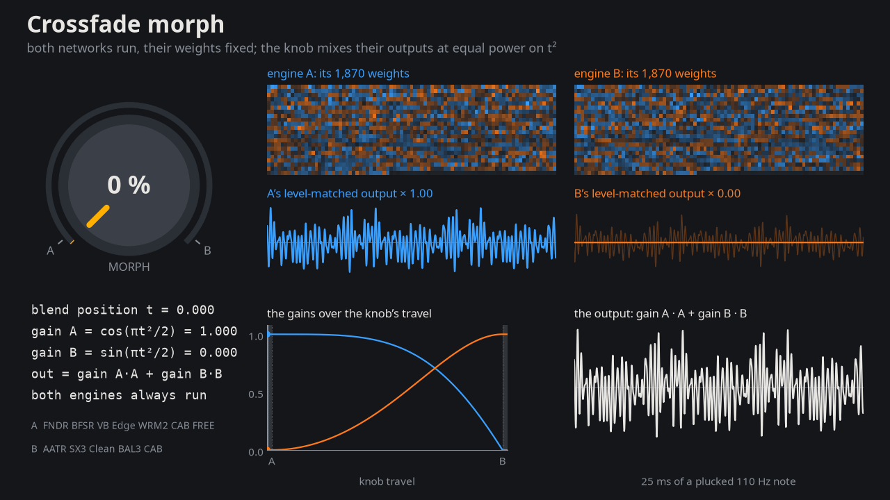
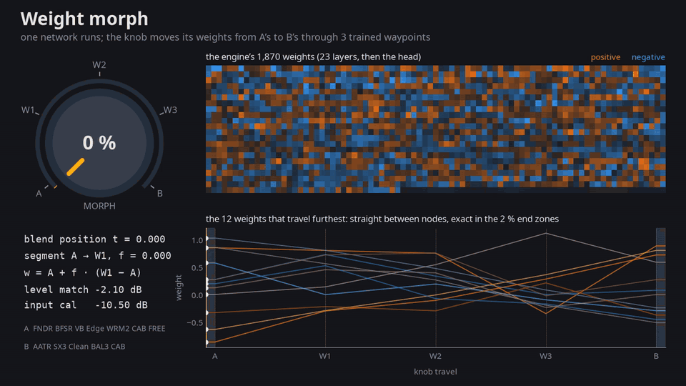

# Ducky

A NAM (Neural Amp Modeler) player for the DaisySeed in a HotHouse pedal: eight presets, each an A2-Lite model with an optional cab IR, a noise gate and an optional morph target, with a compressor, an EQ and an effects loop around them, and a browser editor over USB-MIDI.



Documentation: `docs/` (`docs/FIRMWARE.md` to build and flash, `docs/EDITOR.md` for the editor, `docs/ROADMAP.md` for what is decided and what is left).

## Build and flash

```
git clone --recursive https://github.com/jimbattin/ducky.git ducky && cd ducky
make -C daisy/libDaisy
make -C daisy -j
tools/flash_when_ready.sh
```

A new Seed needs the Daisy bootloader first, and the tools need a few packages and udev rules: `docs/FIRMWARE.md` "Getting started".

## Editor

A browser editor manages the pedal over USB-MIDI while it plays: the eight preset slots, which parameter each knob, switch and the expression pedal drives, the compressor, the EQ, the effects loop and the pedal's log. It needs Chrome (Web MIDI with SysEx). Details: `docs/EDITOR.md`.

```
make -C editor serve      # http://localhost:3000/, with hot reload
make -C editor html       # one self-contained file, editor/dist/editor.html
```

Connect the pedal, open the page and allow MIDI: the toolbar reads `LINKED` and the Presets tab lists the slots.



### Loading a NAM model and an IR

1. On the Presets tab, select a slot (an empty one, or one to change).
2. **Add .nam…** (or **Replace…**) and pick a NAM file. It must hold an A2-Lite model, as the A2 captures on [TONE3000](https://www.tone3000.com/) do; the editor says why it rejects any other.
3. Optionally **Add .wav…** and pick a cab IR. It is resampled to 48 kHz, cut to 2,048 taps (42.7 ms) and normalised. Leave it out for a capture that already includes the cab.
4. Check the result under the slot: the model's metadata, its level match and input calibration, and any warning (a cab model with an IR, a truncated IR). Rename the preset if you like.
5. **Save** under the slot table writes every changed slot to the pedal; **Discard** drops the changes. A saved preset survives power cycles, and FS2 steps to it.



The same from the command line (Linux), with the editor's tab closed (it holds the MIDI port): `bun tools/pedal.ts upload 7 MODEL.nam --ir CAB.wav`.

## MISO and loop modes

One global setting, `loop_mode`, picks how the pedal's two TRS jacks are used. Set it on the editor's Loop tab, with `bun tools/pedal.ts param set loop_mode post-model`, or from a switch assigned to it; it is kept with the other settings. Details: `docs/LOOP.md`.

**MISO** (the default): mono in on the input's tip, the same signal on both outputs. Ordinary mono cables.



**Loop pre-model**: an effects loop before the model, for drives, boosts and wahs.



**Loop post-model**: an effects loop after the model and before the IR, for delays and reverbs. The gate acts on the send, so their tails come back ungated.



The diagrams leave out the gains, the noise gate and the mute: `docs/LOOP.md` has the full chains.

In both loop modes the output's ring is the send, the input's ring is the return, and the pedal plays on the output's tip only. Use an insert cable (TRS to two TS) on each jack: the input's tip leg takes the guitar and its ring leg the last loop pedal's output; the output's tip leg goes to the amp and its ring leg to the first loop pedal's input. The loop is in series, so a loop mode with nothing patched in is silent.

## Preset morph

A preset can name another preset as its morph target. The global `morph` parameter, on a knob or an expression pedal, then moves the pedal from the preset's own model (0 %) to the target's (100 %); the first and last 2 % of its travel are each model alone. The pedal can do it in two ways, one per firmware build. Details, measurements and formats: `docs/MORPH.md`.

### Crossfade (the default build)

Both models run on every block and the knob mixes their outputs at equal power: `cos(πt/2)` of the preset's model plus `sin(πt/2)` of the target's. It sounds like the two amps side by side at every position and needs no preparation, at the cost of a second engine: about 790 permille of the block period, against 430 for the weight morph.



### Weight morph (`make -C daisy APP=weight`)

One model runs, and the knob moves its 1,870 weights from the preset's to the target's. A straight line between two captures of different amps dips in level and sounds like neither in the middle, so the path can go through up to three waypoint networks, trained on the host (`bun tools/pedal.ts morph A B --train`, about ten minutes; the host's one-time setup: `docs/MORPH.md` "Host setup for a trained path") so that the sweep follows a crossfade of the two amps. A blend costs at most 32 permille of a block while the knob moves and nothing while it rests.



The animations show two real models (a Fender Super Reverb into a Two-Rock SSS, the weight morph along a trained path) and come from `tools/morph_anim.py`; `docs/images/morph/` also holds them as `.mp4`.
