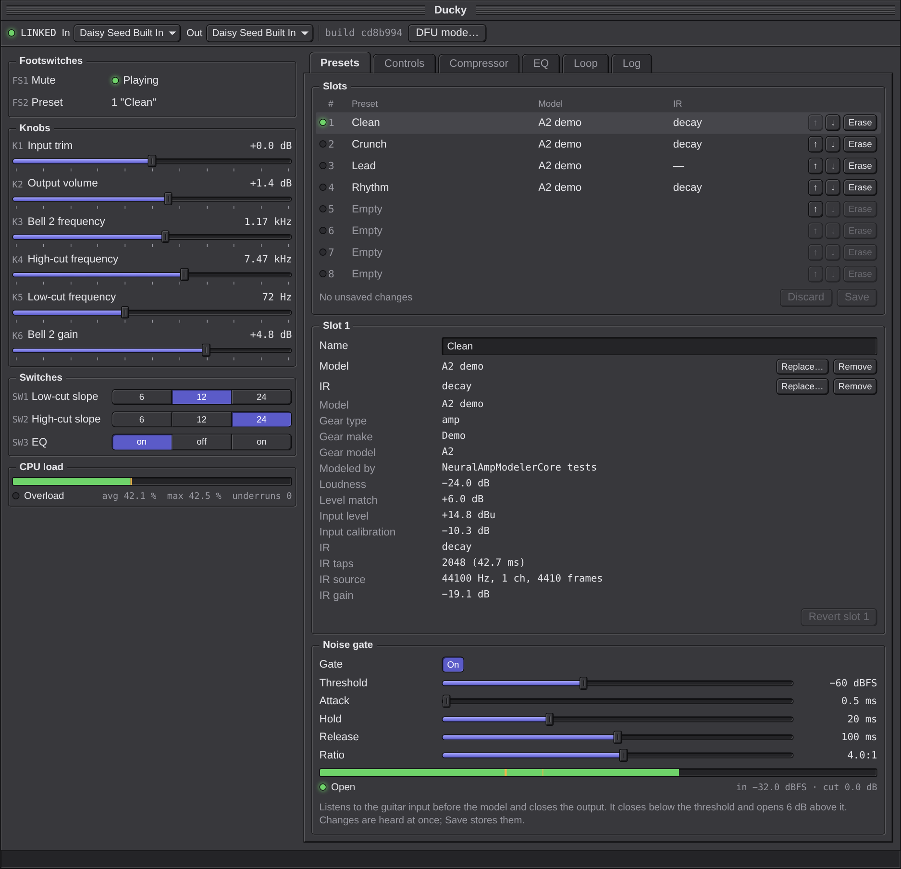
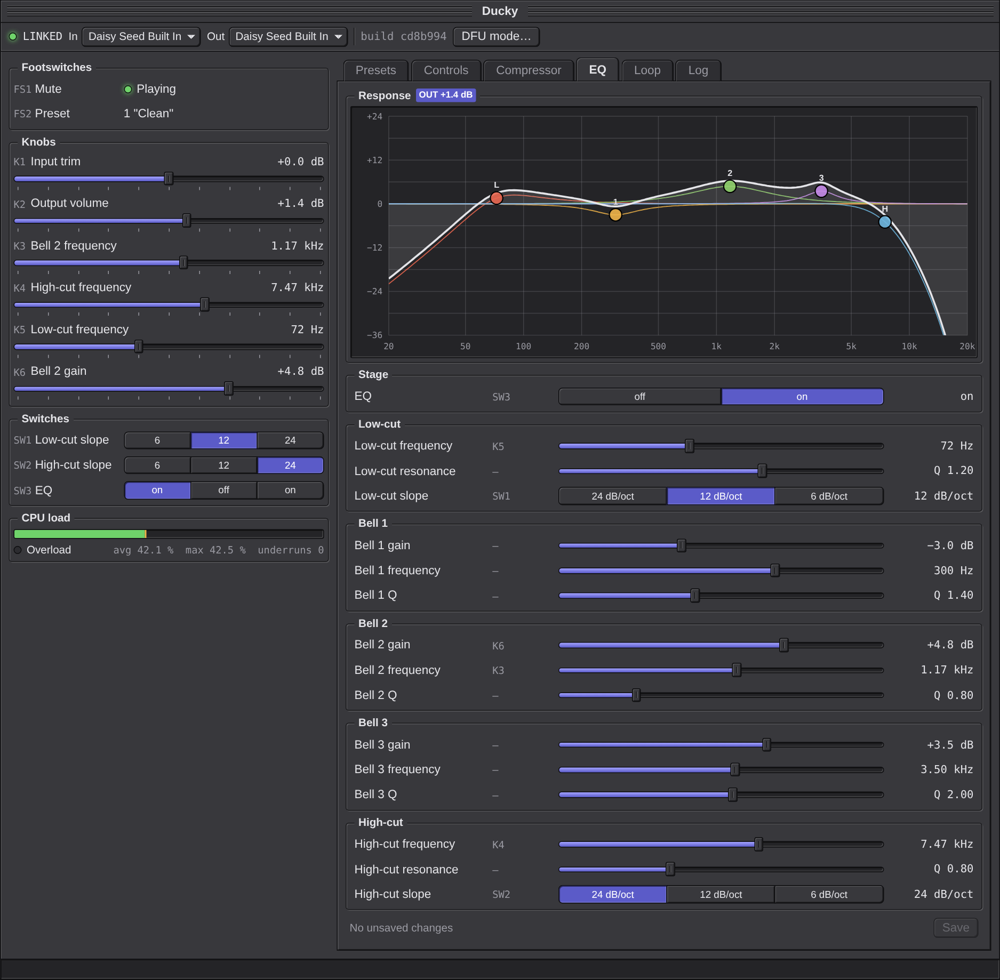
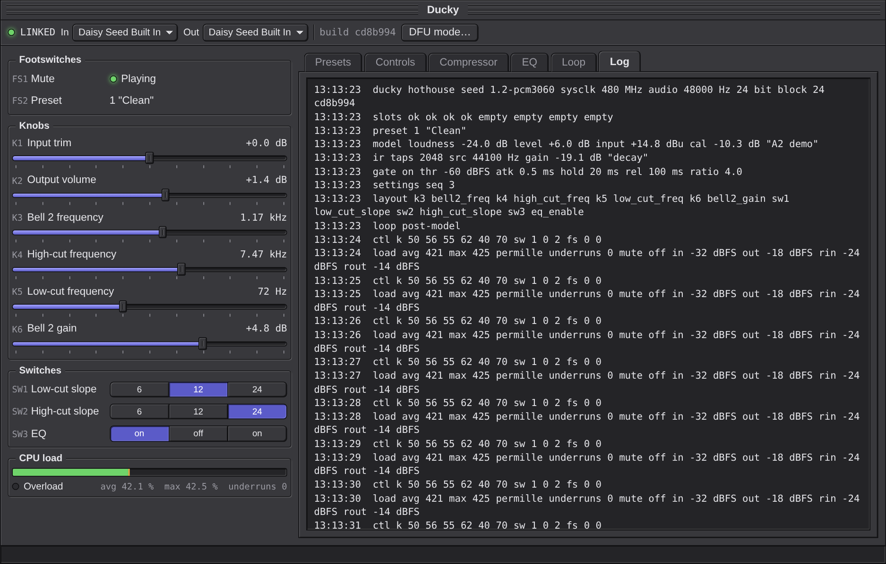
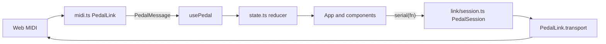

# Editor

The browser editor manages the pedal's 8 preset slots, assigns its knobs and switches to parameters, and shows its live state over USB-MIDI. It is written in Preact and TypeScript, built with Bun into one self-contained file, `editor/dist/editor.html` (scripts and styles inlined, no external URLs). It needs Chrome: Web MIDI with SysEx. It follows the conventions of bad_tape's editor (`../bad_tape`): the Platinum look, a read-only sidebar of the pedal's controls, and tabs over a panel.

It sets slots (presets), which parameter each of Knobs 3–6 and SW1–SW3 drives, and the parameters' values; while you edit a preset it auditions the playing preset's noise gate. A value set from the editor holds until its control moves, and then the pedal is "what you see is what you get" again. Knobs 1 and 2 are never set.

## Running

```
make -C editor serve      # hot reload at http://localhost:3000/ (PORT=… to move it)
make -C editor html       # editor/dist/editor.html
make -C editor test       # bun:test: the editor's, the converters' and the link's tests
make -C editor check      # tsc, then Biome over editor/ and tools/*.ts
make -C editor fmt        # Biome's fixes and formatting, same files
```

`make -C editor` installs the dependencies on first use (`bun install --frozen-lockfile`).

- **Chrome:** the first visit asks for MIDI with SysEx; allow it. Without Web MIDI the status reads `WEB MIDI UNAVAILABLE - USE CHROME`, or `WEB MIDI NEEDS HTTPS OR LOCALHOST` on a page served over plain HTTP from anywhere but localhost. Refused access reads `NO MIDI ACCESS - CONNECT THE PEDAL, ALLOW MIDI, RELOAD`.
- **Port conflicts:** the page holds the pedal's MIDI port. Close the tab before `tools/pedal.ts` or `tools/usb_log.py` (`docs/FIRMWARE.md` "Port conflicts").
- **Hosting:** the built file runs from any URL, and in an `<iframe>` too, when the frame grants MIDI (`allow="midi"`).

## The window



- **Toolbar:** the link lamp and status (`LINKED` green, `NO RESPONSE` amber, else off: `CONNECTING…`, `NO MIDI DEVICE`, or why Web MIDI is unavailable), the **In** and **Out** port menus, the firmware build from the Identity Reply, and **DFU mode…**.
- **Sidebar:** read-only, from STATUS and VALUES. FS1 mute, FS2's playing slot, Knobs 1 and 2 in the firmware's units (`editor/src/controls.ts` mirrors `daisy/src/dsp/gain.h`), then Knobs 3–6 and the three toggles, each named after the parameter it drives (`None` without one) with that parameter's value, and the CPU load. A knob's bar is the knob's position; its readout is the parameter's value, which differs while the control is **Held**: set from the editor or by another control on the same parameter, and waiting to be moved. A cut filter's frequency reads `Off` at its bypass end. A resonance is dimmed when its slope is 6 dB/oct or its filter is off. The CPU bar's fill is the average load (red from 80 %), its amber marker the peak, and the Overload lamp lights on a new underrun or a full peak.
- **Status bar:** the progress of the running operation (`SAVING SLOT 5… 40 %`), then its result or its error.

## Presets tab

The slot table lists the 8 slots: the playing lamp, the slot number (click it, or the row, to select), the preset, model and IR names, ↑/↓ to swap with a neighbour, and **Erase**. Unsaved changes are amber. **Save** and **Discard** under the table act on every unsaved change at once.

Under the table, the selected slot's editor: its name, its model (**Add .nam…** / **Replace…** / **Remove**) and its IR (**Add .wav…** / **Replace…** / **Remove**). Each part is kept, replaced or removed. Below them are the metadata, level match and input calibration of the result, its warnings, and **Revert slot N**. The warnings are: no loudness, no `input_level_dbu`, a cab model with an IR, and a truncated new IR. Files go through the same converters as the CLI tools (`editor/src/nam/`, `editor/src/ir/`).


Edits stay in per-slot drafts (`editor/src/draft.ts`) until Save, which applies each changed slot in turn:

- A removed model erases the slot, after a confirmation.
- A changed gate alone is a GATE: no upload, so no reload fade.
- Otherwise the preset is composed and uploaded. When it keeps the stored model or IR, the whole slot is read back first (READ, CRC-checked by `splitSlot` in `editor/src/preset/bank.ts`). When it keeps neither, only the stored gate is read (8 bytes).

A new model renames the preset while its name is still the old model's. A swap moves the drafts with the slots. Leaving the page with unsaved drafts asks first. After every slot change the table is listed and read again, so it shows what the flash holds even after a failure.

### Noise gate box

Under the slot editor: **On**/**Off** and the five settings as sliders (`editor/src/gateControls.ts` `GATE_PARAMS`: the threshold linear, the rest log), then a meter. The meter shows the input level from STATUS on −90…0 dBFS, with markers where the gate closes (amber) and opens (faint amber). While the slot plays, the lamp line shows the gate's state from its gain reduction: Open, Closing or Closed.

On the playing slot every change is heard at once: it is auditioned with GATE TRY (`editor/src/useGateAudition.ts`), coalesced to the latest value with one request in flight. A preset switch or a resync sends an unsaved gate again; Revert and Discard send the stored one back. A gate edit is part of the slot's draft until Save.

The sliders:

- Arrow keys step one resolution of the setting (1 dB, 0.1 ms, 1 ms, 0.1 of ratio).
- Page Up/Down move 10 % of the travel; Home/End go to the ends.
- Dragging the thumb moves it from where it is; pressing the track jumps there first. Shift drags 10× finer.
- Double-click resets the setting to its default.

## Controls tab


The pedal's parameter table and its live assignments and values, read from the pedal (DUMP, then the VALUES stream): nothing about the parameters is built into the editor except how to draw the EQ (`docs/MIDI.md` "Parameters", "Controls").

- **Controls:** a menu per control, K3–K6 and SW1–SW3. A knob takes any parameter; a switch's menu lists only the choice parameters (the slopes, the mid); `None` leaves the control unused. A parameter may be on several controls. Choosing one sends ASSIGN: the parameter keeps its value, and the control is **Held** until it moves.
- **Parameters:** every parameter with the controls it is on, a slider (continuous) or a button group (a choice), and its value. A change is sent at once as SET (`editor/src/useParamEdits.ts`: coalesced to the latest value per parameter, one request in flight) and heard at once. It holds every control on that parameter; a parameter on no control keeps the value. The sliders work as the noise gate's; double-click resets to the parameter's default. A resonance is dimmed when it has no effect.
- **Held** ends when the control moves: a knob by more than 3 % of its travel, a switch to another position. The parameter then follows the control.
- **Factory layout** puts every control back on its factory parameter (the table's). **Save** writes the layout and the values to the pedal's settings record (SAVE, `docs/FIRMWARE.md` "Settings record"); until then they last until power-off, the line under the table reads `Not saved on the pedal`, and leaving the page asks first. At power-up a parameter on a control takes the control's position, so a saved value matters for parameters on no control.
- Firmware from before the parameter table does not answer DUMP: the tab says so, and the rest of the editor works.

## EQ tab

The response of the low-cut, the mid and the high-cut plus Knob 2's output volume (`editor/src/eqModel.ts`, `docs/FILTERS.md` "Filters"), drawn from the parameters' live values, whichever control or the Controls tab set them, and from STATUS for Knob 2 and the mute. The whole chain is filled to 0 dB. Each section in use is a thin curve with a marker at its frequency (L, M, H; hover for its settings). The volume is the title's badge, and the gain at the pointer is read out top right. Muted dashes the curve; the volume's off end draws only the sections. Knob 1 is not drawn: it sets the drive into the model, not a level after it. Neither are the model and the IR.



## Log tab

The pedal's log lines (`docs/FIRMWARE.md` "Log lines"; the last 1,000), each with its local receive time. It follows new lines while scrolled to the end.



## Link and sync

- **Link:** the editor picks the input and output ports whose name contains `daisy` (the toolbar's In/Out menus override them). It sends HELLO every second until the pedal answers, and reads `LINKED` while anything arrived in the last 4 s. WATCH's STATUS and VALUES every 100 ms keep the link fresh.
- **Sync:** on each link, on the boot line (`ducky …`, so a reflashed or power-cycled pedal is picked up without a reload), and every 3 s until one succeeds. A sync is Identity (device 64), LIST, every ok slot's metadata over READ (`editor/src/preset/info.ts`: 4 READs per slot, 5 with an IR), DUMP (the parameter table and the values), then WATCH on. A boot line also clears `Not saved on the pedal`: a restarted pedal is back on its saved settings.
- **One request at a time:** every request goes through one queue (`usePedal.ts` `serial`), because the pedal answers one request at a time.
- **DFU mode…** sends DFU after a confirmation. `tools/flash_when_ready.sh` then flashes, and the editor relinks and resyncs by itself.



## Source layout

All paths are under `editor/`. Each `*.test.ts` sits beside the module it tests.

| Path | Role |
|---|---|
| `Makefile` | `serve`, `html`, `test`, `check`, `fmt`; `check` and `fmt` also cover `../tools/*.ts`. |
| `build.ts` | Bundles `src/editor.html` into `dist/editor.html` (`make html`). |
| `server.ts` | The dev server with hot reload (`make serve`). |
| `biome.jsonc`, `tsconfig.json` | Lint, format and type-check settings (Code conventions). |
| `package.json`, `bun.lock` | Preact; TypeScript, Biome and Bun's types for development. |
| `src/editor.html`, `src/main.tsx` | The page and its entry point. |
| `src/App.tsx` | The window: tabs, the slot actions (swap, erase, save, discard, DFU), the drafts, and the Controls tab's actions (assign, factory layout, save). |
| `src/ducky.css` | The Platinum styles. |
| `src/midi.ts` | `PedalLink`: Web MIDI ports, SysEx reassembly, the HELLO keep-alive, the link status, the session's transport. |
| `src/usePedal.ts` | The link's lifecycle: the reducer it feeds, the sync and its retries, the `serial` request queue. |
| `src/state.ts` | The reducer: link, identity, slots, slot infos, STATUS, load, log, the parameter table, VALUES, and whether the settings are unsaved. |
| `src/useGateAudition.ts` | GATE TRY auditions of the gate box's changes on the playing slot. |
| `src/useParamEdits.ts` | SETs from the Controls tab, coalesced per parameter, and the value shown while one is in flight. |
| `src/draft.ts` | Per-slot unsaved drafts, what the slot table shows for them, and Save (`saveDraft`). |
| `src/importer.ts` | `.nam` and `.wav` files through the converters; rejection text and import warnings. |
| `src/controls.ts` | Knob 1's and Knob 2's readouts in the firmware's tapers; a toggle's position; level match and input calibration. |
| `src/eqModel.ts` | The EQ's frequency response from the EQ parameters' values and Knob 2; when a resonance has no effect. |
| `src/gateControls.ts` | The gate box's sliders: labels, tapers, resolutions, readouts. |
| `src/device.ts` | `SAMPLE_RATE`, `NAME_MAX`, `sanitiseName`, `writeAscii`: what the converters, the preset code and the link share about the pedal. |
| `src/crc32.ts` | CRC-32 (zlib), as the firmware checks binaries and link chunks. |
| `src/format.ts` | Display formats: the typographic minus, signed dB, Hz, IR length, error text. Plain TypeScript: `link/params.ts` uses it. |
| `src/testFixtures.ts` | `readFixture`, `readFixtureText`: `tests/fixtures/` for the tests; `FACTORY_PARAMS`: the pedal's parameter table, checked against `docs/MIDI.md` (never bundled). |
| `src/components/Toolbar.tsx` | The link lamp, status, port menus, build and DFU button. |
| `src/components/FrontPanel.tsx` | The sidebar: footswitches, the fixed knobs, each assignable knob and switch with its parameter, CPU load. |
| `src/components/KnobGauge.tsx` | A knob's position as a read-only slider track with ticks. |
| `src/components/Positions.tsx` | A toggle's three positions. |
| `src/components/HeldBadge.tsx` | The Held mark on a control waiting to move. |
| `src/components/ControlsTab.tsx` | The Controls tab: each control's parameter, each parameter's value, Factory layout and Save. |
| `src/components/AssignSelect.tsx` | A control's menu of the parameters it accepts. |
| `src/components/Segmented.tsx` | A button group: one pressed button per choice. |
| `src/components/CpuMeter.tsx` | The CPU load meter. |
| `src/components/Meter.tsx` | A bar with a fill and markers over a lamp line; the CPU and gate meters. |
| `src/components/TabNav.tsx` | The WAI-ARIA tab list (Left/Right cycle, Home/End jump). |
| `src/components/SlotTable.tsx` | The slot table with swap, erase, Save and Discard. |
| `src/components/SlotEditor.tsx` | The selected slot's name, model and IR, its warnings and Revert. |
| `src/components/Details.tsx` | A model's and an IR's metadata. |
| `src/components/GateEditor.tsx` | The noise gate box. |
| `src/components/GateMeter.tsx` | The gate's input level against its thresholds, and its state. |
| `src/components/Slider.tsx` | `Slider` (pointer and keyboard) and `SliderTrack`, which `KnobGauge` shares. |
| `src/components/EqGraph.tsx` | The EQ tab's response graph. |
| `src/components/LogView.tsx` | The Log tab. |
| `src/components/GroupBox.tsx`, `Lamp.tsx`, `StatusLine.tsx` | An etched group box, a status lamp, the status bar. |
| `src/link/` | The SysEx link (`docs/MIDI.md`): `protocol.ts` builders, codecs and parsing; `session.ts` `PedalSession`; `params.ts` a parameter's code as its value and readout, the controls and what each accepts. Shared with `tools/pedal.ts`. |
| `src/nam/` | The `.nam` → model binary converter (`docs/NAM_FORMAT.md`). Shared with `tools/nam_convert.ts`. |
| `src/ir/` | The `.wav` → IR binary converter, its WAV reader and resampler (`docs/FILTERS.md`). Shared with `tools/ir_convert.ts`. |
| `src/preset/` | `bank.ts` the slot and bank builders, `gate.ts` the gate block, `info.ts` a stored preset's metadata. Shared with `tools/preset_bank.ts` and `tools/pedal.ts`. |

## Code conventions

- **TypeScript:** `strict` with `noUncheckedIndexedAccess`. A `!` marks an index that a check before it guarantees (the wire parsers above all); `biome.jsonc` says why `noNonNullAssertion` is off. Where a type can carry what is known, use the type instead (App's `edited` list and `selDraft`).
- **Biome:** the recommended rules plus the React domain, imports organised, 120 columns. `make -C editor check` must pass with no warnings; a `biome-ignore` states its reason.
- **One module per shared fact:** the sample rate and name rules in `device.ts`, display formats in `format.ts`, the SLOT statuses in `link/protocol.ts` `SLOT_STATUS`, the slot count in `preset/bank.ts` `SLOT_COUNT`, the controls in `link/params.ts` `CONTROLS`. The parameters' names, ranges and labels come from the pedal. No local copies.
- **Shared code stays portable:** `link/`, `nam/`, `ir/`, `preset/`, `device.ts`, `format.ts` and `crc32.ts` are plain TypeScript (no DOM, no Bun APIs), because `tools/*.ts` imports them too.
- **CSS:** each class in `ducky.css` is used by a component, and each class a component uses is styled; shared looks (bevels, wells, ellipsis, focus ring) are one rule with a selector list.
