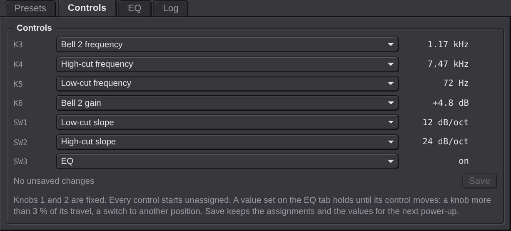
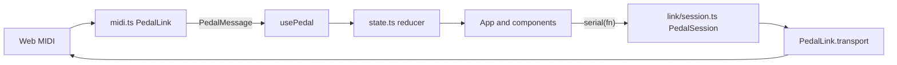

# Editor

The browser editor manages the pedal's 8 preset slots, assigns its knobs and switches to parameters, sets the compressor, the EQ and the FX loop, and shows its live state over USB-MIDI. It is written in Preact and TypeScript, built with Bun into one self-contained file, `editor/dist/editor.html` (scripts and styles inlined, no external URLs). It needs Chrome: Web MIDI with SysEx. It follows the conventions of [bad_tape](https://github.com/jimbattin/bad_tape)'s editor: the Platinum look, a read-only sidebar of the pedal's controls, and tabs over a panel.

It sets slots (presets), which parameter each of Knobs 3–6, SW1–SW3, EXP (an expression pedal on MIDI CC 11) and, on a BurningBungalow, PEDAL (its expression pedal jack) drives, and the parameters' values; while you edit a preset it auditions the playing preset's noise gate. A value set from the editor holds until its control moves, and then the pedal is "what you see is what you get" again. Knobs 1 and 2 are never set.

## Running

```
make -C editor serve      # hot reload at http://localhost:3000/ (PORT=… to move it)
make -C editor html       # editor/dist/editor.html
make -C editor test       # bun:test: the editor's, the converters' and the link's tests
make -C editor check      # tsc, then Biome over editor/ and tools/*.ts
make -C editor fmt        # Biome's fixes and formatting, same files
```

`make -C editor` installs the dependencies on first use (`bun install --frozen-lockfile`).

- **Chrome:** the first visit asks for MIDI with SysEx; allow it. Without Web MIDI the status reads `WEB MIDI UNAVAILABLE - USE CHROME`, or `WEB MIDI NEEDS HTTPS OR LOCALHOST` on a page served over plain HTTP from anywhere but localhost. Refused access reads `NO MIDI ACCESS - CONNECT THE PEDAL, ALLOW MIDI, RELOAD`.
- **Port conflicts:** the page holds the pedal's MIDI port. Close the tab before `tools/pedal.ts` or `tools/usb_log.py` (`docs/FIRMWARE.md` "Port conflicts").
- **Hosting:** the built file runs from any URL, and in an `<iframe>` too, when the frame grants MIDI (`allow="midi"`).

## The window


- **Toolbar:** the link lamp and status (`LINKED` green, `NO RESPONSE` amber, else off: `CONNECTING…`, `NO MIDI DEVICE`, or why Web MIDI is unavailable), the **In** and **Out** port menus, the firmware build from the Identity Reply (`build 3eecc19`; `build 3eecc19, weight morph` when its flags say the image plays the weight morph, `APP=weight`), **DFU mode…** and **Firmware…**.
- **Morph kind:** the Identity Reply's flags tell the editor which morph the firmware plays (`docs/MORPH.md`): the xfade build runs both models and crossfades their outputs, the weight build blends their weights. The slot editor, the save's status and the Morph box follow it; the analysis runs and the block is stored either way, so the slots serve both builds.
- **Sidebar:** read-only, from STATUS and VALUES. FS1 mute, FS2's playing slot, Knobs 1 and 2 in the firmware's units (`editor/src/controls.ts` mirrors `daisy/src/dsp/gain.h`), then Knobs 3–6 and the three toggles, each named after the parameter it drives (`None` without one) with that parameter's value, the Expression box (EXP, the expression pedal over MIDI: its parameter and that parameter's value, the pedal's position is not streamed; on a BurningBungalow PEDAL too, as a knob: its parameter, that parameter's value and the jack's position as the bar), and the CPU load. A toggle's positions read left to right as down, middle, up, the same order as the parameter rows' buttons; with a parameter on it, each of its values is captioned `↓ down`, `– middle` or `↑ up`. A knob's bar is the knob's position; its readout is the parameter's value, which differs while the control is **Held**: set from the editor or by another control on the same parameter, and waiting to be moved. A cut filter's frequency reads `Off` at its bypass end. A resonance is dimmed when its slope is 6 dB/oct or its filter is off. The CPU bar's fill is the average load (red from 80 %), its amber marker the peak, and the Overload lamp lights on a new underrun or a full peak.
- **Status bar:** the progress of the running operation (`SAVING SLOT 5… 40 %`), then its result or its error.

## Presets tab

The slot table lists the 8 slots: the playing lamp, the slot number (click it, or the row, to select), the preset, model and IR names, ↑/↓ to swap with a neighbour, and **Erase**. Unsaved changes are amber. **Save** and **Discard** under the table act on every unsaved change at once.

Under the table, the selected slot's editor: its name, its model (**Add .nam…** / **Replace…** / **Remove**), its IR (**Add .wav…** / **Replace…** / **Remove**) and **Morph to**, the preset it morphs with (None, or any other slot that holds a preset; `docs/MORPH.md`). Each part is kept, replaced or removed. Below them, with the weight build, are the stored morph's fit (for a trained path: `Trained path, 3 waypoints: fit 88.7 % (31.4 % as a straight blend)`); with the xfade build, which does not use the fit, only a note when a trained path is stored (it is the weight build's, and picking a target replaces it). Then the metadata, level match and input calibration of the result (in two columns of rows once the list is 45rem, 900 px at the editor's 20 px rem, wide), its warnings, and **Revert slot N**. The warnings are: no loudness, no `input_level_dbu`, a cab model with an IR, a truncated new IR, and a morph target whose model changed since the morph was analysed (the pedal then plays the preset's own model alone until it is picked and saved again). Files go through the same converters as the CLI tools (`editor/src/nam/`, `editor/src/ir/`).


Edits stay in per-slot drafts (`editor/src/draft.ts`) until Save, which applies each changed slot in turn:

- A removed model erases the slot, after a confirmation.
- A changed gate alone is a GATE: no upload, so no reload fade.
- A changed morph target alone writes nothing here: it is analysed below.
- Otherwise the preset is composed and uploaded. When it keeps the stored model or IR, the whole slot is read back first (READ, CRC-checked by `splitSlot` in `editor/src/preset/bank.ts`). When it keeps neither, only the stored gate is read (8 bytes). An upload that keeps the stored model and leaves **Morph to** alone carries the stored morph over as it is (the block and a trained path's waypoints, aimed at the slot the block resolves to), so a rename or an IR change neither re-analyses nor loses a trained path. Any other upload carries no morph.

Then, once every draft is written, the morphs are analysed and written (`editor/src/morph/save.ts`: both models are read back, `fitAlignment` runs for a second or two under `ANALYSING SLOT N…`, MORPH stores the block), and the status ends `; slot 5 morphs with slot 2` (with the weight morph firmware `; slot 5 morphs with slot 2 (fit 20.8 %)`) or `; slot 5 morph off` for each:

- a slot whose draft picked a target, or None;
- a slot that got a new model and had a morph: its target is analysed again, against the new model;
- a slot whose target got a new model in this save (`morphDependents`), so replacing a model never leaves the presets that morph with it behind. A target that is emptied is not analysed: Save refuses a draft that picks one, and a stored morph with it just stops.

The editor stores straight blends only. A trained path (waypoints between the two models, `docs/MORPH.md`), which only the weight build plays, is made and stored by `bun tools/pedal.ts morph N M --train`; the editor shows it, keeps it across the saves above that keep the model, and replaces it with a straight blend when **Morph to** is picked again or either model changes (the path was trained for the old one).

A new model renames the preset while its name is still the old model's. A swap moves the drafts with the slots, and the morph targets they name. Leaving the page with unsaved drafts asks first. After every slot change the table is listed and read again, so it shows what the flash holds even after a failure.

### Noise gate box

Under the slot editor: **On**/**Off** and the five settings as sliders (`editor/src/gateControls.ts` `GATE_PARAMS`: the threshold linear, the rest log), then a meter. The meter shows the input level from STATUS on −90…0 dBFS, with markers where the gate closes (amber) and opens (faint amber). While the slot plays, the lamp line shows the gate's state from its gain reduction: Open, Closing or Closed.

On the playing slot every change is heard at once: it is auditioned with GATE TRY (`editor/src/useGateAudition.ts`), coalesced to the latest value with one request in flight. A preset switch or a resync sends an unsaved gate again; Revert and Discard send the stored one back. A gate edit is part of the slot's draft until Save.

The sliders:

- Arrow keys step one resolution of the setting (1 dB, 0.1 ms, 1 ms, 0.1 of ratio).
- Page Up/Down move 10 % of the travel; Home/End go to the ends.
- Dragging the thumb moves it from where it is; pressing the track jumps there first. Shift drags 10× finer.
- Double-click resets the setting to its default.

### Morph box

Under the gate box: the `morph` parameter as a row (its control, a slider, its readout) and **Save**, as on the Loop tab. It is the pedal's one morph position, not the selected preset's: set here it is heard at once on the playing preset, holds until its knob moves, and is kept by Save with the other settings. The line under it names what the selected preset morphs between and how (`0 %: slot 5's model. 100 %: slot 2's model. In between, both models run and their outputs crossfade. Slot 5's IR and noise gate stay throughout.`; with the weight morph firmware `In between, a blend of their weights.`); the row is dimmed for a preset without a morph target. Firmware without the parameter shows no box.

## Controls tab



The pedal's parameter table and its live assignments and values, read from the pedal (DUMP, then the VALUES stream): nothing about the parameters is built into the editor except how to draw the EQ (`docs/MIDI.md` "Parameters", "Controls"). The parameters' values are set on the Compressor, EQ and Loop tabs and in the Presets tab's Morph box.
- **Controls:** a menu per control, K3–K6, SW1–SW3, EXP and, on a BurningBungalow (Identity's board 2), PEDAL, with the value of the parameter it drives. With no saved settings the pedal starts in its factory layout: K3 `bell2_gain`, K4 `low_cut_freq`, K5 `high_cut_freq`, K6 `comp_balance`, SW1 `low_cut_slope`, SW2 `comp_mode`, SW3 `comp_level`, EXP and PEDAL none (`daisy/src/params.h` `kFactoryAssign`; `docs/MIDI.md` "Controls"). A knob, EXP or PEDAL takes any parameter; a switch's menu lists only the choice parameters (`eq_enable`, the slopes, `comp_mode`, `comp_level`, `loop_mode`). A parameter may be on several controls. Choosing one sends ASSIGN: the parameter keeps its value, and the control is **Held** until it moves.
- **EXP** is an expression pedal sending MIDI CC 11 (Expression) to the pedal's USB port, e.g. through a USB-MIDI host adapter, or on a BurningBungalow to its MIDI IN jack. The first **CH** row (`USB: CC 11, 102`) picks the channel its CC 11 is taken from on USB (EXP CHANNEL): Any (omni, the factory setting) or Channel 1–16. The same channel takes CC 102, whose value 0–7 selects slot 1–8 (`docs/MIDI.md`). On a BurningBungalow a second **CH** row (`MIDI IN: CC 11, 102`) does the same for the MIDI IN jack (MIDI IN CHANNEL). The editor shows EXP's parameter and value, not the pedal's position; the sidebar's Expression box shows the same.
- **PEDAL** (a BurningBungalow only) is the expression pedal plugged into the pedal's own jack: a knob moved by foot, heel to toe. Leave it on None to ignore the jack (an empty jack reads about 1 % of travel). The HotHouse has no jack: the row is hidden.
- **Held** ends when the control moves: a knob, EXP or PEDAL by more than 3 % of its travel, a switch to another position. The parameter then follows the control.
- **Save** writes the assignments, the MIDI channels and the values to the pedal's settings record (SAVE, `docs/FIRMWARE.md` "Settings record"); until then they last until power-off, the line beside the button reads `Not saved on the pedal`, and leaving the page asks first. At power-up a parameter on a knob, a switch or PEDAL takes the control's position, so a saved value matters for parameters on EXP or on no control. The Compressor, EQ and Loop tabs and the Morph box have the same Save; each ends `Saved the settings (flash N ms)`.
- Firmware from before the parameter table does not answer DUMP: the tab says so, and the rest of the editor works.

## Compressor tab


The compressor before the input trim, the optical OTC-201 (`docs/compressor-spec.md` "DSP model") or the OTA Dyna Comp / Ross (`docs/ota-compressor-spec.md` "DSP model"), set directly: a meter, then a row per parameter.

- **Meter:** the compressor's gain reduction from STATUS (the largest cut of its low-frequency gain below Sustain's per 100 ms; on the OTA, of its bias current below its value at rest) on 0…24 dB, read out as `cut X.X dB`. The lamp line reads `Compressor off`, `Not compressing` (green, a cut under 1 dB) or `Compressing` (amber). With the OTC's Sustain at 0 dB it always reads 0.
- **Rows:** a Mode box with `comp_mode` (Compressor mode: Off; Blend, Balance mixes the dry and the compressed signal; Direct, the compressed signal only, Balance its volume), one three-way state that a switch maps to down, middle, up, and `comp_type` (Compressor type: OTC or OTA; a switch's middle is OTC, up or down OTA); a Compressor box with `comp_sustain` and `comp_level` (−3, 0, +3 dB); an Output box with `comp_balance` (the knob's rotation, 0…100 %; the pedal applies the audio taper). Sustain reads as the OTC's stage gain, 0…+20.8 dB, or as the OTA's Sensitivity pot, 0…100 % of its rotation (`link/params.ts` `shownParam`, also used by the Controls tab, the sidebar and `tools/pedal.ts`). They work as the EQ tab's rows (`editor/src/useParamEdits.ts`); every row but `comp_mode` is dimmed while the compressor is Off.
- **Save** as on the Controls tab.

## EQ tab

The EQ (`docs/EQ.md`: low-cut, bells 1–3, high-cut) set directly, as bad_tape's: a response graph with a handle per band, then a row per parameter.

- **Graph:** the response of the five bands plus Knob 2's output volume (`editor/src/eqModel.ts`), drawn from the parameters' shown values (an edit made here at once, else the pedal's VALUES, whichever control set them) and from STATUS for Knob 2 and the mute. The whole chain is filled to 0 dB; each band in use (a bell off 0 dB, a cut that is on) is a thin curve in its handle's colour. The volume is the title's badge, and the gain at the pointer is read out top right. `EQ OFF` (`eq_enable` off) and muted dash the curve; the volume's off end draws only the bands. Knob 1 is not drawn: it sets the drive into the model, not a level after it. Neither are the model and the IR.
- **Handles:** L, 1, 2, 3, H. A bell's sits at its frequency and gain; a cut's on its curve at its cutoff, and an off cut's at its off end on the 0 dB line, faded. Hover one for its settings.
  - Drag a bell: left and right is its frequency, up and down its gain. Drag a cut: its frequency only; dragged to or past its off end (the graph's left edge for the low-cut, the right for the high-cut) it is off.
  - The wheel over a handle: a bell's Q, or a cut's resonance (when it is on and steeper than 6 dB/oct), a sixth of an octave per notch.
  - Double-click: a bell back to 0 dB, a cut off.
  - Keys on a focused handle (Tab to it): Left/Right frequency by a sixth of an octave (Shift: a 24th); Up/Down a bell's gain by 0.5 dB (Shift: 0.1); PageUp/PageDown Q or resonance by a sixth of an octave; Home as a double-click.
  - Each change is sent as SET with the parameter's code (`codeOfUnits`), only when the code changes.
- **Rows:** a Stage box with `eq_enable`, then a box per band (Low-cut, Bell 1–3, High-cut) with its parameters: the controls each is on, a slider (continuous) or a button group (a choice), and its value. Under a choice's buttons, each value is captioned with the toggle position that selects it when a switch drives the parameter (`togglePositions`, the firmware's `FromToggle`): a three-value choice `↓ down`, `– middle`, `↑ up` in value order; a two-value one `– middle` for the first (off) and `↑↓ up or down` for the second. A change is sent at once as SET (`editor/src/useParamEdits.ts`: coalesced to the latest value per parameter, one request in flight) and heard at once. It holds every control on that parameter; a parameter on no control keeps the value. The sliders work as the noise gate's; double-click resets to the parameter's default. A resonance is dimmed when it has no effect, and every row but `eq_enable` while the EQ is off.
- **Save** as on the Controls tab.


## Loop tab


The FX loop (`docs/LOOP.md`): which jack carries what in the pedal's loop mode, then the mode and the send and return levels.

- **Signal flow:** a drawing of the chain in the shown `loop_mode` (`LoopDiagram.tsx`), from the input's tip to the output's tip, the jacks outlined amber. In MISO the output's ring carries the same signal. In pre-model and post-model the chain breaks between Send level and Return level, where the loop pedals sit, sent on the output's ring and returned on the input's ring. Under it, what the mode is for and, in the loop modes, how to cable it: an insert cable on each jack.
- **Rows:** a Mode box with `loop_mode` (MISO, pre-model, post-model), and a Levels box with `loop_send` and `loop_return` (−12…+12 dB, 0 dB at noon), dimmed in MISO, where they do nothing. They work as the EQ tab's rows; a mode change is heard at once, through a 5 ms fade out and in.
- **Save** as on the Controls tab.

## Log tab

The pedal's log lines (`docs/FIRMWARE.md` "Log lines"; the last 1,000), each with its local receive time. It follows new lines while scrolled to the end.


## Link and sync

- **Link:** the editor picks the input and output ports whose name contains `daisy` (the toolbar's In/Out menus override them). It sends HELLO every second until the pedal answers, and reads `LINKED` while anything arrived in the last 4 s. WATCH's STATUS and VALUES every 100 ms keep the link fresh.
- **Sync:** on each link, on the boot line (`ducky …`, so a reflashed or power-cycled pedal is picked up without a reload), and every 3 s until one succeeds. A sync is Identity (device 64), LIST, every ok slot's metadata over READ (`editor/src/preset/info.ts`: 4 READs per slot, one more with an IR and one more with a morph block; a trained path's waypoints are not read), DUMP (the parameter table and the values), then WATCH on. A boot line also clears `Not saved on the pedal`: a restarted pedal is back on its saved settings.
- **One request at a time:** every request goes through one queue (`usePedal.ts` `serial`), because the pedal answers one request at a time.
- **DFU mode…** sends DFU after a confirmation. `tools/flash_when_ready.sh` then flashes, and the editor relinks and resyncs by itself.
- **Firmware…** picks a `.bin` (`daisy/build/<board>-*/ducky_*.bin`, `<board>` hothouse or burningbungalow; the pedal refuses the other board's), refuses one that is not a tagged Ducky image (`link/firmware.ts`, in the status bar), asks for a confirmation naming its morph and size, then sends it (FIRMWARE, `docs/FIRMWARE.md` "Firmware update") with its progress in the status bar: `Firmware written in T ms: the pedal is restarting`. The pedal comes back with the new Identity and the boot line resyncs the editor. Like DFU, it needs the link up, the Identity read and no request in flight.



## Source layout

All paths are under `editor/`. Each `*.test.ts` sits beside the module it tests.

| Path | Role |
|---|---|
| `Makefile` | `serve`, `html`, `test`, `check`, `fmt`; `check` and `fmt` also cover `../tools/*.ts`. |
| `build.ts` | Bundles `src/editor.html` into `dist/editor.html` (`make html`). |
| `server.ts` | The dev server with hot reload (`make serve`). |
| `biome.jsonc`, `tsconfig.json` | Lint, format and type-check settings (Code conventions). |
| `package.json`, `bun.lock` | Preact; TypeScript, Biome and Bun's types for development. |
| `src/editor.html`, `src/main.tsx` | The page and its entry point. |
| `src/App.tsx` | The window: tabs (Presets, Controls, Compressor, EQ, Loop, Log), the slot actions (swap, erase, save with its morph analyses, discard, DFU, firmware update), the drafts, and the settings actions (assign, save). |
| `src/ducky.css` | The Platinum styles on a very dark slate with a pale steel accent; the palette is the `--rh-*` variables at the top. |
| `src/midi.ts` | `PedalLink`: Web MIDI ports, SysEx reassembly, the HELLO keep-alive, the link status, the session's transport. |
| `src/usePedal.ts` | The link's lifecycle: the reducer it feeds, the sync and its retries, the `serial` request queue. |
| `src/state.ts` | The reducer: link, identity, slots, slot infos, STATUS (`compCutDb` among its fields) and whether its underrun total grew, log, the parameter table, VALUES, and whether the settings are unsaved. |
| `src/useCoalesced.ts` | Requests that follow a moving control (GATE TRY, SET): each key's latest value, one request in flight. |
| `src/useGateAudition.ts` | GATE TRY auditions of the gate box's changes on the playing slot. |
| `src/useParamEdits.ts` | SETs from the Compressor, EQ and Loop tabs and the Morph box, and `ParamTable`: the parameter table, VALUES and the code shown for each parameter (one just set here, else the pedal's). |
| `src/draft.ts` | Per-slot unsaved drafts (name, model, IR, gate, morph target), what the slot table shows for them, Save (`saveDraft`, which carries a kept morph over) and the stored morphs a save must analyse again (`morphDependents`). |
| `src/importer.ts` | `.nam` and `.wav` files through the converters; rejection text and import warnings. |
| `src/controls.ts` | Knob 1's and Knob 2's readouts in the firmware's tapers; a knob's position from STATUS; level match and input calibration. |
| `src/eqModel.ts` | The EQ's bands (`BANDS`) and their frequency response from the EQ parameters' values and Knob 2; when a resonance has no effect. |
| `src/gateControls.ts` | The gate box's sliders: labels, tapers, resolutions, readouts. |
| `src/device.ts` | `SAMPLE_RATE`, `NAME_MAX`, `sanitiseName`, `writeAscii`: what the converters, the preset code and the link share about the pedal. |
| `src/crc32.ts` | CRC-32 (zlib), as the firmware checks binaries and link chunks. |
| `src/format.ts` | Display formats: the typographic minus, signed dB, Hz, IR length, error text. Plain TypeScript: `link/params.ts` uses it. |
| `src/testFixtures.ts` | `readFixture`, `readFixtureText`: `tests/fixtures/` for the tests; `PARAMS`: the pedal's parameter table, checked against `docs/MIDI.md` (never bundled); `firmwareImage`: a synthetic tagged firmware image. |
| `src/components/Toolbar.tsx` | The link lamp, status, port menus, build, the DFU button and the Firmware file button. |
| `src/components/FileButton.tsx` | A file picker styled as a button (**Add .nam…**, **Add .wav…**, **Firmware…**). |
| `src/components/FrontPanel.tsx` | The sidebar: footswitches, the fixed knobs, each assignable knob and switch with its parameter, EXP's parameter (Expression), CPU load. |
| `src/components/KnobGauge.tsx` | A knob's position as a read-only slider track with ticks. |
| `src/components/Positions.tsx` | A toggle's three positions. |
| `src/components/HeldBadge.tsx` | The Held mark on a control waiting to move. |
| `src/components/ControlsTab.tsx` | The Controls tab: each control's parameter and its value, EXP's MIDI channel, and Save. |
| `src/components/CompTab.tsx` | The Compressor tab: the meter, the Mode, Compressor and Output boxes of parameter rows, and Save. |
| `src/components/CompMeter.tsx` | The compressor's gain reduction (STATUS `compCutDb`) and its state. |
| `src/components/EqTab.tsx` | The EQ tab: the graph, the Stage box and a box of parameter rows per band, and Save. |
| `src/components/LoopTab.tsx` | The Loop tab: the signal flow and what the mode is for, the Mode and Levels boxes of parameter rows, and Save. |
| `src/components/LoopDiagram.tsx` | The Loop tab's signal-flow drawing for a `loop_mode` (static SVG). |
| `src/components/ParamRow.tsx` | One parameter: label, controls on it, slider or button group, readout; `ParamGroup`, a group box of them; `paramText`, a parameter's readout. |
| `src/components/SettingsActions.tsx` | The settings record's state line and Save; `SettingsProps`, what the Compressor, EQ and Loop tabs and the Morph box take. |
| `src/components/AssignSelect.tsx` | A control's menu of the parameters it accepts. |
| `src/components/Segmented.tsx` | A button group: one pressed button per choice, optionally captioned with each value's toggle position (`Captioned` and `segmentTitle`, shared with `Positions.tsx`). |
| `src/components/CpuMeter.tsx` | The CPU load meter. |
| `src/components/Meter.tsx` | A bar with a fill and markers over a lamp line; the CPU, gate and compressor meters. |
| `src/components/TabNav.tsx` | The WAI-ARIA tab list (Left/Right cycle, Home/End jump). |
| `src/components/SlotTable.tsx` | The slot table with swap, erase, Save and Discard. |
| `src/components/SlotEditor.tsx` | The selected slot's name, model, IR and morph target, its warnings and Revert. |
| `src/components/Details.tsx` | A model's and an IR's metadata. |
| `src/components/GateEditor.tsx` | The noise gate box. |
| `src/components/MorphBox.tsx` | The Presets tab's Morph box: the `morph` parameter's row, what the selected preset morphs between, and Save. |
| `src/components/GateMeter.tsx` | The gate's input level against its thresholds, and its state. |
| `src/components/Slider.tsx` | `Slider` (pointer and keyboard) and `SliderTrack`, which `KnobGauge` shares. |
| `src/components/EqGraph.tsx` | The EQ tab's response graph and its draggable band handles (pointer, wheel, keys). |
| `src/components/LogView.tsx` | The Log tab. |
| `src/components/GroupBox.tsx`, `Lamp.tsx`, `StatusLine.tsx` | An etched group box, a status lamp, the status bar. |
| `src/link/` | The SysEx link (`docs/MIDI.md`): `protocol.ts` builders, codecs and parsing; `session.ts` `PedalSession`; `firmware.ts` the host's checks of a firmware image; `params.ts` a parameter's code as its value and readout (`shownParam`: Sustain in % while `comp_type` is OTA), the controls, what each accepts and which drive a parameter (`controlsOn`). Shared with `tools/pedal.ts`. |
| `src/nam/` | The `.nam` → model binary converter (`docs/NAM_FORMAT.md`). Shared with `tools/nam_convert.ts`. |
| `src/ir/` | The `.wav` → IR binary converter, its WAV reader and resampler (`docs/FILTERS.md`). Shared with `tools/ir_convert.ts`. |
| `src/preset/` | `bank.ts` the slot and bank builders, `gate.ts` the gate block, `morph.ts` the morph section (the block, a trained path's waypoints), the trainer's path file and the slot a block resolves to, `info.ts` a stored preset's metadata. Shared with `tools/preset_bank.ts` and `tools/pedal.ts`. |
| `src/morph/` | The morph's analysis (`docs/MORPH.md`): `a2.ts` the A2-Lite network in float64, `stimulus.ts` its test signal, `align.ts` the alignment transform and its fit, `save.ts` reading two stored models and writing the block, or storing a trained path. Shared with `tools/pedal.ts`. |

## Code conventions

- **TypeScript:** `strict` with `noUncheckedIndexedAccess`. A `!` marks an index that a check before it guarantees (the wire parsers above all); `biome.jsonc` says why `noNonNullAssertion` is off. Where a type can carry what is known, use the type instead (App's `edited` list and `selDraft`).
- **Biome:** the recommended rules plus the React domain, imports organised, 120 columns. `make -C editor check` must pass with no warnings; a `biome-ignore` states its reason.
- **One module per shared fact:** the sample rate and name rules in `device.ts`, display formats in `format.ts`, the SLOT statuses in `link/protocol.ts` `SLOT_STATUS`, the slot count in `preset/bank.ts` `SLOT_COUNT`, the controls in `link/params.ts` `CONTROLS`. The parameters' names, ranges and labels come from the pedal; the one exception is Sustain's OTA readout (`link/params.ts` `shownParam`), which the table cannot carry. No local copies.
- **Shared code stays portable:** `link/`, `nam/`, `ir/`, `preset/`, `morph/`, `controls.ts`, `device.ts`, `format.ts` and `crc32.ts` are plain TypeScript (no DOM, no Bun APIs), because `tools/*.ts` imports them too.
- **CSS:** each class in `ducky.css` is used by a component, and each class a component uses is styled; shared looks (bevels, wells, ellipsis, dimming, focus ring) are one rule with a selector list. Sizes are in rem outside the SVG drawings (the EQ graph, the loop diagram), whose units are their viewBox's.
