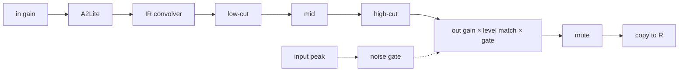

# IR, filters and noise gate (M5)

The cab IR and the EQ that follow the model, and the preset's noise gate. Code: `daisy/src/dsp/convolver.h`, `daisy/src/dsp/filters.h`, `daisy/src/dsp/noise_gate.h`, `daisy/src/ir.h`; converter `editor/src/ir/`, `tools/ir_convert.ts`; the editor's EQ response `editor/src/eqModel.ts`, its gate block `editor/src/preset/gate.ts` and gate sliders `editor/src/gateControls.ts`. Tests: `tests/convolver_test.cpp`, `tests/filters_test.cpp`, `tests/noise_gate_test.cpp`, `tests/ir_test.cpp`, `editor/src/ir/convert.test.ts`, `editor/src/eqModel.test.ts`.

## Signal chain

`AudioCallback` (`daisy/src/ducky.cpp`), in place on the left output buffer:



The IR stage runs only when the current preset has an IR (`docs/FIRMWARE.md` "Preset store"). Every EQ section runs every block, whatever the knobs and switches, so the load does not depend on the controls.

## IR convolver

`dkdsp::IrConvolver`: uniformly partitioned overlap-save convolution with CMSIS-DSP's real FFT.

| | |
|---|---|
| IR length | `kIrTaps` 2048 taps at 48 kHz (42.7 ms) |
| Partition | `kIrPartition` = `kBlockSize` = 24 taps; `kIrParts` = 86 partitions (the last one 8 taps, zero-padded) |
| FFT | `kIrFft` = 64-point real (`arm_rfft_fast_f32`, a 32-point complex FFT inside) |
| Latency | none: a block's output includes its own input's contribution |
| Cost per block | constant: 1 forward FFT, 86 × 32 complex multiply-adds, 1 inverse FFT |

- **Per block:** the frame is the newest 64 input samples (40 older, 24 new). Its spectrum is stored as the newest entry of the input-spectrum ring. The output spectrum is Σₚ X(block − p)·Hₚ over the 86 partitions. The inverse FFT's last 24 samples are the block's output: overlap-save keeps outputs 23…63 of the circular convolution (41 valid samples, 24 needed).
- **Spectra:** CMSIS packs a real spectrum as `[DC, Nyquist, re1, im1, …, re31, im31]`. The multiply-accumulate treats every pair as one complex bin and then recomputes pair 0 as the two real products. CMSIS's inverse is a true inverse (unity scale), which the impulse test checks.
- **Mirrored ring:** `x_` holds 2 × 86 spectra and each new spectrum is written twice, at `slot` and `slot + 86`. Partition p reads `x_[slot + 86 − p]`, so its pointer moves down one spectrum per partition and never wraps.
- **Kernel:** 8 tiles of 4 complex bins. A tile keeps 8 accumulators in registers across all 86 partitions; each partition is one island of 16 loads (8 of X, 8 of H, each through `FpHere`) and then 16 multiply-adds, ordered so that an accumulator's two updates are 8 instructions apart (`docs/M7_PERFORMANCE.md` rules 2 and 6). The image reads `L16 M16` per partition.
- **Memory:** `h_` (partition spectra) 22,016 bytes, `x_` (input spectra) 44,032 bytes; 68 KB in all with the FFT buffers. No default member initialisers, so an instance may live in a `NOLOAD` section.
- **Placement:** AXI SRAM (`.bss`). The 66 KB of spectra stream through the 16 KB D-cache every block, and the bench measured the convolver at 189 permille from AXI SRAM against 248 from D2 SRAM (`DK_D2`; 109 against 138 with 48-sample blocks), so D2 stays unused. The FFT itself (CMSIS-DSP C, built with Ducky's flags) runs from AXI SRAM, not ITCM.
- **Build:** libDaisy's `libdaisy.a` does not contain CMSIS-DSP. `daisy/cmsis_fft.mk` lists the sources and table defines for the 64-point real FFT; `daisy/Makefile` compiles them for the pedal (and recompiles them when `cmsis_fft.mk` changes), and the top-level `Makefile` compiles them for the host tests and `render` with CMSIS's own host switch `__GNUC_PYTHON__`. A missing table compiles fine but makes `Init` return false.

## IR binary (format 1)

`bun tools/ir_convert.ts IN.wav...` writes `IN.bin` next to each input; `dkir::Parse` validates and decodes it. All fields little-endian; unused taps and the pad are 0.

| Offset | Type | Field |
|---|---|---|
| 0 | `u8[4]` | `"DKIR"` |
| 4 | `u16` | version 1 |
| 6 | `u16` | flags 0 (reserved) |
| 8 | `u32` | size 8292 |
| 12 | `u32` | tap count, `min(resampled length, 2048)` |
| 16 | `u32` | source rate (Hz) |
| 20 | `u32` | source frames |
| 24 | `u16` | source channels |
| 26 | `u16` | pad 0 |
| 28 | `f32` | normalisation gain (linear), already applied to the taps |
| 32 | `u8[64]` | name, NUL-padded printable ASCII (at most 63 characters) |
| 96 | `f32[2048]` | taps at 48 kHz |
| 8288 | `u32` | CRC-32 (zlib) of bytes `[0, 8288)` |

`dkir::Parse` checks, in order: size (the length and the size field are both 8292) → `size`; magic → `magic`; version → `version`; CRC → `crc`; `1 ≤ tap count ≤ 2048` and every tap past the count is zero → `taps`; every tap and the gain finite → `samples`.

### Converter

`editor/src/ir/convert.ts` `convertIr(bytes, fallbackName)`, pure TypeScript shared with the editor:

1. **Read** (`ir/wav.ts`, the semantics of `tools/wav.h`): RIFF/WAVE chunks walked (unknown ones skipped, odd sizes padded, a truncated last chunk tolerated). PCM 16/24/32-bit scaled by 1/2^(bits−1), IEEE float 32-bit, and `WAVE_FORMAT_EXTENSIBLE` with PCM or float subformat. Channel 0 only; `ir_convert` warns when there are more.
2. **Resample** to 48 kHz (`ir/resample.ts`) unless the source already is: direct windowed-sinc evaluation in float64. Lowpass at 0.95 × the lower Nyquist (`fc = 0.95 · min(rate, 48000) / 2`), Kaiser window β 8.6, 32 zero crossings each side. The output length is `ceil(frames · 48000 / rate)`.
3. **Truncate** to 2048 taps. A longer IR is faded out over its last 64 taps with a raised cosine that ends at exactly 0.
4. **Normalise** to 0 dB in the reference band, after resampling and truncation: the IR's power gain $|H(f)|^2$ is averaged over 144 log-spaced frequencies from 80 Hz to 5 kHz (24 per octave, so equal weight per octave: band-limited pink noise), and the taps are scaled so that average is 1. The pedal plays the taps as stored; the binary's gain field records the scale.

   Why not unit energy (Σh² = 1): Σh² is the average of $|H|^2$ over the whole 0–24 kHz band, so it is level-neutral only for white noise. A cab passes about 100 Hz–5 kHz, 20 % of that band, and cuts the rest, so unit energy has to boost the passband to pay for the cut: the FDMN mix averaged +6.2 dB over 100 Hz–5 kHz (+12.2 dB at its 129 Hz peak) and made `A2.bin`'s output 10.7 dB louder. An amp model's output has 99.9 % of its energy below 5 kHz, which is where the reference band sits.

Name: the fallback name (the file name without `.wav`) trimmed, non-printable characters replaced by `?`, cut at 63.

| Reject reason | When |
|---|---|
| `not-wav` | not RIFF/WAVE, or no `fmt ` or `data` chunk |
| `format` | a sample format other than the above, 0 channels, or a rate outside 8–384 kHz |
| `empty` | no frames |
| `samples` | a non-finite sample |
| `silent` | zero (or non-finite) energy, or a reference band 60 dB or more below the IR's full-band average (an IR with nothing to normalise against would get a dangerous gain) |

The York Audio packs in `irs/` (3,480 WAVs at 44.1, 48 and 96 kHz, 500 ms each, so every one is truncated) all convert. The 44.1 kHz and 48 kHz versions of the same IR land within 0.2 % of the peak tap of each other.

Level change through the 1,160 48 kHz IRs, on `A2.bin`'s output for `input.wav` and on the raw `guitar_di.wav` stimulus:

| Input | Median | 5 %…95 % | Min…max |
|---|---|---|---|
| `A2.bin` output | +2.3 dB | +0.8…+3.4 dB | −6.6…+4.1 dB |
| Guitar DI | +2.1 dB | +1.1…+3.2 dB | −0.6…+3.8 dB |

The few dB left are the cabs' low-mid resonances, where a guitar signal has more than pink noise's share of energy.

## Filters

`daisy/src/dsp/filters.h`. Every section is a trapezoidal (TPT, Zavalishin/Simper) one-pole or state-variable filter: bilinear-exact responses, with coefficients recomputed every block from the smoothed knobs (one-pole smoothing, 20 ms, at the block rate). `g = tan(π f / 48000)`.

- **One-pole:** `G = g/(1+g)`; `v = (x − s)·G`, `lp = v + s`, `s = lp + v`, `hp = x − lp`.
- **SVF:** `k = 1/Q`, `a1 = 1/(1 + g(g + k))`, `a2 = g·a1`, `a3 = g·a2`; per sample `v3 = x − ic2`, `v1 = a1·ic1 + a2·v3`, `v2 = ic2 + a2·ic1 + a3·v3`, `ic1 = 2v1 − ic1`, `ic2 = 2v2 − ic2`. LP `v2`, HP `x − k·v1 − v2`, bell `x + m1·v1`.

### Low-cut and high-cut

| Control | Map |
|---|---|
| Knob 5 (low-cut frequency) | 20…500 Hz, log (`20 · 25^k`) |
| Knob 4 (high-cut frequency) | 1.5…20 kHz, log |
| Knobs 6, 3 (resonance) | Q 0.5…2, log; 1.0 at noon |
| SW1 (low-cut), SW2 (high-cut) | up 6 dB/oct, middle 12 dB/oct, down 24 dB/oct |

- **Slopes:** 6 dB a one-pole (no resonance); 12 dB an SVF at the knob's Q; 24 dB a Butterworth SVF (Q 0.7071) into an SVF at the knob's Q. At Q 0.7071 on the knob the 24 dB cascade is two Butterworth sections (a Linkwitz–Riley knee, −6 dB at the cutoff); a higher Q peaks it.
- **All slopes run every block,** whatever the switch, with their states warm. A switch crossfades linearly from the current slope weights to the new slope over 5 ms (240 samples); a change mid-fade starts from where the weights are. Once a fade completes the weights are exactly one-hot, and the output is bit-identical to a filter that ran in the new slope all along.
- **Off end:** with the smoothed frequency knob within 0.02 of the end that turns the filter off (low-cut fully CCW, high-cut fully CW), the filter crossfades to dry over 5 ms, and comes back beyond 0.04 (hysteresis). At mix 0 the output is the input bit for bit.
- **Statement order:** the per-sample loop interleaves the one-pole, the 12 dB SVF and the 24 dB Butterworth stage so their latencies overlap (`docs/M7_PERFORMANCE.md` "Recursive filters"); the 24 dB second stage follows.

### Mid (SW3)

A bell at 515 Hz, Q 1.0, constant-Q form: `A = 10^(dB/40)`, `k = 1/(Q·A)`, `m1 = k(A² − 1)`. SW3 **up is +5 dB (boost), middle bypass, down −7 dB (scoop)**. The gain is smoothed in dB (20 ms), so a flip glides; at 0 dB (`|dB| < 1e-3`) `m1` is exactly 0 and the output is the input bit for bit.

### Tests

`tests/filters_test.cpp`: the maps and the hysteresis; every slope at Q 0.707 and 2 for a 100 Hz low-cut and a 5 kHz high-cut at 4 frequencies each, and the mid bell, against the bilinear-exact prototypes (±0.05 dB above −40 dB); neutral settings bit-exact; 4 s of noise with both cutoffs and resonances swept and SW3 flipping every 100 ms stays finite and below 8; slope switches and the bypass engage add no step larger than 1.25× the steady signal's (a hard switch measures 32×).

`editor/src/eqModel.ts` is the same responses in the editor (the EQ tab's graph): each section as its bilinear-exact prototype, from STATUS's knobs and toggles through the firmware's maps (`editor/src/controls.ts`). `editor/src/eqModel.test.ts` checks the maps, the gains at the cutoffs, the slopes and the mid bell. Against `dkdsp::Eq` and `OutputGain` on the host (sines at 12 frequencies, 5 control settings) it agreed within 0.0001 dB above −60 dB.

## Noise gate

A per-preset, side-chained downward expander (`dkdsp::NoiseGate`). The detector reads the raw input at the jack (each block's `max|in|`, before Knob 1, the model and the IR), so the threshold is in dBFS at the input, independent of the trim and the model's calibration. Its gain multiplies the output gain's target (`gOutGain`), which ramps linearly across the block: no per-sample work, no latency, no lookahead. A pick that crosses the open threshold anywhere in a block opens the gate over that same block.

`Process` runs once per 24-sample block (0.5 ms), dry and parked included:

1. **Detector:** the exact maximum of the block peaks over the hold time (a ring of up to 200 block peaks, scanned every block). The level drops only after the input has stayed low for the whole hold; a hold of at least one period of the lowest note gives a ripple-free envelope.
2. **Hysteresis (fixed 6 dB):** the threshold is the close level; the gate opens at threshold + 6 dB.
3. **Ratio:** once closed, the target gain is `(env / threshold)^(ratio − 1)`, kept as a running minimum until the gate opens again, so a decaying tail only ever falls (no sputter). Gains below −100 dB are 0. Ratio 1.5 fades gently; 10 is a hard gate.
4. **Ballistics:** attack is a linear slew of the gain (the time from silent to fully open; 0.5 ms completes within the block), release exponential (the time to fall 60 dB).

Disabled, the gain is exactly 1 (bit-exact output). Enabling, disabling and every setting change glide through the same ballistics; a preset switch changes the gate while the callback is parked. Dry (no valid slot) has no gate.

| Setting | Stored (preset block, GATE) | Range | Default | Editor |
|---|---|---|---|---|
| enabled | flags bit 0 | off/on | off | On/Off button |
| threshold | u8, dB below full scale | −80…−30 dBFS | −60 dBFS | linear slider, 1 dB |
| attack | u8, 0.1 ms | 0.5–10 ms | 0.5 ms | log slider, 0.1 ms |
| hold | u8, ms | 10–100 ms | 20 ms | log slider, 1 ms |
| release | u16, ms | 10–1000 ms | 100 ms | log slider, 1 ms |
| ratio | u8, tenths | 1.5:1–10:1 | 4:1 | log slider, 0.1 |

- **Why these defaults:** measured during planning on `renders/stimuli/guitar_di.wav` and synthetic decays. The fastest attack removes 46 dB of a closed gate's first 10 ms after a pick; a 10 ms attack still removes 11 dB, so 0.5 ms is the default. Over 40 decaying notes with hum 2–10 dB under the threshold, hold 20 ms with 6 dB of hysteresis re-opened 0 times; 3–4 dB of hysteresis or a 10 ms hold sputtered.
- **Where it lives:** the 8-byte gate block of the preset slot (`docs/FIRMWARE.md` "Preset store"); GATE rewrites it, GATE TRY sets the running gate only (`docs/MIDI.md`). STATUS reports the detector's peak level and the largest cut per 100 ms, which the editor's meter shows.
- **Tests:** `tests/noise_gate_test.cpp`: disabled is exactly 1; a closed gate opens fully in the block a pick arrives; hold then release (60 dB after 100 ms, 0 at 190 ms); the hysteresis band neither opens a closed gate nor closes an open one; the expander ratio's gain (−9 dB for a level 3 dB under at 4:1, −3 dB at 2:1); the slow attack's slew; and a decaying low E over hum never re-opens and settles on the expander's floor (−48 dB for hum 16 dB under at 4:1).

## Getting an IR onto the pedal

An IR is part of a preset. The editor's import panel (`docs/EDITOR.md`) takes a `.wav` beside the `.nam` and uploads both to a slot. `tools/pedal.ts` (one slot over the link, while the pedal plays) and `tools/preset_bank.ts` (all 8 slots as a bank image over DFU) convert a `.wav` themselves, and take an IR binary as well:

```sh
bun tools/pedal.ts upload 1 models/fender_super_eob_with_cab.nam \
  --ir "irs/<pack>/48k (…)/Mixes/BLND/YA FDMN 412 BLND Mix 01.wav"
# or the whole bank:
bun tools/preset_bank.ts -o build/bank.bin --slot 1 models/fender_super_eob_with_cab.nam \
  --ir "irs/<pack>/48k (…)/Mixes/BLND/YA FDMN 412 BLND Mix 01.wav"
tools/flash_when_ready.sh build/bank.bin 0x90400000
```

The slot's CRC covers the IR, and the IR binary is also checked with `dkir::Parse`. A slot whose IR does not parse logs `ir` in the `slots` line and is skipped. A failed FFT init stops audio: the pedal serves USB (DFU included) and logs `ir fft` every second. Until M6 the IR was compiled in with `daisy/Makefile` `IR=`; the M5 measurements below used that build.

## Measured (Seed 1.2)

Bench (`APP=bench`, `docs/FIRMWARE.md` "Bench"), cycles per block of noise, maximum in permille of the block period (240,000 cycles at 24 samples, 480,000 at 48):

| Stage | 24 samples: avg cycles | 24 samples: max permille | 48 samples (M5): avg cycles | 48 samples (M5): max permille |
|---|---|---|---|---|
| A2-Lite | 87,334 | 366.9 | 168,561 | 352.4 |
| IR convolver, AXI SRAM (the pedal's) | 44,230 | 189.4 | 51,735 | 109.8 |
| IR convolver, D2 SRAM | 57,844 | 248.4 | 64,440 | 138.2 |
| EQ (both cuts, mid; slope fades every 10 blocks) | 8,652 | 36.2 | 15,135 | 31.8 |
| Noise gate (enabled, 100 ms hold: the longest scan) | 832 | 3.5 | — | — |
| Whole chain (gate, limit 850; 550 at M5): before the noise gate | 141,648 | 594.7 | 237,192 | 496.4 |
| Whole chain with the noise gate | 142,057 | 597.6 | — | — |

- **24-sample blocks:** the convolver's per-block work is the same as at 48 (86 × 32 against 43 × 64 complex multiply-adds, the same 66 KB of spectra through the D-cache) and runs twice as often, so its share of the block period nearly doubles. The model's per-sample cost barely moves. The chain missed the M5 gate (550) and is within the 850 ceiling that replaced it. Live without an IR the pedal measured load avg 415, max 419 permille, 0 underruns (394 at 48 samples); live with an IR is not yet measured.
- **IR check:** the convolver against a direct convolution in double on the device, 4,800 samples of `input.wav`: max error 146e-9 at 24 samples, 182e-9 at 48 (limit 1e-5).
- **Live, 48 samples** (`A2.bin`, `IR=irs/fdmn_blnd_mix01.bin`, 5 minutes): load avg 499, max 501 permille, 0 underruns (limit 600). Without `IR=`: avg 392, max 393. The load does not depend on the controls, since every section always runs.
- **Level:** with the reference-band normalisation the FDMN mix raises `A2.bin`'s render by 2.8 dB RMS (3.9 dB peak); on the pedal the `out` peak stayed at −8…−16 dBFS, against −9…−15 without an IR. Under the earlier unit-energy normalisation it was +10.7 dB and the output reached 0 dBFS.
- **Knob ends:** on the pedal, Knob 5 fully counter-clockwise and Knob 4 fully clockwise bypass their filters (the 0.02/0.04 thresholds hold).
