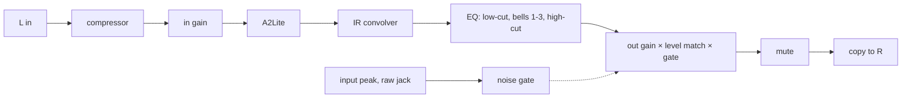

# IR, cut filters and noise gate

The cab IR and the EQ that follow the model, and the preset's noise gate. Code: `daisy/src/dsp/convolver.h`, `daisy/src/dsp/filters.h` (the cut filters and the bell), `daisy/src/dsp/eq.h` (the EQ stage), `daisy/src/dsp/noise_gate.h`, `daisy/src/ir.h`; converter `editor/src/ir/`, `tools/ir_convert.ts`; the editor's EQ response `editor/src/eqModel.ts`, its gate block `editor/src/preset/gate.ts` and gate sliders `editor/src/gateControls.ts`. Tests: `tests/convolver_test.cpp`, `tests/filters_test.cpp`, `tests/eq_test.cpp`, `tests/noise_gate_test.cpp`, `tests/ir_test.cpp`, `editor/src/ir/convert.test.ts`, `editor/src/eqModel.test.ts`. The EQ's specification (low-cut, three bells, high-cut) is `docs/EQ.md`; this file keeps the cut filters' design.

## Signal chain

`AudioCallback` (`daisy/src/ducky.cpp`) in MISO, `loop_mode`'s default: the compressor from the input into the left output buffer, then in place on it:



The compressor (`daisy/src/dsp/compressor.h` and `daisy/src/dsp/ota_compressor.h`, `docs/compressor-spec.md` and `docs/ota-compressor-spec.md` "DSP model") comes first, before Knob 1's trim; the gate's detector reads the raw jack, before the compressor. The IR stage runs only when the current preset has an IR (`docs/FIRMWARE.md` "Preset store"). The EQ's sixteen settings and the compressor's five are parameters (`daisy/src/params.h`, `docs/MIDI.md` "Parameters", `docs/EQ.md`): the editor, the link or any of Knobs 3–6, SW1–SW3 and EXP assigned to one sets each of them.

The loop modes (`docs/LOOP.md`) insert an effects loop on R Out and R In before the model (pre-model) or between the model and the IR (post-model), and play on L Out only.

## IR convolver

`dkdsp::IrConvolver`: two-level partitioned overlap-save convolution with CMSIS-DSP's real FFT. A short head runs every block and gives the zero latency; the rest of the IR, the tail, runs in longer frames whose work is spread over the blocks of a frame. It replaced a uniform convolver (86 partitions of 24 taps every block), which cost 2.4 times as much ("Measured (two-level convolver, Seed 1.2, 24 samples)").

| | |
|---|---|
| IR length | `kIrTaps` 2048 taps at 48 kHz (42.7 ms) |
| Head | taps 0–191: `kIrHeadParts` = 8 partitions of `kBlockSize` = 24 taps, `kIrHeadFft` = 64-point real FFT |
| Tail | taps 192–2047: `kIrTailParts` = 20 partitions of `kIrTailFrame` = 96 taps (the last one 32 taps, zero-padded), `kIrTailFft` = 256-point real FFT, one frame per `kIrTailPhases` = 4 blocks |
| Latency | none: a block's output includes its own input's contribution |
| Cost per block | head: 1 forward and 1 inverse 64-point FFT, 8 × 32 complex multiply-adds. Tail, by the block's phase in its frame (`kIrTailSplit`): the forward 256-point FFT, 10 × 128 complex multiply-adds, 10 × 128 more, the inverse 256-point FFT |

- **Head, per block:** the frame is the newest 64 input samples (40 older, 24 new). Its spectrum is the newest entry of a ring of 8. The output spectrum is Σₚ X(block − p)·H1ₚ over the 8 partitions. The inverse FFT's last 24 samples are the head's output: overlap-save keeps outputs 23…63 of the circular convolution (41 valid samples, 24 needed).
- **Tail, per frame of 4 blocks:** at phase 0 of frame f, the spectrum of the 256 input samples that end with frame f − 1 (160 older, 96 new) joins a ring of 20. Phases 1 and 2 accumulate Y = Σ_q X(f − 1 − q)·H2_q, ten partitions each. Phase 3 runs the inverse FFT, whose last 96 samples are added to the head's output during frame f + 1. The tail's output is therefore two frames (192 samples) behind its input, which is where its first tap sits: the head's length is that delay.
- **Phases:** the split puts each 256-point FFT in a block of its own and the multiply-adds in the two between, which is the most even the load gets: on the bench the four phases cost 17,349, 19,160, 19,278 and 18,166 cycles. A `Load` (a preset switch) or `Reset` restarts the frame at phase 0 with every ring cleared.
- **Spectra:** CMSIS packs a real spectrum as `[DC, Nyquist, re1, im1, …]`. The multiply-accumulate treats every pair as one complex bin, and sums pair 0's two real products apart, right after the first tile. CMSIS's inverse is a true inverse (unity scale), which the impulse test checks.
- **Kernel** (`Mac`, one for both levels): tiles of 4 complex bins. A tile keeps 8 accumulators in registers across its partitions; each partition is one island of 16 loads (8 of X, 8 of H, each through `FpHere`) and then 16 multiply-adds, ordered so that an accumulator's two updates are 8 instructions apart (`docs/M7_PERFORMANCE.md` rules 2 and 6). A tail phase after the first starts its accumulators from the sum so far.
- **Memory:** the object is 8,800 bytes: the head's partition and input spectra (2,048 bytes each) and the working buffers. The tail's spectra are the caller's pool, `kIrTailPoolFloats` = 10,240 floats (40,960 bytes: 20 partition spectra, then 20 input spectra). No default member initialisers, so an instance may live in a `NOLOAD` section.
- **Placement:** the object in DTCM (`DK_DTCM_BSS`), the pool in AXI SRAM (`.bss`), which DTCM has no room for. The pool is read once per frame, 40 KB through a 16 KB D-cache, so every line it reads is a miss. Two things remove their cost:
  - The pool is 32-byte aligned, so a tile of a spectrum is exactly one cache line (4,100 cycles less in each block that multiplies, 2,000 a block on average, against an unaligned pool).
  - Each island first prefetches (`pld`) the two lines of the next one, which then load while it computes (4,000 cycles less in each block that multiplies, 2,100 on average). A tail partition then costs 1,170 cycles, 37 a tile: what the arithmetic costs.
- **Copies:** the frames are moved with `CopyFloats` (`dsp/blocks.h`), not `memcpy`/`memmove`: newlib-nano's are byte loops, through which a block's copies cost 1,500 cycles and those of the block that builds the tail's window 6,100 (`docs/M7_PERFORMANCE.md` "Copies").
- **FFT:** CMSIS-DSP's C FFT, compiled with GCC's scheduling on (`daisy/Makefile`), unlike Ducky's own kernels: 9,330 and 10,290 cycles for the forward and inverse 256-point transforms against 13,070 and 14,350 without it, 2,080 and 2,310 against 2,990 and 3,300 for the 64-point ones. It runs from AXI SRAM: in ITCM it measured the same on the bench and 1 permille lower live, so it stays where it was.
- **Build:** libDaisy's `libdaisy.a` does not contain CMSIS-DSP. `daisy/cmsis_fft.mk` lists the sources and table defines for the 64-point and 256-point real FFTs; `daisy/Makefile` compiles them for the pedal (and recompiles them when `cmsis_fft.mk` changes), and the top-level `Makefile` compiles them for the host tests and `render` with CMSIS's own host switch `__GNUC_PYTHON__`. A missing table compiles fine but makes `Init` return false.

## IR binary (format 1)

`bun tools/ir_convert.ts IN.wav...` writes `IN.bin` next to each input; `dkir::Parse` validates and decodes it. All fields little-endian; unused taps and the pad are 0.

| Offset | Type | Field |
|---|---|---|
| 0 | `u8[4]` | `"DKIR"` |
| 4 | `u16` | version 1 |
| 6 | `u16` | flags 0 (reserved) |
| 8 | `u32` | size 8292 |
| 12 | `u32` | tap count, `min(resampled length, 2048)` |
| 16 | `u32` | source rate (Hz) |
| 20 | `u32` | source frames |
| 24 | `u16` | source channels |
| 26 | `u16` | pad 0 |
| 28 | `f32` | normalisation gain (linear), already applied to the taps |
| 32 | `u8[64]` | name, NUL-padded printable ASCII (at most 63 characters) |
| 96 | `f32[2048]` | taps at 48 kHz |
| 8288 | `u32` | CRC-32 (zlib) of bytes `[0, 8288)` |

`dkir::Parse` checks, in order: size (the length and the size field are both 8292) → `size`; magic → `magic`; version → `version`; CRC → `crc`; `1 ≤ tap count ≤ 2048` and every tap past the count is zero → `taps`; every tap and the gain finite → `samples`.

### Converter

`editor/src/ir/convert.ts` `convertIr(bytes, fallbackName)`, pure TypeScript shared with the editor:

1. **Read** (`ir/wav.ts`, the semantics of `tools/wav.h`): RIFF/WAVE chunks walked (unknown ones skipped, odd sizes padded, a truncated last chunk tolerated). PCM 16/24/32-bit scaled by 1/2^(bits−1), IEEE float 32-bit, and `WAVE_FORMAT_EXTENSIBLE` with PCM or float subformat. Channel 0 only; `ir_convert` warns when there are more.
2. **Resample** to 48 kHz (`ir/resample.ts`) unless the source already is: direct windowed-sinc evaluation in float64. Lowpass at 0.95 × the lower Nyquist (`fc = 0.95 · min(rate, 48000) / 2`), Kaiser window β 8.6, 32 zero crossings each side. The output length is `ceil(frames · 48000 / rate)`.
3. **Truncate** to 2048 taps. A longer IR is faded out over its last 64 taps with a raised cosine that ends at exactly 0.
4. **Normalise** to 0 dB in the reference band, after resampling and truncation: the IR's power gain $|H(f)|^2$ is averaged over 144 log-spaced frequencies from 80 Hz to 5 kHz (24 per octave, so equal weight per octave: band-limited pink noise), and the taps are scaled so that average is 1. The pedal plays the taps as stored; the binary's gain field records the scale.

   Why not unit energy (Σh² = 1): Σh² is the average of $|H|^2$ over the whole 0–24 kHz band, so it is level-neutral only for white noise. A cab passes about 100 Hz–5 kHz, 20 % of that band, and cuts the rest, so unit energy has to boost the passband to pay for the cut: the FDMN mix averaged +6.2 dB over 100 Hz–5 kHz (+12.2 dB at its 129 Hz peak) and made `A2.bin`'s output 10.7 dB louder. An amp model's output has 99.9 % of its energy below 5 kHz, which is where the reference band sits.

Name: the fallback name (the file name without `.wav`) trimmed, non-printable characters replaced by `?`, cut at 63.

| Reject reason | When |
|---|---|
| `not-wav` | not RIFF/WAVE, or no `fmt ` or `data` chunk |
| `format` | a sample format other than the above, 0 channels, or a rate outside 8–384 kHz |
| `empty` | no frames |
| `samples` | a non-finite sample |
| `silent` | zero (or non-finite) energy, or a reference band 60 dB or more below the IR's full-band average (an IR with nothing to normalise against would get a dangerous gain) |

The York Audio packs in `irs/` (3,480 WAVs at 44.1, 48 and 96 kHz, 500 ms each, so every one is truncated) all convert. The 44.1 kHz and 48 kHz versions of the same IR land within 0.2 % of the peak tap of each other.

Level change through the 1,160 48 kHz IRs, on `A2.bin`'s output for `input.wav` and on the raw `guitar_di.wav` stimulus:

| Input | Median | 5 %…95 % | Min…max |
|---|---|---|---|
| `A2.bin` output | +2.3 dB | +0.8…+3.4 dB | −6.6…+4.1 dB |
| Guitar DI | +2.1 dB | +1.1…+3.2 dB | −0.6…+3.8 dB |

The few dB left are the cabs' low-mid resonances, where a guitar signal has more than pink noise's share of energy.

## Filters

`daisy/src/dsp/filters.h`: the EQ's cut filters (`CutFilter`); its bells and the stage are in `docs/EQ.md`. Every section is a trapezoidal (TPT, Zavalishin/Simper) one-pole or state-variable filter: bilinear-exact responses, with coefficients recomputed every control tick (24 samples, counted in samples so the output does not depend on the caller's block split) from the smoothed parameters (one-pole smoothing, 20 ms, at the tick rate). `g = tan(π f / 48000)`.

- **One-pole:** `G = g/(1+g)`; `v = (x − s)·G`, `lp = v + s`, `s = lp + v`, `hp = x − lp`.
- **SVF:** `k = 1/Q`, `a1 = 1/(1 + g(g + k))`, `a2 = g·a1`, `a3 = g·a2`; per sample `v3 = x − ic2`, `v1 = a1·ic1 + a2·v3`, `v2 = ic2 + a2·ic1 + a3·v3`, `ic1 = 2v1 − ic1`, `ic2 = 2v2 − ic2`. LP `v2`, HP `x − k·v1 − v2`, bell `x + m1·v1`.

### Low-cut and high-cut

| Parameter | Map |
|---|---|
| `low_cut_freq` | 20…500 Hz, log (`20 · 25^k`), k the parameter's value 0..1 |
| `high_cut_freq` | 1.5…20 kHz, log |
| `low_cut_res`, `high_cut_res` | Q 0.5…2, log; 1.0 at the middle |
| `low_cut_slope`, `high_cut_slope` | index 2 6 dB/oct, 1 12 dB/oct, 0 24 dB/oct (on a switch: up, middle, down) |

- **Slopes:** 6 dB a one-pole (no resonance); 12 dB an SVF at the resonance's Q; 24 dB a Butterworth SVF (Q 0.7071) into an SVF at the resonance's Q. At Q 0.7071 the 24 dB cascade is two Butterworth sections (a Linkwitz–Riley knee, −6 dB at the cutoff); a higher Q peaks it.
- **All slopes run every tick,** whatever the slope, with their states warm. A slope change crossfades linearly from the current slope weights to the new slope over 5 ms (240 samples, 10 ticks); a change mid-fade starts from where the weights are. Once a fade completes the weights are exactly one-hot, and the output is bit-identical to a filter that ran in the new slope all along.
- **Off end:** with the smoothed frequency within 0.02 of the end that turns the filter off (the low-cut's bottom, the high-cut's top), the filter crossfades to dry over 5 ms, and comes back beyond 0.04 (hysteresis). At mix 0 the output is the input bit for bit.
- **Statement order:** the per-sample loop interleaves the one-pole, the 12 dB SVF and the 24 dB Butterworth stage so their latencies overlap (`docs/M7_PERFORMANCE.md` "Recursive filters"); the 24 dB second stage follows.
- **Control and run:** `Control(freq, res, slope)` at each tick's start steps the smoothers and sets the tick's coefficients, slope-weight ramps and mix ramp; `Run(x, m, at)` filters m samples starting `at` samples into the tick, each ramp evaluated as `w0 + dw·t` with t counted from the tick's start.

### Tests

`tests/filters_test.cpp`: the maps and the hysteresis; every slope at Q 0.707 and 2 for a 100 Hz low-cut and a 5 kHz high-cut at 4 frequencies each against the bilinear-exact prototypes (±0.05 dB above −40 dB); slope switches and the bypass engage add no step larger than 1.25× the steady signal's (a hard switch measures 32×). The whole EQ (bells, identity, no-click jumps, block-size independence): `tests/eq_test.cpp`, `docs/EQ.md` section 4.

`editor/src/eqModel.ts` is the same responses in the editor (the EQ tab's graph): each section as its bilinear-exact prototype, from the parameters' codes. `editor/src/eqModel.test.ts` checks the gains at the cutoffs, the bells and setting A (`docs/EQ.md` section 3).

## Noise gate

A per-preset, side-chained downward expander (`dkdsp::NoiseGate`). The detector reads the raw input at the jack (each block's `max|in|`, before the compressor, Knob 1, the model and the IR), so the threshold is in dBFS at the input, independent of the compressor, the trim and the model's calibration. In MISO and pre-model its gain multiplies the output gain's target (`gOutGain`); in post-model it multiplies the send's (`gSendGain`), so the loop pedals' tails come back ungated (`docs/LOOP.md`). Either ramps linearly across the block: no per-sample work, no latency, no lookahead. A pick that crosses the open threshold anywhere in a block opens the gate over that same block.

`Process` runs once per 24-sample block (0.5 ms), dry and parked included:

1. **Detector:** the exact maximum of the block peaks over the hold time (up to 200 blocks). It is kept as a deque of the peaks no later peak has reached, largest first, so a block costs a few steps and not a scan of the window. The level drops only after the input has stayed low for the whole hold; a hold of at least one period of the lowest note gives a ripple-free envelope.
2. **Hysteresis (fixed 6 dB):** the threshold is the close level; the gate opens at threshold + 6 dB.
3. **Ratio:** once closed, the target gain is `(env / threshold)^(ratio − 1)`, kept as a running minimum until the gate opens again, so a decaying tail only ever falls (no sputter). Gains below −100 dB are 0. Ratio 1.5 fades gently; 10 is a hard gate.
4. **Ballistics:** attack is a linear slew of the gain (the time from silent to fully open; 0.5 ms completes within the block), release exponential (the time to fall 60 dB).

Disabled, the gain is exactly 1 (bit-exact output). Enabling, disabling and every setting change glide through the same ballistics; a preset switch changes the gate while the callback is parked. Dry (no valid slot) has no gate.

| Setting | Stored (preset block, GATE) | Range | Default | Editor |
|---|---|---|---|---|
| enabled | flags bit 0 | off/on | off | On/Off button |
| threshold | u8, dB below full scale | −80…−30 dBFS | −60 dBFS | linear slider, 1 dB |
| attack | u8, 0.1 ms | 0.5–10 ms | 0.5 ms | log slider, 0.1 ms |
| hold | u8, ms | 10–100 ms | 20 ms | log slider, 1 ms |
| release | u16, ms | 10–1000 ms | 100 ms | log slider, 1 ms |
| ratio | u8, tenths | 1.5:1–10:1 | 4:1 | log slider, 0.1 |

- **Why these defaults:** measured during planning on `renders/stimuli/guitar_di.wav` and synthetic decays. The fastest attack removes 46 dB of a closed gate's first 10 ms after a pick; a 10 ms attack still removes 11 dB, so 0.5 ms is the default. Over 40 decaying notes with hum 2–10 dB under the threshold, hold 20 ms with 6 dB of hysteresis re-opened 0 times; 3–4 dB of hysteresis or a 10 ms hold sputtered.
- **Where it lives:** the 8-byte gate block of the preset slot (`docs/FIRMWARE.md` "Preset store"); GATE rewrites it, GATE TRY sets the running gate only (`docs/MIDI.md`). STATUS reports the detector's peak level and the largest cut per 100 ms, which the editor's meter shows.
- **Tests:** `tests/noise_gate_test.cpp`: disabled is exactly 1; a closed gate opens fully in the block a pick arrives; hold then release (60 dB after 100 ms, 0 at 190 ms); the hysteresis band neither opens a closed gate nor closes an open one; the expander ratio's gain (−9 dB for a level 3 dB under at 4:1, −3 dB at 2:1); the slow attack's slew; and a decaying low E over hum never re-opens and settles on the expander's floor (−48 dB for hum 16 dB under at 4:1).

## Getting an IR onto the pedal

An IR is part of a preset. The editor's slot editor (`docs/EDITOR.md` "Presets tab") takes a `.wav` beside the `.nam` and uploads both to a slot. `tools/pedal.ts` (one slot over the link, while the pedal plays) and `tools/preset_bank.ts` (all 8 slots as a bank image over DFU) convert a `.wav` themselves, and take an IR binary as well:

```sh
bun tools/pedal.ts upload 1 models/fender_super_eob_with_cab.nam \
  --ir "irs/<pack>/48k (…)/Mixes/BLND/YA FDMN 412 BLND Mix 01.wav"
# or the whole bank:
bun tools/preset_bank.ts -o build/bank.bin --slot 1 models/fender_super_eob_with_cab.nam \
  --ir "irs/<pack>/48k (…)/Mixes/BLND/YA FDMN 412 BLND Mix 01.wav"
tools/flash_when_ready.sh build/bank.bin 0x90400000
```

The slot's CRC covers the IR, and the IR binary is also checked with `dkir::Parse`. A slot whose IR does not parse logs `ir` in the `slots` line and is skipped. A failed FFT init stops audio: the pedal serves USB (DFU included) and logs `ir fft` every second.

## Measured (two-level convolver, Seed 1.2, 24 samples)

Bench stage `ir axi` (the pedal's placement), each row adding to the one above:

| Convolver | Avg cycles | Max permille |
|---|---|---|
| Uniform, 86 × 24 taps, 64-point FFT (before) | 43,718 | 186.0 |
| Two-level, tail phases of 4, 6, 6 and 4 partitions | 29,215 | 155.4 |
| Tail phases of 0, 10, 10 and 0 partitions (each 256-point FFT in its own block) | 29,254 | 131.3 |
| Tail pool 32-byte aligned | 27,205 | 120.9 |
| Prefetch of the next island's two cache lines | 25,100 | 120.8 |
| Float copies in place of newlib-nano's `memcpy` and `memmove` | 22,209 | 100.5 |
| CMSIS-DSP's FFT compiled with scheduling | 18,460 | 81.7 |

- **All in D2 SRAM** (`ir d2`, the object and the pool): `docs/MEASUREMENTS.md` "Bench" (245.7 permille max with the uniform convolver).
- **IR check:** 178e-9 against the direct convolution in double (146e-9 before; limit 1e-5). On the host the impulse response matches the taps to 1e-6 and noise matches the direct convolution to 1e-5 (`tests/convolver_test.cpp`).
- **Live**, weight build (`APP=weight`), Fender model with the 2,048-tap FDMN mix, compressor in blend, a morph target: load avg 508, max 517 permille, 0 underruns, against 652 and 658 before. The IR costs 78 permille live (508 against 430 on a preset without one), 187 before.
- **Where the 18,460 cycles go:** the head 7,500 a block (its two FFTs 4,400, its multiply-adds and copies the rest); the tail 11,000 on average (the two 256-point FFTs 20,600 a frame, the 20 partitions 23,400).
- **The noise gate's detector** as a deque: 235 cycles a block (max 308) against 832 for the scan of a 100 ms hold.
- **Level:** with the reference-band normalisation the FDMN mix raises `A2.bin`'s render by 2.8 dB RMS (3.9 dB peak); on the pedal the `out` peak stayed at −8…−16 dBFS, against −9…−15 without an IR. Under the earlier unit-energy normalisation it was +10.7 dB and the output reached 0 dBFS.
- **Off ends:** on the pedal, the low-cut's knob fully counter-clockwise and the high-cut's fully clockwise bypass their filters (the 0.02/0.04 thresholds hold).
