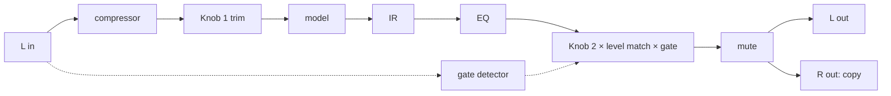
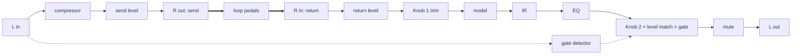
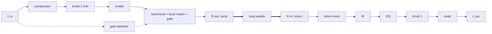

# FX loop (M12)

Ducky's global IO mode, `loop_mode` (parameter 21, `docs/MIDI.md` "Parameters"), saved in the settings record with the other parameters (`docs/FIRMWARE.md` "Settings record"):

- **MISO** (the default): mono in, the same signal on both outputs.
- **pre-model:** an effects loop before the model, for drives, boosts and wahs.
- **post-model:** an effects loop after the model and before the IR, for delays and reverbs.

In both loop modes R Out (the output jack's ring) is the send, R In (the input jack's ring) is the return, and the pedal plays on L Out only. The send and return levels are parameters too (`loop_send`, `loop_return`). Set all three from the editor's Loop tab (`docs/EDITOR.md` "Loop tab"), with `bun tools/pedal.ts param set loop_mode post-model`, or from a control assigned to them.

## Signal flow

MISO, as before M12:



pre-model:



post-model:



- **Series only.** The return replaces the signal; nothing mixes it with a dry path. A dry-plus-return blend would comb-filter against the round trip (below).
- **The gate** always listens to L In before the compressor. In MISO and pre-model its gain rides the output ramp, as before. That keeps it after the model, where it gates the model's amplified noise, the return's included. In post-model it rides the send, so a delay's or reverb's tails come back ungated.
- **The level match** rides with the gate. In post-model it scales the send, so a model's level reaches the loop pedals already normalised (−18 dB loudness, `docs/FIRMWARE.md` "Threads"); Knob 2 is then the volume alone.
- **FS1** mutes L Out only. The send keeps running, so a delay or reverb in the loop keeps its state.
- **The return is always an earlier block's send.** The callback writes the send and reads the return in the same block, and the round trip is longer than a block, so no extra buffering is needed.

## Cabling

Both HotHouse jacks are TRS (`../hothouse_pcb/open-source-pedals/hothouse/eagle/hothouse-io-no-branding.sch`): the input's tip is L In and its ring R In, the output's tip L Out and its ring R Out. Use an insert cable (TRS to two TS, the TS legs marked tip and ring) on each jack:

| Jack | Tip leg | Ring leg |
|---|---|---|
| Input | guitar | loop return (the last loop pedal's output) |
| Output | amp | loop send (the first loop pedal's input) |

- **Nothing in the loop: no sound.** With no plug, or a mono plug, the jack grounds R In, so the return reads silence and the output with it. The pedal cannot tell a loop from no loop, which is why the mode is a setting.
- **A return leg left floating** (the insert cable in, its ring leg unplugged) is not silent: it picks up the send through the cable. Measured, with the send at −17 dBFS, the return read −43 to −53 dBFS, and a high-gain model in pre-model turned that into −32 to −36 dBFS at the output (−18 dBFS with the loop patched). Unplug the insert cable, or switch to MISO.

## Fades and controls

- **A mode change** fades both outputs out over 5 ms (`gModeFade`, a `MuteRamp`), switches the routing at silence, and fades them back in over 5 ms. A mode that flips back before the fade lands just fades back in.
- **A preset switch** fades L Out as before. In post-model it fades the send too (`MuteRamp::ProcessPair`): while the main loop loads the next preset the send is silent, so the loop pedals' tails are cut during the switch's gap of about 11 ms. In pre-model the send is the compressor's output, which no preset touches, so it does not fade.
- **`loop_mode` on a switch:** a 3-position toggle gives down MISO, middle pre-model, up post-model (`dkparam::FromToggle`: a three-value choice's index is the position). Assign it with `bun tools/pedal.ts param assign sw1 loop_mode` or the editor's Controls tab.
- **The send and return levels** are ±12 dB, linear in dB, 0 dB at noon: the same law as Knob 1 (`dkdsp::InputGain`). Each is smoothed (one-pole, 20 ms) and ramped linearly across each block (`GainRamp`). In MISO their smoothers keep running, so a loop mode starts from the current values. In pre-model the return level sets the drive into the model, not a volume.
- **At boot** the send fades in from silence with the output.

## Measuring the loop

`APP=latency` (`daisy/src/latency.cpp`, `make -C daisy APP=latency -j`, then `tools/flash_when_ready.sh daisy/build/hothouse-latency/ducky_latency.bin`) measures the loop's round trip and the crosstalk between the channels, ported from bad_tape's latency image. It runs at the pedal's 48 kHz and 24-sample blocks. Patch the send to the return (the two ring legs joined by a TS coupler, or a true-bypass pedal in bypass), then read it with `uv run tools/usb_log.py 15`.

Each pass clicks R Out 5 times (phase R), then L Out 5 times (phase L): a one-sample click at 0.25 full scale, 256 samples into an 8,192-sample capture of both inputs. For each captured input it removes the DC and takes the noise (the largest deviation before the click). It then finds the peak, refined by a parabola, and the onset, the first sample above a tenth of the peak. A peak at or below 4× the noise is reported as no click.

```
ducky_latency hothouse seed 1.2-pcm3060 cd8b994+dirty                              (boot / HELLO)
lat R->R t 0 peak 82.72 smp 1723 us onset 80 smp amp -1600 noise 0                 (per trial and input)
lat L->R t 0 no click (peak -1 noise 0)                                            (per trial and input)
lat R->R peak min 82.72 max 82.72 smp 1723..1723 us                                (per phase and input with clicks)
lat pass 1 done seed 1.2-pcm3060
```

- `O->I`: the clicked output and the captured input, L or R.
- `amp` and `noise`: in 1/10000 full scale; `amp` is signed.
- Passes repeat every 2 s. The link's DFU command works between trials, so `flash_when_ready.sh` returns to Ducky with no button presses.

## Measured (M12, Seed 1.2 / PCM3060)

The latency image, with the output ring leg joined to the input ring leg and both tip legs unplugged:

| Path | Result |
|---|---|
| R Out → R In (the loop) | 82.72 samples, 1,723 µs, every trial; −0.16 FS for the 0.25 FS click, polarity inverted |
| R Out → L In | 0.0021–0.0036 FS (−37 to −42 dB below the click), with L In's tip leg floating |
| L Out → R In | nothing above the noise: below 0.0001 FS (−68 dB below the click) |
| L Out → L In | nothing (the tips are not joined) |
| R In noise floor | at most 0.0001 FS (−80 dBFS) peak |

- **The round trip** is 2 × 24 + 34.72 samples: two blocks of DMA buffering plus the converters' filters, the same as bad_tape measured on the same Seed. The pedal adds nothing of its own, so a loop pedal costs 1.7 ms on top of Ducky's own input-to-output latency.
- **Without the cable** (the ring legs not joined) R In still caught R Out's click, 0.0002 FS (−62 dB below it), at the same 82.7 samples: crosstalk inside the codec.
- **Through the loop at 0 dB send and return,** the playing levels the `load` line logs (`rin`, `rout`) came back within 1 dB of what went out.

On the pedal, with a guitar on the input tip, an amp on the output tip and the ring legs joined (`uv run tools/usb_log.py`, the modes and levels set with `bun tools/pedal.ts param set`):

- **Levels:** in pre-model the send followed the input (`rout` within 1 dB of `in`); `loop_send` at +12 and −12 dB moved it by +13 and −12 dB. In post-model the send carried the model's level-matched output (−13 dBFS against −18 dBFS out); `loop_send` ±12 dB moved the send and the output by +12 and −12 dB, and `loop_return` ±12 dB moved the output by +12 and −12 dB. In pre-model `loop_return` changes the drive into the model, so a high-gain model's output barely moved.
- **Unpatched:** pulling the coupler between the ring legs while playing silenced the pedal to the player's ear (the floating return leg's pickup: "Cabling").
- **Mode changes** with SW1 on `loop_mode`, while playing: no clicks.
- **Load** (live): MISO 419/422, pre-model 422/426, post-model 423/427 permille avg/max, 0 underruns (`docs/FIRMWARE.md` "Measured (M12)").
- **Playtest:** go, the player's verdict after the checks above; no issues reported.
