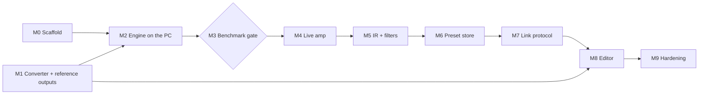

# Ducky roadmap

A living plan. Milestones are done in order; any of them may be revised, split, or dropped as the project learns.

## Decisions

| Topic | Decision |
|---|---|
| Model format | NAM A2 `.nam` (`SlimmableContainer`, 48 kHz). Only the A2-Lite submodel (`max_value` 0.5) runs. A1 models and A2-Full are rejected. Format, weight order and forward pass: `docs/NAM_FORMAT.md`. |
| Model shape | A2-Lite is fixed at compile time: 23 layers, 3 channels, bottleneck 3, kernels 6 (layers 15–16: 15), dilations `1 3 7 17 41 101 239 ×2, 1 13, 1 3 7 17 41 101 239`, LeakyReLU 0.01, no gating, FiLM, or groups. The head is a convolution with kernel 16, then `head_scale`. The editor rejects any other shape. Each stored model carries a shape descriptor, and the firmware checks it. |
| Sample rate / block size | 48 kHz and 48 samples (1 ms). No resampling. |
| Input gain (Knob 1) | Relative trim of ±12 dB around the model's input calibration at noon (M4): NeuralAmpModelerPlugin's `+4.5 dBu − input_level_dbu`, where +4.5 dBu is the level at the input jack that reaches 0 dBFS (from the datasheets, not measured). A model without `input_level_dbu` is assumed captured at +12 dBu. |
| Output (Knob 2) | Off … +12 dB, unity at noon. Each preset's output is level-matched using the A2-Lite submodel's own `metadata.loudness`. The top-level `loudness` is A2-Full's, and the two differ by about 0.1 dB. `loudness` is measured at the capture level, so after the input calibration a clean model plays a little quieter than a driven one (M4: about 1.8 dB). |
| Cut filters | Knob 5 sets the low-cut (high-pass) cutoff, 20–500 Hz. Knob 4 sets the high-cut (low-pass) cutoff, 1.5–20 kHz. Both use a log taper. Turning the low-cut fully counter-clockwise or the high-cut fully clockwise bypasses that filter. Knob 6 sets the low-cut resonance and Knob 3 the high-cut resonance (Q 0.5 to about 2, only on the 12 and 24 dB slopes). SW1 sets the low-cut slope and SW2 the high-cut slope: up 6, middle 12, down 24 dB/oct. |
| Mid (SW3) | Peaking filter at 515 Hz, Q 1: up +5 dB, middle bypass, down −7 dB. |
| IR | Optional, up to 2048 taps (about 43 ms). The converter (`editor/src/ir/`, shared by the editor and `tools/ir_convert.ts`) resamples to 48 kHz, trims with a 64-tap fade, and normalises the 80 Hz–5 kHz band to 0 dB (pink-weighted), so a cab leaves an amp model's level about where it was. The editor warns when the model's `gear_type` already includes a cab. |
| Preset switching | FS2 steps forward through filled slots only and wraps. Audio fades out, the model is swapped and reset, then audio fades back in (5 ms each way, a gap of about 11 ms, no crossfade). LED2 blinks N times for slot N. The last slot is remembered across power cycles. |
| Preset persistence | Presets survive switching to another firmware and back. They live in the upper 4 MB of the QSPI flash, outside any firmware image and outside bad_tape's saved values at `0x903FE000`. |
| Hardware | Daisy Seed with 64 MB or more of SDRAM (development unit: Seed 1.2, 64 MB). HotHouse. |
| SysEx | `F0 7D 64 <version> <cmd> … F7`. Device byte `0x64` is unused by sibling projects. Identity Reply and DFU command follow the bad_tape conventions. |
| Editor | Preset manager plus live status: log, CPU load meter, knob/switch states. It does not control the knobs remotely, because the pedal is "what you see is what you get". |
| Model and IR files | `models/*.nam`, converted `*.bin` and `irs/` are git-ignored. Only upstream MIT fixtures (`tests/fixtures/nam/`) are committed, plus `A2.bin` converted from upstream `A2.nam`, the generated IR fixture `tests/fixtures/ir/decay.{wav,bin}`, and the preset fixture `tests/fixtures/preset/A2_decay.bin` built from those two. |

## Feasibility

| | A2-Lite | A2-Full |
|---|---|---|
| Weights | 1,871 | 12,146 |
| Multiply-adds per second at 48 kHz | ≈ 90 M | ≈ 583 M |
| Estimated load at 480 MHz, 1.2–2 cycles per multiply-add | 22–37 % | 120–200 % |

- Every weight is used about once per sample, so the multiply-add count tracks the weight count. The estimate assumes a hand-written float kernel that keeps each 3×3 tap matrix in registers across a block. M3 measured 35 % (2.0 cycles per multiply-add, everything included).
- The model looks back 6,346 samples (132 ms). Its history takes 91 KB for 3 channels (each layer's ring also holds one block and a 5-frame guard), and its weights 7.5 KB. Both fit in DTCM, the processor's fast internal RAM.
- Reset is cheap: with silent input every layer settles to a constant value per channel. Compute those once at load time and fill the history with them, instead of running 132 ms of silence through the model.
- A direct-form IR costs N multiply-adds per sample. A 2048-tap IR uses uniformly partitioned FFT convolution (CMSIS-DSP `arm_rfft_fast_f32`); M5 measured it at 11 % of the block period. The `daisy/libDaisy/Drivers/CMSIS-DSP` submodule is initialised by `git submodule update --init --recursive`; `libdaisy.a` does not contain it, so `daisy/cmsis_fft.mk` lists the sources both builds compile.
- NeuralAmpModelerCore has an A2-specific fast path (`NAM/wavenet/a2_fast.cpp`): a shape check, the weight loader and a scalar 3-channel kernel. It is still Eigen-based, but it is the readable reference for the M2 engine.

## Milestones

### M0: Scaffold, passthrough, DFU (done, `06ea416`)
- Same layout as bad_tape:
  - `daisy/Makefile`: `APP_TYPE = BOOT_SRAM`, `BOARD=hothouse`, build id, and `APP=ducky` (M3 adds `APP=bench`).
  - HotHouse `board.h`.
  - `memory.h` placement macros.
  - Linker script with fast-RAM sections (DTCM, ITCM) and SDRAM sections.
  - Top-level `Makefile` for the PC builds.
- USB-MIDI link: Identity Reply, HELLO, LOG, DFU command. `tools/flash_when_ready.sh`.
- Audio: left input copied to both outputs at 48 kHz / 48 samples. FS1 mutes with a ramp, and LED1 follows. A status log line reports CPU load, underruns, and knob states.
- **Done when:** the pedal flashes over USB-MIDI DFU with no button presses, passthrough is clean, and the Identity Reply parses. Board revision and codec are confirmed and recorded.
- **Measured:** the development unit reports `seed 1.2-pcm3060` (Seed 1.2, PCM3060 codec), sysclk 480 MHz, 48 kHz, 24-bit, 48-sample blocks. Passthrough load is avg 6 / max 7 permille with 0 underruns. DTCM 16.5 KB of 128 KB (including the 16 KB stack reserve), ITCM 1.2 KB, SRAM 124 KB of 480 KB.
- **Docs:** `docs/FIRMWARE.md` covers build, flash, log, the source layout, threads, the memory map and the log lines.

### M1: Model converter and reference outputs (done, `06a26cd`)
- The `.nam` → binary converter is written in TypeScript and shared by the editor and a Bun command-line tool.
- Binary layout: magic, format version, shape descriptor, weights (float32 LE), `head_scale`, `loudness`, `input_level_dbu`, name, CRC-32.
- Reference outputs: render with NeuralAmpModelerCore's `tools/render.cpp` (`render --slim 0.25 model.nam in.wav out.wav`, which selects A2-Lite) on a fixed set of guitar DI recordings, and keep the results as test fixtures. Pin the core's commit. `render` prewarms before processing, so the references start from the settled zero-input state.
- Inputs and fixtures: `docs/NAM_FORMAT.md` has the shape check, the weight stream, the forward pass, the metadata to keep, and the upstream example models for accept and reject cases.
- Decided: the converter lives in `editor/src/nam/` and the CLI is `tools/nam_convert.ts`. A model without an A2-Lite `loudness` is accepted, flagged, and plays at unity. The DI stimulus is the first 20 s of the left channel of the sibling projects' `guitar.wav` (local, in `renders/`); upstream's MIT fixtures and the `A2.nam` reference are committed under `tests/fixtures/nam/`.
- **Done when:** both development models convert, and models with a non-Lite shape are rejected with a named reason.
- **Result:** `bun tools/nam_convert.ts` converts both development models and upstream `A2.nam` to 7652-byte format-1 binaries, and rejects upstream `slimmable_container.nam` (`no-lite-submodel`) and `wavenet_a2_feature_test.nam` (`not-container`). `tools/nam_reference.sh` renders A2-Lite references for every model on `input.wav` (96,000 samples) and the 20 s guitar stimulus (960,000 samples); reruns are bit-identical.
- **Docs:** `docs/NAM_FORMAT.md` "Ducky model binary (format 1)" and "Reference renders".

### M2: A2-Lite engine on the PC (done, `a60b2a9`)
- Portable C++ that does not include libDaisy: block processing and constant-fill reset.
- `build/host/render IN.wav OUT.wav --model X.bin`.
- GoogleTest against the reference outputs.
- **Done when:** the maximum error against the reference is about 1e-5, output is the same at any block size, and there are no NaNs or denormals.
- **Result:** `dkdsp::A2Lite` (`daisy/src/dsp/a2lite.h`) matches all six reference renders bit for bit (max error 0), including both development models on the 20 s guitar stimulus. Output is bit-identical at block sizes 1, 7, 48, 100 and an irregular schedule. Ten seconds of silence then ±1e-40 input leave no NaN or subnormal in the output or the histories; subnormal inputs are flushed to zero. History 76,248 bytes, weights 7,480 bytes. On the PC (`-O2`, scalar) `render` runs about 23× real time.
- **Docs:** `docs/NAM_FORMAT.md` "Engine"; `docs/FIRMWARE.md` "Source layout".

### M3: Benchmark gate (done, `0dd970e`)
- `APP=bench`: the model is compiled in, and the DWT cycle counter times each layer.
- Optimise: tap matrices held in registers, ITCM code, DTCM history, flush-to-zero.
- **Done when:** model load is ≤ 45 % at a 48-sample block, and device output matches the PC within tolerance.
- **If it fails:** try fixed-point or SIMD variants, a larger block, or ask NAM upstream for a smaller shape.
- **Result (go):** `APP=bench` (`daisy/src/bench.cpp`) logs the device check, the gate and per-layer cycles. The model costs avg 350.7, max 351.9 permille of the 48-sample block against the 450 limit, and the device check passes with max error 241e-9 against the reference (host output is still bit-exact). The first engines measured 520–620 permille. What closed the gap was measuring the core instead of counting instructions: on the Cortex-M7 a load, store, move or add that follows a multiply-accumulate waits about 3 cycles, and GCC's scheduler interleaves them. The engine now runs 6-frame tiles as load islands followed by pure multiply-accumulate runs, with scheduling off, a branch-free leaky ReLU, and each layer writing straight into the next layer's ring. No fallback (fixed point, larger block, smaller shape) was needed.
- **Also:** `.dtcm_bss` (`DK_DTCM_BSS`), a zeroed DTCM section with no load image, for the engine. `tools/usb_log.py --port` and `DK_USB_PORT` for `tools/flash_when_ready.sh` address one Seed by USB path when several are attached.
- **Docs:** `docs/M7_PERFORMANCE.md` (the cost model, the rules for DSP code, how to measure); `docs/FIRMWARE.md` "Bench"; `docs/NAM_FORMAT.md` "Engine".

### M4: Live amp (done, `047ddc6`)
- The engine runs in the audio callback with one compiled-in model.
- Knobs 1 and 2 are smoothed, and output is level-matched with `loudness`.
- **Done when:** playable, with no zipper noise and no denormal spikes after long silence.
- **Decided:** the compiled-in model is `daisy/Makefile` `MODEL=FILE.bin`, default the committed `tests/fixtures/nam/A2.bin` (a clean clone builds). Knob 1 is −12…+12 dB, dB-linear, around the model's input calibration at noon. Knob 2 is `(2k)^3` up to noon (off at fully CCW, unity at noon), then dB-linear to +12 dB. Both are smoothed (one-pole, 20 ms at the block rate) and ramped linearly across each block (`dkdsp::GainRamp`, `daisy/src/dsp/gain.h`). The level match brings `loudness` to −18 dB, NeuralAmpModelerPlugin's target. The engine runs while muted. If the model does not parse, audio never starts and the pedal only serves USB/DFU.
- **Input calibration (added after the first playing test):** with 0 dB at noon, the models sounded distorted until Knob 1 was near 9 o'clock. Ducky's input reaches 0 dBFS at about +4.5 dBu (from the datasheets, not measured), while the development models were captured at +15 dBu, so noon drove them about 10 dB harder than the captured amps. The input gain at noon is now `+4.5 dBu − input_level_dbu`, as in NeuralAmpModelerPlugin's input calibration; a model without `input_level_dbu` is assumed captured at +12 dBu (`docs/FIRMWARE.md` "Threads"). Confirmed by ear on `A2.bin`: noon is no longer distorted.
- **Measured (`A2.bin`, Seed 1.2):** load avg 361, max 363 permille, 0 underruns, and the same after 5 minutes with nothing plugged in (input −84 dBFS); DTCM 115,704 bytes; `model loudness -24.0 dB level +6.0 dB input +14.8 dBu cal -10.3 dB "A2"`. Level matches: Fender −2.1 dB, SSS +3.7 dB; input calibration −10.5 dB for both. With no input the `out` peak is not −120 dBFS: the model has a −60 dBFS DC offset at zero input, before the output gain.
- **Result:** on the pedal with the Fender build, the knob sweeps have no zipper noise or clicks, Knob 2 fully counter-clockwise is silent, and FS1 still mutes with its ramp. The SSS build plays quieter at noon than the Fender. NAM's loudness measurement (its 1.75 s burst signal, K-weighted), run on the PC through the engine, reproduces both models' stored `loudness` exactly at the capture level. At the calibrated level the Fender drops 8.1 dB and the SSS 9.9 dB, because the clean amp does not compress, so the SSS ends up 1.8 dB quieter. NeuralAmpModelerPlugin behaves the same with input calibration and normalisation both on, and both models sit 8–10 dB below the −18 dB target at noon. Accepted for M4. The fix, if wanted later, is to measure `loudness` at the calibrated level on the pedal when a model loads.
- **Docs:** `docs/FIRMWARE.md` "Threads" (the chain, input calibration, level match), "Log lines", "Measured (M4)" and the `MODEL=` build option; `docs/NAM_FORMAT.md` "Metadata Ducky uses".

### M5: IR and filters (done, `a7e8813`)
- Partitioned FFT convolver for IRs up to 2048 taps.
- Cut filters:
  - 6 dB/oct is first-order, so its resonance knob does nothing.
  - 12 dB/oct is one biquad with Q from the resonance knob.
  - 24 dB/oct is two cascaded biquads: a Butterworth stage, then a stage whose Q comes from the resonance knob.
  - The extreme knob position bypasses the filter.
- Mid peaking filter for SW3.
- Spec in `docs/FILTERS.md`; tests on the PC (frequency response, stability under knob sweeps, no clicks when switching slopes).
- Kernels follow `docs/M7_PERFORMANCE.md`. The IR convolver's FFT is CMSIS-DSP's. libDaisy's `libdaisy.a` turned out not to contain CMSIS-DSP, so both builds compile the FFT sources themselves (`daisy/cmsis_fft.mk`).
- Test data: example IRs in `irs/` (git-ignored, commercial York Audio 4×12 packs). Each pack has `44.1k`, `48k` and `96k` WAV folders (mono, 24-bit PCM, 500 ms: 22,050 / 24,000 / 48,000 frames, some about 50 frames longer) and a `Kemper Converted` folder of `.kipr` files, which are not supported. So the 48k WAVs exercise trimming to 2048 taps, and the 44.1k and 96k WAVs exercise resampling. The folders also hold macOS `._*` AppleDouble files and `.DS_Store`, which an importer must skip.
- **Done when:** the whole chain stays within budget on hardware, measured by `APP=bench` and the live load meter.
- **Decided:** the IR is compiled in with `daisy/Makefile` `IR=FILE.bin` (default none) until M6. `tools/ir_convert.ts` (`editor/src/ir/`) converts a WAV to the IR binary: resampled to 48 kHz (windowed sinc), truncated to 2048 taps with a 64-tap fade, normalised to 0 dB over 80 Hz–5 kHz. The convolver is uniformly partitioned overlap-save, 48-tap partitions, 128-point FFT, zero latency. All filter sections are TPT (Simper) one-poles and SVFs; all slopes run every block and a slope switch or bypass crossfades over 5 ms. SW3 is up +5 dB, middle bypass, down −7 dB at 515 Hz, Q 1. A bad IR stops audio like a bad model. Spec: `docs/FILTERS.md`.
- **Measured (Seed 1.2):** bench chain max 496.4 permille (gate 550, go); IR convolver 109.4 permille from AXI SRAM against 137.6 from D2 SRAM, so it stays in AXI SRAM; EQ 31.8; IR check on the device 182e-9. Live with `A2.bin` and a York FDMN IR: load avg 499, max 501 permille, 0 underruns over 5 minutes; 392/393 without an IR. All 3,480 example WAVs convert. Knob 5 fully CCW and Knob 4 fully CW bypass their filters on the pedal.
- **IR level (revised after the first build):** unit energy (Σh² = 1) is level-neutral only for white noise; a cab cuts everything above 5 kHz, so unit energy boosted its passband and the FDMN IR made `A2.bin` 10.7 dB louder, reaching 0 dBFS at noon. Normalising the 80 Hz–5 kHz band instead brings that to +2.8 dB, and across the 1,160 48 kHz York IRs to +0.8…+3.4 dB (5th–95th percentile) on `A2.bin`'s output.
- **Docs:** `docs/FILTERS.md`; `docs/FIRMWARE.md` "Threads", "Log lines" (`ir`), "Measured (M5)", "Bench" and the `IR=` build option.

### M6: Preset store and switching (done, `ef3d6ee`)
- Flash region in the upper 4 MB, clear of the last flash addresses (chip erratum `ES0392 2.7.5`). 8 slots, each holding a header, model, optional IR, and CRC. A small two-copy state record holds the last slot.
- Presets load into RAM. FS2 skips empty slots and wraps; audio fades out, the model is reset, and audio fades back in. LED2 blinks N times.
- The audio callback never reads QSPI, so flash writes cannot stall audio.
- Test data: the development models are written to flash by a command-line tool.
- **Done when:** switching while playing is clean, corrupt slots are skipped, and the pedal recovers if power is pulled during a write.
- **Decided:** slots are 64 KB erase blocks at `0x90400000` (slot k at `+k × 0x10000`); the state records are two 4 KB sectors at `0x90480000`/`0x90481000`; MPU region 4 makes `0x90400000–0x904FFFFF` read-only, write-through cached and execute-never, and the rest of QSPI stays no-access. The slot format (`DKPS`, version, flags, size, name, model binary, optional IR binary, CRC-32) is `daisy/src/preset.h`, shared with `editor/src/preset/bank.ts`. The pedal writes only the state record; presets reach flash as a 512 KB bank image from `tools/preset_bank.ts`, written by dfu-util at `0x90400000` (`tools/flash_when_ready.sh FILE ADDR`), which the Daisy bootloader's layout (`0x90400000/60*64Kg`) allows. Chunked upload stays in M7. `MODEL=`/`IR=` are gone. All 8 slots are parsed into SDRAM at boot (127 KB), so a switch only reloads the engine and the convolver. The fade reuses `MuteRamp` (5 ms each way). The state record is written 2 s after the last switch, so stepping through slots does not wear the sectors. With no valid slot the pedal plays dry (trim, EQ, volume, mute) at unity calibration and level.
- **Measured (Seed 1.2):** preset load 138 µs without an IR, 994 µs with one; state write 80–85 ms; 0 underruns over 16 logged switches and 7 state writes; load 500 permille with an IR, 394 without, 42 dry. On the pedal, while playing, LED2's counts matched, the switches did not click, the saved slot came back after a power cycle, a corrupt slot 2 was skipped (`slots ok crc empty ok …`, FS2 1 → 4 → 1), and power pulled during the bank download left the pedal booting dry with all slots erased, recovered by flashing the bank again. The bench is unchanged (chain 496.4 permille, go).
- **Gap:** about 11 ms by construction (5 ms out, the load, 5 ms in), shorter than the 20–30 ms planned; not measured on the output, no click by ear.
- **Docs:** `docs/FIRMWARE.md` "Preset store", "Threads" (the switch handshake), "Memory" (SDRAM, QSPI, MPU region 4), "Log lines" (`slots`, `preset`, `state`), "Measured (M6)"; `docs/FILTERS.md` "Getting an IR onto the pedal".

### M7: Link protocol
- Preset upload in chunks, with an acknowledgement and CRC per chunk. List, erase, rename, and reorder slots.
- Status stream: CPU load (average and maximum), underruns, current slot, knob and switch states, and log lines.
- `docs/MIDI.md` is generated from the protocol header. A command-line tool uploads presets and dumps status.
- **Done when:** all 8 slots can be managed from the command line while audio runs, with no underruns.

### M8: Editor
- Bun + TypeScript + Preact, built to a single HTML file (`editor/dist/editor.html`).
- Imports `.nam` files (checked with the M1 converter) and WAV IRs (resampled, trimmed, normalised).
- Manages 8 slots and shows model metadata, including `input_level_dbu` and gear type.
- Panel showing the log, CPU load meter, and knob/switch states. DFU button.
- **Done when:** a full preset round trip works from the browser, and the editor works when hosted inside a multi-firmware launcher.

### M9: Hardening and release prep
- Stress tests: fast FS2 presses, uploading while playing, power loss during writes, rapid knob sweeps.
- Docs: a top-level `README.md`, and bring `docs/FIRMWARE.md` (memory map, measured performance, log lines) up to date.
- Licence review before the history is squashed, including the upstream MIT fixtures and their `LICENSE` in `tests/fixtures/nam/`.

## Risks

- **CPU:** the generic NAM core is built on Eigen, which has no float SIMD on Cortex-M7, so it is assumed too slow. The custom kernel passed the M3 gate at 35 % for the model alone. With the IR and the EQ (M5) the bench chain is at 49.6 % (gate 55 %) and the pedal at 50.1 % live; M6's preset switching adds no steady load (the loads run in the main loop while the callback is parked), so later work has about half the block period left. The kernel's speed depends on GCC keeping the instruction order it was written in (`docs/M7_PERFORMANCE.md`), so a toolchain or flag change needs a bench run.
- **Locked model shape:** if NAM revises A2-Lite, the firmware needs an update. The shape descriptor plus the editor's check keep unsupported models from playing incorrectly.
- **QSPI coexistence:** another firmware's image could grow into the preset region. The largest sibling image is about 2.2 MB, and the presets start above 4 MB.
