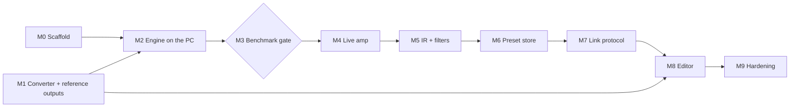

# Ducky roadmap

A living plan. Milestones are done in order; any of them may be revised, split, or dropped as the project learns.

## Decisions

| Topic | Decision |
|---|---|
| Model format | NAM A2 `.nam` (`SlimmableContainer`, 48 kHz). Only the A2-Lite submodel (`max_value` 0.5) runs. A1 models and A2-Full are rejected. Format, weight order and forward pass: `docs/NAM_FORMAT.md`. |
| Model shape | A2-Lite is fixed at compile time: 23 layers, 3 channels, bottleneck 3, kernels 6 (layers 15–16: 15), dilations `1 3 7 17 41 101 239 ×2, 1 13, 1 3 7 17 41 101 239`, LeakyReLU 0.01, no gating, FiLM, or groups. The head is a convolution with kernel 16, then `head_scale`. The editor rejects any other shape. Each stored model carries a shape descriptor, and the firmware checks it. |
| Sample rate / block size | 48 kHz and 48 samples (1 ms). No resampling. |
| Input gain (Knob 1) | Relative trim of ±12 dB, 0 dB at noon. Codec full scale feeds the model unchanged. The model's `input_level_dbu` is shown in the editor, not applied, and there is no hardware calibration. |
| Output (Knob 2) | Off … +12 dB, unity at noon. Each preset's output is level-matched using the A2-Lite submodel's own `metadata.loudness`. The top-level `loudness` is A2-Full's, and the two differ by about 0.1 dB. |
| Cut filters | Knob 5 sets the low-cut (high-pass) cutoff, 20–500 Hz. Knob 4 sets the high-cut (low-pass) cutoff, 1.5–20 kHz. Both use a log taper. Turning the low-cut fully counter-clockwise or the high-cut fully clockwise bypasses that filter. Knob 6 sets the low-cut resonance and Knob 3 the high-cut resonance (Q 0.5 to about 2, only on the 12 and 24 dB slopes). SW1 sets the low-cut slope and SW2 the high-cut slope: up 6, middle 12, down 24 dB/oct. |
| Mid (SW3) | Peaking filter at 515 Hz: −7 dB / bypass / +5 dB. |
| IR | Optional, up to 2048 taps (about 43 ms). The editor resamples to 48 kHz, trims, and normalises. It warns when the model's `gear_type` already includes a cab. |
| Preset switching | FS2 steps forward through filled slots only and wraps. Audio fades out, the model is swapped and reset, then audio fades back in (a gap of about 20–30 ms, no crossfade). LED2 blinks N times for slot N. The last slot is remembered across power cycles. |
| Preset persistence | Presets survive switching to another firmware and back. They live in the upper 4 MB of the QSPI flash, outside any firmware image and outside bad_tape's saved values at `0x903FE000`. |
| Hardware | Daisy Seed with 64 MB or more of SDRAM (development unit: Seed 1.2, 64 MB). HotHouse. |
| SysEx | `F0 7D 64 <version> <cmd> … F7`. Device byte `0x64` is unused by sibling projects. Identity Reply and DFU command follow the bad_tape conventions. |
| Editor | Preset manager plus live status: log, CPU load meter, knob/switch states. It does not control the knobs remotely, because the pedal is "what you see is what you get". |
| Model files | `models/*.nam` and converted `*.bin` are git-ignored. Only upstream MIT fixtures (`tests/fixtures/nam/`) are committed, plus `A2.bin` converted from upstream `A2.nam`. |

## Feasibility

| | A2-Lite | A2-Full |
|---|---|---|
| Weights | 1,871 | 12,146 |
| Multiply-adds per second at 48 kHz | ≈ 90 M | ≈ 583 M |
| Estimated load at 480 MHz, 1.2–2 cycles per multiply-add | 22–37 % | 120–200 % |

- Every weight is used about once per sample, so the multiply-add count tracks the weight count. The estimate assumes a hand-written float kernel that keeps each 3×3 tap matrix in registers across a block. M3 measured 35 % (2.0 cycles per multiply-add, everything included).
- The model looks back 6,346 samples (132 ms). Its history takes 91 KB for 3 channels (each layer's ring also holds one block and a 5-frame guard), and its weights 7.5 KB. Both fit in DTCM, the processor's fast internal RAM.
- Reset is cheap: with silent input every layer settles to a constant value per channel. Compute those once at load time and fill the history with them, instead of running 132 ms of silence through the model.
- A direct-form IR costs N multiply-adds per sample. A 2048-tap IR uses uniformly partitioned FFT convolution (CMSIS-DSP `arm_rfft_fast_f32`). The `daisy/libDaisy/Drivers/CMSIS-DSP` submodule is initialised by `git submodule update --init --recursive`.
- NeuralAmpModelerCore has an A2-specific fast path (`NAM/wavenet/a2_fast.cpp`): a shape check, the weight loader and a scalar 3-channel kernel. It is still Eigen-based, but it is the readable reference for the M2 engine.

## Milestones

### M0: Scaffold, passthrough, DFU (done, `06ea416`)
- Same layout as bad_tape:
  - `daisy/Makefile`: `APP_TYPE = BOOT_SRAM`, `BOARD=hothouse`, build id, and `APP=ducky` (M3 adds `APP=bench`).
  - HotHouse `board.h`.
  - `memory.h` placement macros.
  - Linker script with fast-RAM sections (DTCM, ITCM) and SDRAM sections.
  - Top-level `Makefile` for the PC builds.
- USB-MIDI link: Identity Reply, HELLO, LOG, DFU command. `tools/flash_when_ready.sh`.
- Audio: left input copied to both outputs at 48 kHz / 48 samples. FS1 mutes with a ramp, and LED1 follows. A status log line reports CPU load, underruns, and knob states.
- **Done when:** the pedal flashes over USB-MIDI DFU with no button presses, passthrough is clean, and the Identity Reply parses. Board revision and codec are confirmed and recorded.
- **Measured:** the development unit reports `seed 1.2-pcm3060` (Seed 1.2, PCM3060 codec), sysclk 480 MHz, 48 kHz, 24-bit, 48-sample blocks. Passthrough load is avg 6 / max 7 permille with 0 underruns. DTCM 16.5 KB of 128 KB (including the 16 KB stack reserve), ITCM 1.2 KB, SRAM 124 KB of 480 KB.
- **Docs:** `docs/FIRMWARE.md` covers build, flash, log, the source layout, threads, the memory map and the log lines.

### M1: Model converter and reference outputs (done, `06a26cd`)
- The `.nam` → binary converter is written in TypeScript and shared by the editor and a Bun command-line tool.
- Binary layout: magic, format version, shape descriptor, weights (float32 LE), `head_scale`, `loudness`, `input_level_dbu`, name, CRC-32.
- Reference outputs: render with NeuralAmpModelerCore's `tools/render.cpp` (`render --slim 0.25 model.nam in.wav out.wav`, which selects A2-Lite) on a fixed set of guitar DI recordings, and keep the results as test fixtures. Pin the core's commit. `render` prewarms before processing, so the references start from the settled zero-input state.
- Inputs and fixtures: `docs/NAM_FORMAT.md` has the shape check, the weight stream, the forward pass, the metadata to keep, and the upstream example models for accept and reject cases.
- Decided: the converter lives in `editor/src/nam/` and the CLI is `tools/nam_convert.ts`. A model without an A2-Lite `loudness` is accepted, flagged, and plays at unity. The DI stimulus is the first 20 s of the left channel of the sibling projects' `guitar.wav` (local, in `renders/`); upstream's MIT fixtures and the `A2.nam` reference are committed under `tests/fixtures/nam/`.
- **Done when:** both development models convert, and models with a non-Lite shape are rejected with a named reason.
- **Result:** `bun tools/nam_convert.ts` converts both development models and upstream `A2.nam` to 7652-byte format-1 binaries, and rejects upstream `slimmable_container.nam` (`no-lite-submodel`) and `wavenet_a2_feature_test.nam` (`not-container`). `tools/nam_reference.sh` renders A2-Lite references for every model on `input.wav` (96,000 samples) and the 20 s guitar stimulus (960,000 samples); reruns are bit-identical.
- **Docs:** `docs/NAM_FORMAT.md` "Ducky model binary (format 1)" and "Reference renders".

### M2: A2-Lite engine on the PC (done, `a60b2a9`)
- Portable C++ that does not include libDaisy: block processing and constant-fill reset.
- `build/host/render IN.wav OUT.wav --model X.bin`.
- GoogleTest against the reference outputs.
- **Done when:** the maximum error against the reference is about 1e-5, output is the same at any block size, and there are no NaNs or denormals.
- **Result:** `dkdsp::A2Lite` (`daisy/src/dsp/a2lite.h`) matches all six reference renders bit for bit (max error 0), including both development models on the 20 s guitar stimulus. Output is bit-identical at block sizes 1, 7, 48, 100 and an irregular schedule. Ten seconds of silence then ±1e-40 input leave no NaN or subnormal in the output or the histories; subnormal inputs are flushed to zero. History 76,248 bytes, weights 7,480 bytes. On the PC (`-O2`, scalar) `render` runs about 23× real time.
- **Docs:** `docs/NAM_FORMAT.md` "Engine"; `docs/FIRMWARE.md` "Source layout".

### M3: Benchmark gate (done, `0dd970e`)
- `APP=bench`: the model is compiled in, and the DWT cycle counter times each layer.
- Optimise: tap matrices held in registers, ITCM code, DTCM history, flush-to-zero.
- **Done when:** model load is ≤ 45 % at a 48-sample block, and device output matches the PC within tolerance.
- **If it fails:** try fixed-point or SIMD variants, a larger block, or ask NAM upstream for a smaller shape.
- **Result (go):** `APP=bench` (`daisy/src/bench.cpp`) logs the device check, the gate and per-layer cycles. The model costs avg 350.7, max 351.9 permille of the 48-sample block against the 450 limit, and the device check passes with max error 241e-9 against the reference (host output is still bit-exact). The first engines measured 520–620 permille. What closed the gap was measuring the core instead of counting instructions: on the Cortex-M7 a load, store, move or add that follows a multiply-accumulate waits about 3 cycles, and GCC's scheduler interleaves them. The engine now runs 6-frame tiles as load islands followed by pure multiply-accumulate runs, with scheduling off, a branch-free leaky ReLU, and each layer writing straight into the next layer's ring. No fallback (fixed point, larger block, smaller shape) was needed.
- **Also:** `.dtcm_bss` (`DK_DTCM_BSS`), a zeroed DTCM section with no load image, for the engine. `tools/usb_log.py --port` and `DK_USB_PORT` for `tools/flash_when_ready.sh` address one Seed by USB path when several are attached.
- **Docs:** `docs/M7_PERFORMANCE.md` (the cost model, the rules for DSP code, how to measure); `docs/FIRMWARE.md` "Bench (M3)"; `docs/NAM_FORMAT.md` "Engine".

### M4: Live amp
- The engine runs in the audio callback with one compiled-in model.
- Knobs 1 and 2 are smoothed, and output is level-matched with `loudness`.
- **Done when:** playable, with no zipper noise and no denormal spikes after long silence.

### M5: IR and filters
- Partitioned FFT convolver for IRs up to 2048 taps.
- Cut filters:
  - 6 dB/oct is first-order, so its resonance knob does nothing.
  - 12 dB/oct is one biquad with Q from the resonance knob.
  - 24 dB/oct is two cascaded biquads: a Butterworth stage, then a stage whose Q comes from the resonance knob.
  - The extreme knob position bypasses the filter.
- Mid peaking filter for SW3.
- Spec in `docs/FILTERS.md`; tests on the PC (frequency response, stability under knob sweeps, no clicks when switching slopes).
- Kernels follow `docs/M7_PERFORMANCE.md`. The IR convolver's FFT is CMSIS-DSP's, built with libDaisy, and has not been measured on this core.
- **Done when:** the whole chain stays within budget on hardware, measured by `APP=bench` and the live load meter.

### M6: Preset store and switching
- Flash region in the upper 4 MB, clear of the last flash addresses (chip erratum `ES0392 2.7.5`). 8 slots, each holding a header, model, optional IR, and CRC. A small two-copy state record holds the last slot.
- Presets load into RAM. FS2 skips empty slots and wraps; audio fades out, the model is reset, and audio fades back in. LED2 blinks N times.
- The audio callback never reads QSPI, so flash writes cannot stall audio.
- Test data: the development models are written to flash by a command-line tool.
- **Done when:** switching while playing is clean, corrupt slots are skipped, and the pedal recovers if power is pulled during a write.

### M7: Link protocol
- Preset upload in chunks, with an acknowledgement and CRC per chunk. List, erase, rename, and reorder slots.
- Status stream: CPU load (average and maximum), underruns, current slot, knob and switch states, and log lines.
- `docs/MIDI.md` is generated from the protocol header. A command-line tool uploads presets and dumps status.
- **Done when:** all 8 slots can be managed from the command line while audio runs, with no underruns.

### M8: Editor
- Bun + TypeScript + Preact, built to a single HTML file (`editor/dist/editor.html`).
- Imports `.nam` files (checked with the M1 converter) and WAV IRs (resampled, trimmed, normalised).
- Manages 8 slots and shows model metadata, including `input_level_dbu` and gear type.
- Panel showing the log, CPU load meter, and knob/switch states. DFU button.
- **Done when:** a full preset round trip works from the browser, and the editor works when hosted inside a multi-firmware launcher.

### M9: Hardening and release prep
- Stress tests: fast FS2 presses, uploading while playing, power loss during writes, rapid knob sweeps.
- Docs: a top-level `README.md`, and bring `docs/FIRMWARE.md` (memory map, measured performance, log lines) up to date.
- Licence review before the history is squashed, including the upstream MIT fixtures and their `LICENSE` in `tests/fixtures/nam/`.

## Risks

- **CPU:** the generic NAM core is built on Eigen, which has no float SIMD on Cortex-M7, so it is assumed too slow. The custom kernel passed the M3 gate at 35 % for the model alone; the IR, the filters and the callback's own work (M4, M5) must fit in the rest. The kernel's speed depends on GCC keeping the instruction order it was written in (`docs/M7_PERFORMANCE.md`), so a toolchain or flag change needs a bench run.
- **Locked model shape:** if NAM revises A2-Lite, the firmware needs an update. The shape descriptor plus the editor's check keep unsupported models from playing incorrectly.
- **QSPI coexistence:** another firmware's image could grow into the preset region. The largest sibling image is about 2.2 MB, and the presets start above 4 MB.
