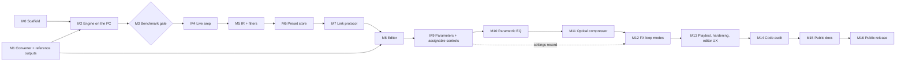

# Ducky roadmap

A living plan. Milestones are done in order; any of them may be revised, split, or dropped as the project learns.

## Decisions

The decisions in force. Each names the doc that specifies it.

### Model

- **Model format:** NAM A2 `.nam` (`SlimmableContainer`, 48 kHz). Only the A2-Lite submodel (`max_value` 0.5) runs. A1 models and A2-Full are rejected. Format, weight order and forward pass: `docs/NAM_FORMAT.md`.
- **Model shape:** A2-Lite is fixed at compile time: 23 layers, 3 channels, bottleneck 3, kernels 6 (layers 15–16: 15), dilations `1 3 7 17 41 101 239 ×2, 1 13, 1 3 7 17 41 101 239`, LeakyReLU 0.01, no gating, FiLM, or groups. The head is a convolution with kernel 16, then `head_scale`. The editor rejects any other shape. Each stored model carries a shape descriptor, and the firmware checks it.
- **Model and IR files:** `models/*.nam`, converted `*.bin` and `irs/` are git-ignored. Only upstream MIT fixtures (`tests/fixtures/nam/`) are committed, plus `A2.bin` converted from upstream `A2.nam`, the generated IR fixture `tests/fixtures/ir/decay.{wav,bin}`, and the preset fixture `tests/fixtures/preset/A2_decay.bin` built from those two.

### Budget and hardware

- **Sample rate / block size:** 48 kHz and 24 samples (0.5 ms), for 1 ms less latency than the original 48. No resampling. Being playtested: the bench chain with an IR, the gate, the EQ at its worst, both compressors and a morph blend on every block is at 595 permille (`docs/MEASUREMENTS.md` "Bench").
- **CPU ceiling:** the pedal's load stays under 850 permille of the block period; the bench's chain gate checks it (`docs/FIRMWARE.md` "Bench"). The model keeps its own gate (450 permille).
  - **Headroom:** the rest is for what the load meter does not see: libDaisy's audio interrupt and its sample conversion, and the main loop (USB, the link, slot writes). The bench times the DSP alone, about 10 permille under the live meter.
  - **One exception, accepted:** the xfade build's morph runs two models, and a morph preset with an IR measured 870 / 880 live (864 / 875 on the Seed 3); an overrun sheds the second model (`docs/HISTORY.md` "Morph: the crossfade is the default").
- **Hardware:** Daisy Seed with 64 MB or more of SDRAM (development units: a Seed 1.2 and a Seed 3, both 64 MB). HotHouse.

### Signal chain

- **Input gain (Knob 1):** relative trim of ±12 dB around the model's input calibration at noon: NeuralAmpModelerPlugin's `+4.5 dBu − input_level_dbu`, where +4.5 dBu is the level at the input jack that reaches 0 dBFS (from the datasheets, not measured). One value for every Seed: the Seed 3's round trip through the loop matched the Seed 1.2's within 0.5 dB (`docs/MEASUREMENTS.md` "FX loop"). A model without `input_level_dbu` is assumed captured at +12 dBu.
- **Output (Knob 2):** off … +12 dB, unity at noon. Each preset's output is level-matched using the A2-Lite submodel's own `metadata.loudness`. The top-level `loudness` is A2-Full's, and the two differ by about 0.1 dB. `loudness` is measured at the capture level, so after the input calibration a clean model plays a little quieter than a driven one (about 1.8 dB).
- **Compressor:** between the input jack and Knob 1, global; `comp_type` picks the model: the reduced OTC-201 (`docs/compressor-spec.md` "DSP model", the default) or the reduced Dyna Comp / Ross OTA (`docs/ota-compressor-spec.md` "DSP model"). float32, no tables: the OTC with libm `log1pf`/`powf` and a division per sample, the OTA with a division per sample and a compensated envelope sum.
  - **Mode:** one three-way `comp_mode`: Off (the default), Blend, Direct (a switch's down, middle, up). Off is a bit-exact bypass (20 ms crossfade; turned on it restarts from rest). The type not picked is the same bypass, so a `comp_type` switch crossfades the two models over 20 ms, both running.
  - **Settings:** Sustain is the OTC's stage gain, 0 to +20.8 dB, linear in dB, or the OTA's Sensitivity rotation (its gain below threshold linear in dB over 25.8 dB); Level −3 / 0 / +3 dB (a toggle's positions); Balance the knob's rotation through an audio taper (`x = (81^v − 1)/80`, 0.1 at noon).
- **FX loop:** a global `loop_mode`, MISO by default: MISO (mono in, both outputs the same), pre-model (the loop between the compressor and Knob 1's trim) or post-model (between the model and the IR). Series only. `docs/LOOP.md`.
  - **Jacks:** in the loop modes R Out (the output's ring) is the send, R In (the input's ring) the return, and the pedal plays on L Out only.
  - **Gate:** it stays at the output in pre-model and rides the send in post-model, with the level match, so the loop pedals' tails come back ungated.
  - **Levels and fades:** send and return levels ±12 dB. A mode change fades both outputs 5 ms out and in.
- **IR:** optional, up to 2048 taps (about 43 ms). The converter (`editor/src/ir/`, shared by the editor and `tools/ir_convert.ts`) resamples to 48 kHz, trims with a 64-tap fade, and normalises the 80 Hz–5 kHz band to 0 dB (pink-weighted), so a cab leaves an amp model's level about where it was. The editor warns when the model's `gear_type` already includes a cab.
- **EQ:** after the IR, always there (no pre/post placement): low-cut → bells 1–3 → high-cut, on by default (`eq_enable`) and the identity at its defaults. No shelves. `docs/EQ.md`.
  - **Cuts:** a low-cut (high-pass), 20–500 Hz, and a high-cut (low-pass), 1.5–20 kHz, log tapers, bypassed at their off ends (the low-cut's bottom, the high-cut's top); resonance Q 0.5 to 2 on the 12 and 24 dB slopes; slope 6, 12 or 24 dB/oct.
  - **Bells:** bad_tape's RBJ bells, ±12 dB, Q 0.4–8, at 40–800 Hz, 200 Hz–5 kHz and 800 Hz–12 kHz.
- **Noise gate:** per preset, off by default: threshold −80…−30 dBFS (opens 6 dB above it), attack 0.5–10 ms, hold 10–100 ms, release 10–1000 ms, ratio 1.5:1–10:1. Side-chained from the input jack (before the compressor and Knob 1) and applied in Knob 2's output ramp (in post-model, the send's), once per block: no latency, no lookahead. Edited in the editor (auditioned live) or with `tools/pedal.ts gate`; `docs/FILTERS.md` "Noise gate".
- **Preset morph:** a preset may name another preset as its morph target; the global `morph` parameter (0–100 %, assignable to a control) moves from the playing preset's model to the target's, with the preset's own IR and gate. `docs/MORPH.md`.
  - **The xfade build** runs both models and crossfades their outputs (equal power on the square of the position, so the target fades in slowly; each at its own level match and input calibration).
  - **The weight build** (`APP=weight`) runs one model, its weights blended into the target's, straight or along a trained path.
  - **The target** is found by its model's CRC, so swaps keep the pair and a replaced target turns the morph off until it is analysed again.
  - **The analysis:** the host analyses a pair (an alignment of the target's channels, kept only when its blends are closer to a crossfade of the two outputs than the unaligned ones) and stores a 64-byte block in the preset; the fit, the alignment and the waypoints are the weight build's. Captures of different amps blend unaligned; how well is measured as the fit (about 80 % for four of the pedal's five models, 20 % for the fifth).

### Controls and presets

- **Controls:** Knobs 1 and 2 are fixed. Knobs 3–6, SW1–SW3, EXP (an expression pedal: MIDI CC 11 on the Seed's USB MIDI port or a BurningBungalow's MIDI IN jack, each on one channel or any) and, on a BurningBungalow, PEDAL (its expression pedal jack, scaled from fixed heel and toe ends, not calibrated per pedal) each drive one parameter of the table (`daisy/src/params.h`) or none. `docs/MIDI.md` "Parameters", "Controls".
  - **Factory layout** (`kFactoryAssign`, with no saved settings): K3 `bell2_gain`, K4 `low_cut_freq`, K5 `high_cut_freq`, K6 `comp_balance`, SW1 `low_cut_slope`, SW2 `comp_mode`, SW3 `comp_level`, EXP none, PEDAL none.
  - **Switches** take only on/off and three-value parameters (on/off: middle off, up and down on; three values: down, middle, up); EXP and PEDAL take any, as a knob does.
  - **Global and saved:** the assignments, the EXP and MIDI IN channels and the values are global, not per preset, and are kept by an explicit SAVE.
  - **Pickup:** a value set from the editor holds until its control moves (a knob, EXP or PEDAL more than 3 % of its travel).
- **Preset switching:** FS2 steps forward through filled slots only and wraps; MIDI CC 102 (value 0–7, on EXP CHANNEL's channel over USB or MIDI IN CHANNEL's on a BurningBungalow's MIDI IN) goes to a given filled slot. Audio fades out, the model is swapped and reset, then audio fades back in (5 ms each way, a gap of about 11 ms, no crossfade). LED2 blinks N times for slot N, repeating after 5 s dark; off while dry. The last slot is remembered across power cycles.
- **Preset persistence:** presets survive switching to another firmware and back. They live in the upper 4 MB of the QSPI flash, outside any firmware image and outside bad_tape's saved values at `0x903FE000`.

### Link and editor

- **SysEx:** `F0 7D 64 <version> <cmd> … F7`. Device byte `0x64` (bad_tape's is `0x62`). Identity Reply and DFU command follow the bad_tape conventions. `daisy/src/link.h` is the reference and `docs/MIDI.md` is generated from it.
  - **Slots:** the link lists, uploads in chunks, erases, renames, swaps and reads back (READ/DATA) slots, and streams status.
  - **Parameters:** it sends the parameter table, sets values and assignments and saves them (DUMP, SET, ASSIGN, SAVE; PARAM, VALUES), and sets EXP's channel (EXP CHANNEL) and a BurningBungalow's MIDI IN channel (MIDI IN CHANNEL).
  - **Besides SysEx** the pedal takes two messages, Control Change 11 and 102, on USB and on a BurningBungalow's MIDI IN.
- **Editor:** one self-contained HTML file, so it can be hosted anywhere, including in an iframe. Stored slots' metadata and the parameter table are read from the pedal, not kept by the editor. `docs/EDITOR.md`.
  - **Tabs:** preset manager, the controls' assignments (Controls tab), the compressor (Compressor tab: a gain-reduction meter and a row per parameter), the EQ set directly (EQ tab: a draggable response graph and a row per parameter, as bad_tape's) and the FX loop (Loop tab: the mode's signal flow and a row per parameter), plus live status: log, CPU load meter, knob/switch states.
  - **Parameters:** a parameter on a control stays "what you see is what you get" once that control moves; the editor sets parameters and holds them until then.

## Feasibility

| | A2-Lite | A2-Full |
|---|---|---|
| Weights | 1,871 | 12,146 |
| Multiply-adds per second at 48 kHz | ≈ 90 M | ≈ 583 M |
| Estimated load at 480 MHz, 1.2–2 cycles per multiply-add | 220–370 permille | 1,200–2,000 permille |

- Every weight is used about once per sample, so the multiply-add count tracks the weight count. The estimate assumes a hand-written float kernel that keeps each 3×3 tap matrix in registers across a block. M3 measured 350 permille (2.0 cycles per multiply-add, everything included).
- The model looks back 6,346 samples (132 ms). Its history takes 84 KB for 3 channels (each layer's ring also holds one block and a 5-frame guard), and its weights 7.5 KB. Both fit in DTCM, the processor's fast internal RAM.
- Reset is cheap: with silent input every layer settles to a constant value per channel. Compute those once at load time and fill the history with them, instead of running 132 ms of silence through the model.
- A direct-form IR costs N multiply-adds per sample. A 2048-tap IR uses partitioned FFT convolution (CMSIS-DSP `arm_rfft_fast_f32`): uniform at M5, which measured it at 110 permille of the block period, two-level since the efficiency pass. The `daisy/libDaisy/Drivers/CMSIS-DSP` submodule is initialised by `git submodule update --init --recursive`; `libdaisy.a` does not contain it, so `daisy/cmsis_fft.mk` lists the sources every build compiles.
- NeuralAmpModelerCore has an A2-specific fast path (`NAM/wavenet/a2_fast.cpp`): a shape check, the weight loader and a scalar 3-channel kernel. It is still Eigen-based, but it is the readable reference for the M2 engine.

## Milestones

Done, each with what it decided, measured and verified in `docs/HISTORY.md`:

- **M0 to M12:** M0 Scaffold, passthrough, DFU; M1 Model converter and reference outputs; M2 A2-Lite engine on the PC; M3 Benchmark gate; M4 Live amp; M5 IR and filters; M6 Preset store and switching; M7 Link protocol; M8 Editor; M9 Parameter table and assignable controls; M10 Parametric EQ; M11 Optical compressor (OTC-201); M12 FX loop modes.
- **After M8:** the noise gate.
- **During M13:** the preset morph, its trained paths, the dual-model crossfade (an experiment, then the xfade build), the efficiency pass (the IR convolver, memory placement, per-block audit) and the expression pedal (MIDI CC 11 as an assignable control).
- **During M14:** preset select over MIDI (CC 102).

### M13: Playtest, hardening and editor UX audit
- **Playtest** M9–M12 on the pedal over several sessions, keeping an issue list.
- **Hardening** (the old M9's stress tests, plus the new paths): fast FS2 presses, uploading while playing, power loss during slot and settings writes, rapid knob sweeps and switch flips, reassigning controls while playing, the editor unplugged mid-save, an hour-long run with 0 underruns.
- **Editor UX audit:** tab structure now that parameters live in the editor (presets, controls, EQ, compressor, gate, loop, log); what each knob does at a glance; consistency with bad_tape's conventions; keyboard and screen-reader use; error states (no Web MIDI, the wrong device, DFU, a stale firmware); a ranked list of findings, fixed in this milestone.
- **Done so far:** the compressor's `comp_enable` and `comp_mode` merged into one three-way `comp_mode` (down off, middle blend, up direct), so a single switch runs the compressor; ids 17–18 stay, `comp_balance` and the loop's three move down one, and the settings record goes to version 3 (a version-2 record reads as `settings factory`). Host: `Compressor.NoClickOnSettingJump` over every pair of `comp_mode`'s values, `Settings.EarlierVersionsAreInvalid`, `Values.Bytes` with 23 codes; `make -C editor test check`.
- **Switch captions and order:** the editor lists a toggle's positions and a choice's values the same way everywhere, down, middle, up from left to right, and captions each value with the toggle position that selects it (`↓ down`, `– middle`, `↑ up`; a two-value choice `– middle`, `↑↓ up or down`), in the parameter rows and on the sidebar's switches. `daisy/src/board.h`'s pins (D9/D10, D7/D8, D5/D6 as up/down) checked on the pedal with SW1–SW3 all down, all middle, then all up: STATUS read `sw 0 0 0`, `sw 1 1 1`, `sw 2 2 2`; a build with the pairs swapped read `sw 2 2 2` with all three down. In the editor on the pedal, SW1 down, SW2 middle and SW3 up showed `[Off] Blend Direct` (SW1 on `comp_mode`), `Down [Middle] Up` and `Down Middle [Up]`.
- **Factory layout:** with no settings record the controls start as the layout set up on the pedal during this playtest (`kFactoryAssign` in `daisy/src/params.h`): K3 `bell2_gain`, K4 `low_cut_freq`, K5 `high_cut_freq`, K6 `comp_balance`, SW1 `low_cut_slope`, SW2 `comp_mode`, SW3 `comp_level`. A static assert checks each switch holds a choice; `docs/MIDI.md` "Controls" lists it (generated). Bell 2's default frequency moves from 1 kHz to 515 Hz (position 0.29384, code 4814), the usual mid on many amps, so K3 is a mid control out of the box.
- **Palette:** the editor moves from neutral grey with a lavender accent to a very dark slate (desk `#07090c`, panels `#141a21`, wells `#0b0f14`) with a pale steel accent (`#a9c4dc`, deep `#4d6a86`): only `ducky.css`'s `--rh-*` variables change; the lamps, meters and EQ band colours stay. Every `docs/EDITOR.md` screenshot retaken against the pedal (EXP on none) as before, in headless Chromium at 1250 px and 1.5× scale; the import's slot 7 draft discarded.
- **Done when:** the issue list is closed or explicitly deferred, the stress tests pass on the pedal, and `docs/EDITOR.md` has fresh screenshots.

### M14: Code audit
- **Firmware:** rerun the bench for every stage; check `docs/M7_PERFORMANCE.md`'s rules, ITCM/DTCM placement and no heap (`nm -u`); split `ducky.cpp` (1,200 lines) where a seam is clear (the link's slot commands, the parameter commands and the settings); dead code, names, comments that no longer match.
- **Editor and tools:** the cost of the WATCH stream's re-renders, bundle size, duplicated logic between `editor/src/` and `tools/`, formats shared with C++ tested on both sides.
- **Tests:** everything host-portable covered; no flaky or wording-only tests.
- **Docs:** every file, symbol and section a doc names still exists (a script check), measured numbers current.
- **Done so far:**
  - **Editor:** one coalescing queue for GATE TRY and SET, the parameter rows, props and readouts built once, the CSS's lost container query and duplicated rules, Biome 2.6.8.
  - **Firmware** (`docs/HISTORY.md` "Firmware audit"): one QSPI write path, `onCommand` split, the uploads' shared staging, the records' CRC helpers, the DSP's shared fades and taper helpers (the audio callback's code unchanged but for the mute ramp's loads), the build files, the beginner's build and flash guide (`docs/FIRMWARE.md` "Getting started"), the docs checked against the code; the bench on the Seed 3 unchanged to within 0.4 % per stage. No `new` or `malloc` in Ducky's code: newlib's `malloc` is linked only through `iprintf`, which ST's USB middleware calls on its init error paths.
  - **Left:** a script that checks every file, symbol and section a doc names; `ducky.cpp` is still one file (1,572 lines; its long commands are now functions).
- **Done when:** the findings are fixed, the bench and host suites pass, and the docs match the code.

### M15: Documentation for public release
- A top-level `README.md`: what Ducky is, the hardware (Seed with 64 MB SDRAM, HotHouse), the controls, flashing a release, the editor, getting A2 models (Tone3000) and IRs; a pedal photo and editor screenshots.
- Separate the player's documentation from the developer's (build, firmware internals, formats, research).
- **Done:** paths outside the repo replaced with public links (bad_tape, the HotHouse design files, the ST and Arm manuals); the guitar DI's source is a local file under `renders/`.
- Decide what ships of `CLAUDE.md` and this roadmap (kept as history or condensed).
- **Done when:** someone new builds, flashes and loads a preset from the README alone, tried on a clean clone.

### M16: Public release
- **Licence review:** the root `LICENSE` (MIT) and the third-party code that ships: libDaisy (MIT) and its STM32 HAL (BSD-3), CMSIS-DSP (Apache-2.0, compiled into the firmware: its notice), Preact (MIT, inlined in `editor.html`), the upstream NAM fixtures (MIT, `tests/fixtures/nam/LICENSE`). Models and IRs are never shipped (the York Audio packs are commercial). Product names (Dinosaural, Aion, York Audio, Tone3000) used descriptively only.
- **Done:** the history squashed to one initial commit. Before the repo is made public, check again that nothing git-ignored or commercial is in the tree and that no personal paths, ports or secrets remain.
- **Release:** a tag; a GitHub release with `ducky_xfade.bin`, `ducky_weight.bin` and the matching `editor.html`; flashing through the Daisy web programmer (check that it installs the bootloader a `BOOT_SRAM` image needs); optionally the editor on GitHub Pages and CI running the host and editor tests.
- **Done when:** the public repo builds from a clean clone, and the release flashes a fresh Seed and talks to the published editor.

## Risks

- **CPU:** the generic NAM core is built on Eigen, which has no float SIMD on Cortex-M7, so it is assumed too slow. The custom kernel runs the model at 342 permille of a 24-sample block (its gate is 450), and the bench's whole chain (an IR, the gate, the EQ at its worst, both compressors and a morph blend on every block) at 595 permille against the 850 ceiling (`docs/MEASUREMENTS.md` "Bench"). Live, one case is above the ceiling, and accepted: the xfade build's morph with an IR, at 870 permille (`docs/MEASUREMENTS.md` "Live load"). The loop modes add 3–4 permille live over MISO (two gain ramps and a two-buffer fade). Preset switching and slot writes add no steady load (both run in the main loop; the callback is parked for a load and reads no QSPI during a write). The kernel's speed depends on GCC keeping the instruction order it was written in (`docs/M7_PERFORMANCE.md`), so a toolchain or flag change needs a bench run.
- **Locked model shape:** if NAM revises A2-Lite, the firmware needs an update. The shape descriptor plus the editor's check keep unsupported models from playing incorrectly.
- **QSPI coexistence:** another firmware's image could grow into the preset region. The largest such image so far is about 2.2 MB, and the presets start above 4 MB.
