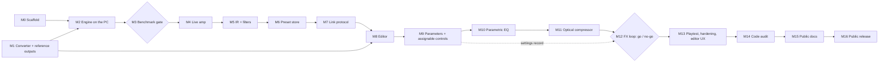

# Ducky roadmap

A living plan. Milestones are done in order; any of them may be revised, split, or dropped as the project learns.

## Decisions

| Topic | Decision |
|---|---|
| Model format | NAM A2 `.nam` (`SlimmableContainer`, 48 kHz). Only the A2-Lite submodel (`max_value` 0.5) runs. A1 models and A2-Full are rejected. Format, weight order and forward pass: `docs/NAM_FORMAT.md`. |
| Model shape | A2-Lite is fixed at compile time: 23 layers, 3 channels, bottleneck 3, kernels 6 (layers 15–16: 15), dilations `1 3 7 17 41 101 239 ×2, 1 13, 1 3 7 17 41 101 239`, LeakyReLU 0.01, no gating, FiLM, or groups. The head is a convolution with kernel 16, then `head_scale`. The editor rejects any other shape. Each stored model carries a shape descriptor, and the firmware checks it. |
| Sample rate / block size | 48 kHz and 24 samples (0.5 ms), for 1 ms less latency than the original 48. No resampling. Being playtested: the bench chain with an IR is at 59.8 % (`docs/FILTERS.md` "Measured"). |
| CPU ceiling | The pedal's load stays under 850 permille of the block period; the bench's chain gate checks it (`docs/FIRMWARE.md` "Bench"). The rest is for what the load meter does not see: libDaisy's audio interrupt and its sample conversion, and the main loop (USB, the link, slot writes). The bench times the DSP alone, about 10 permille under the live meter. The model keeps its own M3 gate (450 permille). Until the 24-sample blocks the chain gate was 550. |
| Input gain (Knob 1) | Relative trim of ±12 dB around the model's input calibration at noon (M4): NeuralAmpModelerPlugin's `+4.5 dBu − input_level_dbu`, where +4.5 dBu is the level at the input jack that reaches 0 dBFS (from the datasheets, not measured). A model without `input_level_dbu` is assumed captured at +12 dBu. |
| Output (Knob 2) | Off … +12 dB, unity at noon. Each preset's output is level-matched using the A2-Lite submodel's own `metadata.loudness`. The top-level `loudness` is A2-Full's, and the two differ by about 0.1 dB. `loudness` is measured at the capture level, so after the input calibration a clean model plays a little quieter than a driven one (M4: about 1.8 dB). |
| EQ (M10) | After the IR, always there (no pre/post placement): low-cut → bells 1–3 → high-cut, on by default (`eq_enable`) and the identity at its defaults. No shelves. Cuts: a low-cut (high-pass), 20–500 Hz, and a high-cut (low-pass), 1.5–20 kHz, log tapers, bypassed at their off ends (the low-cut's bottom, the high-cut's top); resonance Q 0.5 to 2 on the 12 and 24 dB slopes; slope 6, 12 or 24 dB/oct. Bells: bad_tape's RBJ bells, ±12 dB, Q 0.4–8, at 40–800 Hz, 200 Hz–5 kHz and 800 Hz–12 kHz. The M5 515 Hz mid is gone. `docs/EQ.md`. |
| Controls (M9, M10) | Knobs 1 and 2 are fixed. Knobs 3–6 and SW1–SW3 each drive one parameter of the table (`daisy/src/params.h`) or none, and all start unassigned (no factory layout); a switch takes only on/off and three-value parameters (on/off: middle off, up and down on). The assignments and the values are global, not per preset, and are kept by an explicit SAVE. A value set from the editor holds until its control moves (a knob more than 3 % of its travel). `docs/MIDI.md` "Parameters", "Controls". |
| IR | Optional, up to 2048 taps (about 43 ms). The converter (`editor/src/ir/`, shared by the editor and `tools/ir_convert.ts`) resamples to 48 kHz, trims with a 64-tap fade, and normalises the 80 Hz–5 kHz band to 0 dB (pink-weighted), so a cab leaves an amp model's level about where it was. The editor warns when the model's `gear_type` already includes a cab. |
| Noise gate | Per preset, off by default: threshold −80…−30 dBFS (opens 6 dB above it), attack 0.5–10 ms, hold 10–100 ms, release 10–1000 ms, ratio 1.5:1–10:1. Side-chained from the input jack (before Knob 1) and applied in Knob 2's output ramp, once per block: no latency, no lookahead. Edited in the editor (auditioned live) or with `tools/pedal.ts gate`; `docs/FILTERS.md` "Noise gate". |
| Preset switching | FS2 steps forward through filled slots only and wraps. Audio fades out, the model is swapped and reset, then audio fades back in (5 ms each way, a gap of about 11 ms, no crossfade). LED2 blinks N times for slot N, repeating after 5 s dark; off while dry. The last slot is remembered across power cycles. |
| Preset persistence | Presets survive switching to another firmware and back. They live in the upper 4 MB of the QSPI flash, outside any firmware image and outside bad_tape's saved values at `0x903FE000`. |
| Hardware | Daisy Seed with 64 MB or more of SDRAM (development unit: Seed 1.2, 64 MB). HotHouse. |
| SysEx | `F0 7D 64 <version> <cmd> … F7`. Device byte `0x64` is unused by sibling projects. Identity Reply and DFU command follow the bad_tape conventions. Since M7 the link also manages slots (list, chunked upload, erase, rename, swap) and streams status; since M8 it reads slots back (READ/DATA); since M9 it sends the parameter table, sets values and assignments and saves them (DUMP, SET, ASSIGN, SAVE; PARAM, VALUES). `daisy/src/link.h` is the reference and `docs/MIDI.md` is generated from it. |
| Editor | Preset manager, the controls' assignments (Controls tab) and the EQ set directly (EQ tab: a draggable response graph and a row per parameter, as bad_tape's), plus live status: log, CPU load meter, knob/switch states. A parameter on a control stays "what you see is what you get" once that control moves; the editor sets parameters and holds them until then. One self-contained HTML file, so it can be hosted anywhere, including in an iframe. Stored slots' metadata and the parameter table are read from the pedal, not kept by the editor. |
| Model and IR files | `models/*.nam`, converted `*.bin` and `irs/` are git-ignored. Only upstream MIT fixtures (`tests/fixtures/nam/`) are committed, plus `A2.bin` converted from upstream `A2.nam`, the generated IR fixture `tests/fixtures/ir/decay.{wav,bin}`, and the preset fixture `tests/fixtures/preset/A2_decay.bin` built from those two. |

## Feasibility

| | A2-Lite | A2-Full |
|---|---|---|
| Weights | 1,871 | 12,146 |
| Multiply-adds per second at 48 kHz | ≈ 90 M | ≈ 583 M |
| Estimated load at 480 MHz, 1.2–2 cycles per multiply-add | 22–37 % | 120–200 % |

- Every weight is used about once per sample, so the multiply-add count tracks the weight count. The estimate assumes a hand-written float kernel that keeps each 3×3 tap matrix in registers across a block. M3 measured 35 % (2.0 cycles per multiply-add, everything included).
- The model looks back 6,346 samples (132 ms). Its history takes 84 KB for 3 channels (each layer's ring also holds one block and a 5-frame guard), and its weights 7.5 KB. Both fit in DTCM, the processor's fast internal RAM.
- Reset is cheap: with silent input every layer settles to a constant value per channel. Compute those once at load time and fill the history with them, instead of running 132 ms of silence through the model.
- A direct-form IR costs N multiply-adds per sample. A 2048-tap IR uses uniformly partitioned FFT convolution (CMSIS-DSP `arm_rfft_fast_f32`); M5 measured it at 11 % of the block period. The `daisy/libDaisy/Drivers/CMSIS-DSP` submodule is initialised by `git submodule update --init --recursive`; `libdaisy.a` does not contain it, so `daisy/cmsis_fft.mk` lists the sources both builds compile.
- NeuralAmpModelerCore has an A2-specific fast path (`NAM/wavenet/a2_fast.cpp`): a shape check, the weight loader and a scalar 3-channel kernel. It is still Eigen-based, but it is the readable reference for the M2 engine.

## Milestones

### M0: Scaffold, passthrough, DFU (done, `06ea416`)
- Same layout as bad_tape:
  - `daisy/Makefile`: `APP_TYPE = BOOT_SRAM`, `BOARD=hothouse`, build id, and `APP=ducky` (M3 adds `APP=bench`).
  - HotHouse `board.h`.
  - `memory.h` placement macros.
  - Linker script with fast-RAM sections (DTCM, ITCM) and SDRAM sections.
  - Top-level `Makefile` for the PC builds.
- USB-MIDI link: Identity Reply, HELLO, LOG, DFU command. `tools/flash_when_ready.sh`.
- Audio: left input copied to both outputs at 48 kHz / 48 samples. FS1 mutes with a ramp, and LED1 follows. A status log line reports CPU load, underruns, and knob states.
- **Done when:** the pedal flashes over USB-MIDI DFU with no button presses, passthrough is clean, and the Identity Reply parses. Board revision and codec are confirmed and recorded.
- **Measured:** the development unit reports `seed 1.2-pcm3060` (Seed 1.2, PCM3060 codec), sysclk 480 MHz, 48 kHz, 24-bit, 48-sample blocks. Passthrough load is avg 6 / max 7 permille with 0 underruns. DTCM 16.5 KB of 128 KB (including the 16 KB stack reserve), ITCM 1.2 KB, SRAM 124 KB of 480 KB.
- **Docs:** `docs/FIRMWARE.md` covers build, flash, log, the source layout, threads, the memory map and the log lines.

### M1: Model converter and reference outputs (done, `06a26cd`)
- The `.nam` → binary converter is written in TypeScript and shared by the editor and a Bun command-line tool.
- Binary layout: magic, format version, shape descriptor, weights (float32 LE), `head_scale`, `loudness`, `input_level_dbu`, name, CRC-32.
- Reference outputs: render with NeuralAmpModelerCore's `tools/render.cpp` (`render --slim 0.25 model.nam in.wav out.wav`, which selects A2-Lite) on a fixed set of guitar DI recordings, and keep the results as test fixtures. Pin the core's commit. `render` prewarms before processing, so the references start from the settled zero-input state.
- Inputs and fixtures: `docs/NAM_FORMAT.md` has the shape check, the weight stream, the forward pass, the metadata to keep, and the upstream example models for accept and reject cases.
- Decided: the converter lives in `editor/src/nam/` and the CLI is `tools/nam_convert.ts`. A model without an A2-Lite `loudness` is accepted, flagged, and plays at unity. The DI stimulus is the first 20 s of the left channel of the sibling projects' `guitar.wav` (local, in `renders/`); upstream's MIT fixtures and the `A2.nam` reference are committed under `tests/fixtures/nam/`.
- **Done when:** both development models convert, and models with a non-Lite shape are rejected with a named reason.
- **Result:** `bun tools/nam_convert.ts` converts both development models and upstream `A2.nam` to 7652-byte format-1 binaries, and rejects upstream `slimmable_container.nam` (`no-lite-submodel`) and `wavenet_a2_feature_test.nam` (`not-container`). `tools/nam_reference.sh` renders A2-Lite references for every model on `input.wav` (96,000 samples) and the 20 s guitar stimulus (960,000 samples); reruns are bit-identical.
- **Docs:** `docs/NAM_FORMAT.md` "Ducky model binary (format 2)" (format 1 until M8) and "Reference renders".

### M2: A2-Lite engine on the PC (done, `a60b2a9`)
- Portable C++ that does not include libDaisy: block processing and constant-fill reset.
- `build/host/render IN.wav OUT.wav --model X.bin`.
- GoogleTest against the reference outputs.
- **Done when:** the maximum error against the reference is about 1e-5, output is the same at any block size, and there are no NaNs or denormals.
- **Result:** `dkdsp::A2Lite` (`daisy/src/dsp/a2lite.h`) matches all six reference renders bit for bit (max error 0), including both development models on the 20 s guitar stimulus. Output is bit-identical at block sizes 1, 7, 48, 100 and an irregular schedule. Ten seconds of silence then ±1e-40 input leave no NaN or subnormal in the output or the histories; subnormal inputs are flushed to zero. History 76,248 bytes, weights 7,480 bytes. On the PC (`-O2`, scalar) `render` runs about 23× real time.
- **Docs:** `docs/NAM_FORMAT.md` "Engine"; `docs/FIRMWARE.md` "Source layout".

### M3: Benchmark gate (done, `0dd970e`)
- `APP=bench`: the model is compiled in, and the DWT cycle counter times each layer.
- Optimise: tap matrices held in registers, ITCM code, DTCM history, flush-to-zero.
- **Done when:** model load is ≤ 45 % at a 48-sample block, and device output matches the PC within tolerance.
- **If it fails:** try fixed-point or SIMD variants, a larger block, or ask NAM upstream for a smaller shape.
- **Result (go):** `APP=bench` (`daisy/src/bench.cpp`) logs the device check, the gate and per-layer cycles. The model costs avg 350.7, max 351.9 permille of the 48-sample block against the 450 limit, and the device check passes with max error 241e-9 against the reference (host output is still bit-exact). The first engines measured 520–620 permille. What closed the gap was measuring the core instead of counting instructions: on the Cortex-M7 a load, store, move or add that follows a multiply-accumulate waits about 3 cycles, and GCC's scheduler interleaves them. The engine now runs 6-frame tiles as load islands followed by pure multiply-accumulate runs, with scheduling off, a branch-free leaky ReLU, and each layer writing straight into the next layer's ring. No fallback (fixed point, larger block, smaller shape) was needed.
- **Also:** `.dtcm_bss` (`DK_DTCM_BSS`), a zeroed DTCM section with no load image, for the engine. `tools/usb_log.py --port` and `DK_USB_PORT` for `tools/flash_when_ready.sh` address one Seed by USB path when several are attached.
- **Docs:** `docs/M7_PERFORMANCE.md` (the cost model, the rules for DSP code, how to measure); `docs/FIRMWARE.md` "Bench"; `docs/NAM_FORMAT.md` "Engine".

### M4: Live amp (done, `047ddc6`)
- The engine runs in the audio callback with one compiled-in model.
- Knobs 1 and 2 are smoothed, and output is level-matched with `loudness`.
- **Done when:** playable, with no zipper noise and no denormal spikes after long silence.
- **Decided:** the compiled-in model is `daisy/Makefile` `MODEL=FILE.bin`, default the committed `tests/fixtures/nam/A2.bin` (a clean clone builds). Knob 1 is −12…+12 dB, dB-linear, around the model's input calibration at noon. Knob 2 is `(2k)^3` up to noon (off at fully CCW, unity at noon), then dB-linear to +12 dB. Both are smoothed (one-pole, 20 ms at the block rate) and ramped linearly across each block (`dkdsp::GainRamp`, `daisy/src/dsp/gain.h`). The level match brings `loudness` to −18 dB, NeuralAmpModelerPlugin's target. The engine runs while muted. If the model does not parse, audio never starts and the pedal only serves USB/DFU.
- **Input calibration (added after the first playing test):** with 0 dB at noon, the models sounded distorted until Knob 1 was near 9 o'clock. Ducky's input reaches 0 dBFS at about +4.5 dBu (from the datasheets, not measured), while the development models were captured at +15 dBu, so noon drove them about 10 dB harder than the captured amps. The input gain at noon is now `+4.5 dBu − input_level_dbu`, as in NeuralAmpModelerPlugin's input calibration; a model without `input_level_dbu` is assumed captured at +12 dBu (`docs/FIRMWARE.md` "Threads"). Confirmed by ear on `A2.bin`: noon is no longer distorted.
- **Measured (`A2.bin`, Seed 1.2):** load avg 361, max 363 permille, 0 underruns, and the same after 5 minutes with nothing plugged in (input −84 dBFS); DTCM 115,704 bytes; `model loudness -24.0 dB level +6.0 dB input +14.8 dBu cal -10.3 dB "A2"`. Level matches: Fender −2.1 dB, SSS +3.7 dB; input calibration −10.5 dB for both. With no input the `out` peak is not −120 dBFS: the model has a −60 dBFS DC offset at zero input, before the output gain.
- **Result:** on the pedal with the Fender build, the knob sweeps have no zipper noise or clicks, Knob 2 fully counter-clockwise is silent, and FS1 still mutes with its ramp. The SSS build plays quieter at noon than the Fender. NAM's loudness measurement (its 1.75 s burst signal, K-weighted), run on the PC through the engine, reproduces both models' stored `loudness` exactly at the capture level. At the calibrated level the Fender drops 8.1 dB and the SSS 9.9 dB, because the clean amp does not compress, so the SSS ends up 1.8 dB quieter. NeuralAmpModelerPlugin behaves the same with input calibration and normalisation both on, and both models sit 8–10 dB below the −18 dB target at noon. Accepted for M4. The fix, if wanted later, is to measure `loudness` at the calibrated level on the pedal when a model loads.
- **Docs:** `docs/FIRMWARE.md` "Threads" (the chain, input calibration, level match), "Log lines", "Measured (M4)" and the `MODEL=` build option; `docs/NAM_FORMAT.md` "Metadata Ducky uses".

### M5: IR and filters (done, `a7e8813`)
- Partitioned FFT convolver for IRs up to 2048 taps.
- Cut filters:
  - 6 dB/oct is first-order, so its resonance knob does nothing.
  - 12 dB/oct is one biquad with Q from the resonance knob.
  - 24 dB/oct is two cascaded biquads: a Butterworth stage, then a stage whose Q comes from the resonance knob.
  - The extreme knob position bypasses the filter.
- Mid peaking filter for SW3.
- Spec in `docs/FILTERS.md`; tests on the PC (frequency response, stability under knob sweeps, no clicks when switching slopes).
- Kernels follow `docs/M7_PERFORMANCE.md`. The IR convolver's FFT is CMSIS-DSP's. libDaisy's `libdaisy.a` turned out not to contain CMSIS-DSP, so both builds compile the FFT sources themselves (`daisy/cmsis_fft.mk`).
- Test data: example IRs in `irs/` (git-ignored, commercial York Audio 4×12 packs). Each pack has `44.1k`, `48k` and `96k` WAV folders (mono, 24-bit PCM, 500 ms: 22,050 / 24,000 / 48,000 frames, some about 50 frames longer) and a `Kemper Converted` folder of `.kipr` files, which are not supported. So the 48k WAVs exercise trimming to 2048 taps, and the 44.1k and 96k WAVs exercise resampling. The folders also hold macOS `._*` AppleDouble files and `.DS_Store`, which an importer must skip.
- **Done when:** the whole chain stays within budget on hardware, measured by `APP=bench` and the live load meter.
- **Decided:** the IR is compiled in with `daisy/Makefile` `IR=FILE.bin` (default none) until M6. `tools/ir_convert.ts` (`editor/src/ir/`) converts a WAV to the IR binary: resampled to 48 kHz (windowed sinc), truncated to 2048 taps with a 64-tap fade, normalised to 0 dB over 80 Hz–5 kHz. The convolver is uniformly partitioned overlap-save, 48-tap partitions, 128-point FFT, zero latency. All filter sections are TPT (Simper) one-poles and SVFs; all slopes run every block and a slope switch or bypass crossfades over 5 ms. SW3 is up +5 dB, middle bypass, down −7 dB at 515 Hz, Q 1. A bad IR stops audio like a bad model. Spec: `docs/FILTERS.md`.
- **Measured (Seed 1.2):** bench chain max 496.4 permille (gate 550, go); IR convolver 109.4 permille from AXI SRAM against 137.6 from D2 SRAM, so it stays in AXI SRAM; EQ 31.8; IR check on the device 182e-9. Live with `A2.bin` and a York FDMN IR: load avg 499, max 501 permille, 0 underruns over 5 minutes; 392/393 without an IR. All 3,480 example WAVs convert. Knob 5 fully CCW and Knob 4 fully CW bypass their filters on the pedal.
- **IR level (revised after the first build):** unit energy (Σh² = 1) is level-neutral only for white noise; a cab cuts everything above 5 kHz, so unit energy boosted its passband and the FDMN IR made `A2.bin` 10.7 dB louder, reaching 0 dBFS at noon. Normalising the 80 Hz–5 kHz band instead brings that to +2.8 dB, and across the 1,160 48 kHz York IRs to +0.8…+3.4 dB (5th–95th percentile) on `A2.bin`'s output.
- **Docs:** `docs/FILTERS.md`; `docs/FIRMWARE.md` "Threads", "Log lines" (`ir`), "Measured (M5)", "Bench" and the `IR=` build option.

### M6: Preset store and switching (done, `ef3d6ee`)
- Flash region in the upper 4 MB, clear of the last flash addresses (chip erratum `ES0392 2.7.5`). 8 slots, each holding a header, model, optional IR, and CRC. A small two-copy state record holds the last slot.
- Presets load into RAM. FS2 skips empty slots and wraps; audio fades out, the model is reset, and audio fades back in. LED2 blinks N times.
- The audio callback never reads QSPI, so flash writes cannot stall audio.
- Test data: the development models are written to flash by a command-line tool.
- **Done when:** switching while playing is clean, corrupt slots are skipped, and the pedal recovers if power is pulled during a write.
- **Decided:** slots are 64 KB erase blocks at `0x90400000` (slot k at `+k × 0x10000`); the state records are two 4 KB sectors at `0x90480000`/`0x90481000`; MPU region 4 makes `0x90400000–0x904FFFFF` read-only, write-through cached and execute-never, and the rest of QSPI stays no-access. The slot format (`DKPS`, version, flags, size, name, model binary, optional IR binary, CRC-32) is `daisy/src/preset.h`, shared with `editor/src/preset/bank.ts`. The pedal writes only the state record; presets reach flash as a 512 KB bank image from `tools/preset_bank.ts`, written by dfu-util at `0x90400000` (`tools/flash_when_ready.sh FILE ADDR`), which the Daisy bootloader's layout (`0x90400000/60*64Kg`) allows. Chunked upload stays in M7. `MODEL=`/`IR=` are gone. All 8 slots are parsed into SDRAM at boot (127 KB), so a switch only reloads the engine and the convolver. The fade reuses `MuteRamp` (5 ms each way). The state record is written 2 s after the last switch, so stepping through slots does not wear the sectors. With no valid slot the pedal plays dry (trim, EQ, volume, mute) at unity calibration and level.
- **Measured (Seed 1.2):** preset load 138 µs without an IR, 994 µs with one; state write 80–85 ms; 0 underruns over 16 logged switches and 7 state writes; load 500 permille with an IR, 394 without, 42 dry. On the pedal, while playing, LED2's counts matched, the switches did not click, the saved slot came back after a power cycle, a corrupt slot 2 was skipped (`slots ok crc empty ok …`, FS2 1 → 4 → 1), and power pulled during the bank download left the pedal booting dry with all slots erased, recovered by flashing the bank again. The bench is unchanged (chain 496.4 permille, go).
- **Gap:** about 11 ms by construction (5 ms out, the load, 5 ms in), shorter than the 20–30 ms planned; not measured on the output, no click by ear.
- **Docs:** `docs/FIRMWARE.md` "Preset store", "Threads" (the switch handshake), "Memory" (SDRAM, QSPI, MPU region 4), "Log lines" (`slots`, `preset`, `state`), "Measured (M6)"; `docs/FILTERS.md` "Getting an IR onto the pedal".

### M7: Link protocol (done, `dc80284`)
- Preset upload in chunks, with an acknowledgement and CRC per chunk. List, erase, rename, and reorder slots.
- Status stream: CPU load (average and maximum), underruns, current slot, knob and switch states, and log lines.
- `docs/MIDI.md` is generated from the protocol header. A command-line tool uploads presets and dumps status.
- **Done when:** all 8 slots can be managed from the command line while audio runs, with no underruns.
- **Decided:** additive commands on the M0 header (`F0 7D 64 01`): LIST, ERASE, RENAME, SWAP (reorder is a swap of two slots), WATCH, UPLOAD BEGIN/CHUNK/COMMIT; replies SLOT, RESULT, STATUS. Integers as 7-bit septets, binary data as Pack7, 256-byte chunks (a 307-byte frame) each with its CRC-32 and offset; the RESULT carries the next expected offset, so a resent chunk is idempotent and a gap answers `offset`. Every request except HELLO and DFU gets exactly one RESULT, last. COMMIT parses the image before touching flash; every write is read back. An upload into the playing slot reloads it with the usual fade; an upload while dry plays it; erasing the playing slot moves to the next filled one; SWAP keeps the playing preset playing under its new number. STATUS carries the last once-a-second load values, not a live window. No slot read-back command. The CLI is Bun/TypeScript (`tools/pedal.ts` over ALSA rawmidi), converts `.nam`/`.wav` itself (`tools/slot_source.ts`, shared with `preset_bank.ts`), and its protocol code (`editor/src/link/`) is shared with M8. `docs/MIDI.md` is printed by `tools/gen_midi_doc.cpp` from `link.h`'s `kCommands`/`kResults`; `make test` fails when it is stale, and the editor tests check its tables against the TypeScript constants.
- **Found on hardware:** libDaisy's 64 KB block erase leaves the QSPI in indirect mode; the first ERASE (no write after it) then read the mapped region and the pedal stopped answering until it was put into DFU by hand. An erase without data now ends with a 4 KB sector erase, which returns to memory-mapped mode (`docs/FIRMWARE.md` "Slot writes").
- **Measured (Seed 1.2):** all 8 slots uploaded, listed, renamed, swapped and erased from the command line while audio ran, with 0 underruns in every `load` and STATUS line; upload 0.3 s with an IR (0 retries over 16 uploads), flash 137–173 ms per upload, 188–215 ms per erase, 301–316 ms per swap; load unchanged (500/394/42 permille with an IR, without, dry). Details: `docs/FIRMWARE.md` "Measured (M7)".
- **Docs:** `docs/MIDI.md` (generated); `docs/FIRMWARE.md` "Link protocol" (the CLI), "Preset store" ("Slot writes"), "Threads", "Memory", "Log lines", "Measured (M7)"; `docs/FILTERS.md` "Getting an IR onto the pedal".

### M8: Editor (done, `223964e`)
- Bun + TypeScript + Preact, built to a single HTML file (`editor/dist/editor.html`).
- Imports `.nam` files (checked with the M1 converter) and WAV IRs (resampled, trimmed, normalised).
- Manages 8 slots and shows model metadata, including `input_level_dbu` and gear type.
- Panel showing the log, CPU load meter, and knob/switch states. DFU button.
- Added after M8: an EQ tab drawing the response of the cuts, the mid and the output volume from the live controls, after bad_tape's EQ graph (`docs/EDITOR.md`).
- **Done when:** a full preset round trip works from the browser, and the editor works when hosted inside a multi-firmware launcher.
- **Decided:** model binary format 2 adds `gear_type`, `gear_make`, `gear_model` and `modeled_by` (64 bytes each) after the name, so the preset slot becomes format 2 (7,988 / 16,280 bytes); format-1 slots read `version` and must be uploaded again. A new READ command returns up to 160 bytes of an ok slot's image per DATA reply, so the editor and `tools/pedal.ts info` show stored slots' full metadata (`editor/src/preset/info.ts`: 4 READs per slot, 5 with an IR). The sidebar is read-only and shows the firmware's tapers in units (dB, Hz, Q). Requests go through one queue (`usePedal.ts` `serial`), since the pedal answers one at a time.
- **Verified (Seed 1.2, Chromium):** the editor links, syncs (Identity, LIST, slot infos, WATCH) and shows the build. A `.nam` + 48 kHz `.wav` import showed gear type, `input_level_dbu`, and the cab and truncation warnings; the upload's progress rose to 100 % (flash 158 ms) and slot 3's read-back details matched the import panel. Rename, ↑/↓ (the playing lamp and FS2 followed the playing preset) and erase each ended with a status line, and `pedal.ts list` agreed with the table. The sidebar followed the knobs, toggles and footswitches. DFU mode put the pedal into `0483:df11`; after `flash_when_ready.sh` the editor relinked and re-enabled WATCH on its own. Served from a local iframe page at `/editors/ducky`, the single-file build (no external `src`/`href`) linked, listed, uploaded, and showed DFU's confirm dialog.
- **Docs:** `docs/MIDI.md` (READ, DATA); `docs/NAM_FORMAT.md` "Ducky model binary (format 2)"; `docs/EDITOR.md`; `docs/FIRMWARE.md` "Preset store", "Link protocol", "Source layout"; `docs/FILTERS.md` "Getting an IR onto the pedal".

### Noise gate (added after M8, done, `d086cd1`)
- A per-preset guitar noise gate, side-chained from the input jack and applied at the output, edited in the browser (sliders, a meter) and from `tools/pedal.ts gate`.
- **Done when:** a high-gain preset is quiet between notes with no softened pick attack, no added latency and no sputter on decaying notes, and the gate is set and auditioned from the editor while the pedal plays.
- **Decided:** the gate runs once per 24-sample block on the block's input peak (before Knob 1), and its gain joins Knob 2's per-block ramp: no per-sample cost, no latency, no lookahead. Detector: the exact maximum of the block peaks over the hold time. The threshold is the close level and the gate opens 6 dB above it (fixed). Ratio is the closed state's downward-expander ratio, held as a running minimum so a tail only falls. Attack is a linear slew, release exponential (the time to fall 60 dB). Per preset: an 8-byte block after the name makes the slot format 3 (7,996 / 16,288 bytes); format-2 slots read `version` and must be uploaded again; new presets carry the gate off. New link commands GATE (rewrite the block, no reload) and GATE TRY (set the running gate only, for the sliders); STATUS grows to 30 bytes with the gate's level and cut. Spec: `docs/FILTERS.md` "Noise gate".
- **Verified (host):** `tests/noise_gate_test.cpp` (the ballistics, hold, hysteresis, ratio and a decaying low E over hum that never re-opens), the format-3 slot and gate block in C++ and TypeScript against the regenerated fixture, the GATE payload and STATUS bytes on both sides, the editor's gate-only save (GATE, no upload). Both firmware images build (DTCM 109,752 bytes, `gGate` in DTCM, `AudioCallback` in ITCM).
- **Measured (Seed 1.2):** bench `noise gate` avg 832, max 855 cycles (3.5 permille; budget 1,000), chain 597.6 permille against 594.7 before (both over the 55 % gate, as since the 24-sample switch). Live on a model without an IR: load avg 414–415, max 418–419 permille, 0 underruns, the same as the previous firmware. The 5 stored presets were read back over READ before the flash and uploaded again as format 3. GATE: 140–150 ms flash, the `gate slot N on|off T ms` and `slots` lines, no `preset` reload; `info` reads the gate back, and the HELLO lines end with `gate on thr -55 dBFS atk 0.5 ms hold 20 ms rel 100 ms ratio 4.0`. With an input dropping from −26 to −72 dBFS (threshold −55), the cut went 43 → 66 → 70 dB over 200 ms and back to 0 in the next 100 ms when a note returned. GATE TRY answers in about 1.3 ms, writes nothing and logs nothing, and answers `slot-state` for a slot that is not playing; a reboot or GATE restores the stored gate.
- **Editor on the pedal (Chromium):** the gate box shows the stored gate and a live meter; moving Threshold to −30 dBFS (End key) took effect on the pedal at once (the meter's cut rose from 70 to 120 dB), Revert restored the stored gate on the pedal, Save sent one GATE (no upload, no reload) and a page reload showed the saved values. A non-playing slot's box shows only the input level.
- **Found on hardware:** the first STATUS after WATCH on carried the gate's largest cut since the previous STATUS, which could be seconds old (70 dB with the gate auditioned off). WATCH on now restarts the gate meter and sends its first STATUS 100 ms later. The log sliders' arrow keys (Slider's 1 % position step) rounded back to the same value near a taper's low end (Hold 20 ms → 20.47 → 20); the gate box's arrow keys now step each setting by its resolution.
- **By ear:** on a high-gain preset the gate works as intended (user check on the pedal).
- **Not yet checked:** an FS2 switch away and back re-auditioning an unsaved gate in the editor (needs the footswitch).
- **Docs:** `docs/FILTERS.md` "Noise gate"; `docs/MIDI.md` (GATE, GATE TRY, STATUS); `docs/EDITOR.md`; `docs/FIRMWARE.md` "Threads", "Preset store", "Link protocol", "Log lines", "Bench".

### M9: Parameter table and assignable controls (done, `77fd765`)
Knobs 1 and 2 stay fixed (input trim, output volume). Knobs 3–6 and SW1–SW3 drive parameters chosen in the editor, after bad_tape's knob slots (`../bad_tape/daisy/src/params.h`, `param_store.h`, `saved_store.h`, the editor's Knobs tab, `AssignSelect.tsx`).

- **Starting point:** Ducky had no parameter table. Every control was hard-wired in `daisy/src/ducky.cpp` and `controls.h`, and the gate was the only edited setting (in the slot). Most of M9 is the infrastructure M10–M12 add parameters to.
- **Done when:** the factory layout plays as today (bench chain unchanged); every knob and switch slot is reassigned from the editor and from `pedal.ts` while playing, with no underruns, and survives a power cycle; a torn settings write leaves the previous record.
- **Decided:**
  - **Table** (`daisy/src/params.h`, host-portable): id (append-only), name, label, unit, group, range, default, taper (log or choice), off end, factory control. Seven parameters, the M5 EQ's. The editor and `pedal.ts` learn it over the link (DUMP), so ranges are not duplicated in TypeScript. No smoothing field: the DSP blocks smooth.
  - **Values:** a continuous parameter's value is its position 0..1 along its taper (what the EQ already took from a knob); a choice's is its index, which for three values is the toggle position, so `SlopeFromToggle` and `MidGainDb` are unchanged. On the wire a value is a u14 code.
  - **Controls:** slots 0–6 are Knobs 3–6 and SW1–SW3. A knob takes any parameter (a choice splits its travel, with hysteresis at the boundaries); a switch takes choices only. An on/off parameter on a switch is off in the middle and on up or down. A parameter may be on several controls or on none.
  - **Arbitration** (`daisy/src/param_store.h`, in the audio callback): bad_tape's pickup. A SET, or assigning a control, holds it until a knob has moved more than 3 % of its travel or a switch changes position; a toggle that changes position always writes; the control moved last holds the others on its parameter.
  - **Global, saved explicitly:** assignments and values are not per preset (a preset stays the model, the IR and the gate; the slot format stays 3). SET and ASSIGN act at once; SAVE writes the settings record (`daisy/src/settings.h`): two 4 KB sectors at `0x90482000`/`0x90483000`, written like the state record. At power-up a parameter on a control takes the control's position, one on no control its saved value.
  - **Link:** DUMP (PARAM per parameter, then VALUES), SET, ASSIGN, SAVE, and a VALUES with every STATUS under WATCH. No GET: DUMP and the stream carry the values. The protocol version stays `01`. `tools/pedal.ts param list|get|set|assign|save`.
  - **Editor:** a Controls tab (a menu per control, a slider or a button group per parameter, Factory layout, Save); the sidebar names what each control drives and marks held controls; the EQ graph is drawn from the parameters' values.
  - FS2 has no hold layer (bad_tape's secondaries); its tap keeps stepping presets.
- **Verified (host):** `tests/params_test.cpp`, `param_store_test.cpp` (the factory layout follows the controls exactly, pickup, last control wins, a jittering knob does not keep another held), `settings_test.cpp` (round trip, a torn newest record leaves the previous one, fewer stored parameters keep the later defaults, bad values and assignments decode safely), the PARAM and VALUES bytes in C++ and TypeScript, and `docs/MIDI.md`'s Parameters table against the editor's fixture. Both firmware images build; `AudioCallback` is in ITCM with the store inlined.
- **Measured (Seed 1.2):** the parameter step costs 327 cycles a block (1.4 permille), after two rounds: the first version cost 545 (a loop over every control at each knob write, and float compares; `docs/M7_PERFORMANCE.md` rule 4). Live on a model without an IR: load avg 417, max 420–421 permille against 415, 418–419 before; 0 underruns through every command. SAVE takes 78–85 ms. `settings factory` on a pedal with no record; after assigning Knob 3 to the low-cut slope and Knob 6 to nothing, SAVE and a restart: `settings seq 1` and `layout k3 low_cut_slope … k6 none …`, the low-cut resonance (on no control) back at its saved Q 1.50 and the high-cut frequency (held at 3 kHz before the restart) back on Knob 4's position.
- **Editor on the pedal (Chromium):** the Controls tab listed 7 controls and 7 parameters; choosing the low-cut slope for K3 renamed the sidebar's K3; SW1's menu offered only the three choices; a slider on a parameter with no control moved the EQ graph's curve; a slider on K5's parameter marked K5 Held; Save, then a page reload, showed the layout; Factory layout restored it.
- **Not yet checked (needs hands on the pedal):** a held knob taking over after 3 % of travel and a held switch after a flip; a choice parameter on a knob by ear; a power pull during SAVE (the torn-record path is covered on the host).
- **Found on hardware:** at power-up the knob readings rise from 0 over the first blocks, so with one parameter on a knob and a switch the knob usually ends up with it, not the switch.
- **Docs:** `CLAUDE.md` "Controls"; `docs/MIDI.md` (generated: the commands, "Parameters", "Controls"); `docs/EDITOR.md` "Controls tab"; `docs/FIRMWARE.md` "Threads", "Settings record", "Memory", "Link protocol", "Log lines", "Measured (M9)".

### M10: Parametric EQ (done, `6cd8baf`)
Replace the M5 EQ (cuts and the 515 Hz mid) with low-cut → three bells → high-cut, set directly from the editor. Spec `docs/EQ.md`; code `daisy/src/dsp/eq.h`, `daisy/src/dsp/filters.h`, `tests/eq_model.h`, `tests/eq_test.cpp`, `editor/src/eqModel.ts`, `EqGraph.tsx`, `EqTab.tsx`.

- **Decided:**
  - **No shelves:** the cuts stay (a shelf is not a 24 dB/oct high-cut for fizz), and bad_tape's three bells sit between them (its ranges, ±12 dB, Q 0.4–8). The 515 Hz mid is removed: bell 1 or 2 covers it.
  - **No `eq_position`:** the EQ stays where it was, after the IR.
  - **`eq_enable`,** a choice, on by default; at the defaults (gains 0 dB, both cuts off) the output is bit-identical to the input.
  - **No factory layout:** Knobs 3–6 and SW1–SW3 start unassigned; the `factory` field left the table, the PARAM frame (its head is 15 bytes; the protocol version stays `01` so DFU works against older firmware), the editor and the docs.
  - **Direct control in the editor,** as bad_tape's: the EQ tab has a handle per band on the response graph (drag, wheel, double-click, keys) and the parameter rows; the Controls tab keeps only the assignments and Save.
  - **Settings record version 2:** the table is renumbered (16 parameters, `Taper::kLinear` for the gains), and a version-1 record is ignored, so the pedal boots with the defaults and nothing assigned after the update.
  - **No shared library with bad_tape:** the bell design and its ramp are copied into `dkdsp` and adapted; Ducky's `Smoother`, `kKnobSmoothS`, `MakeSvf` and `Prewarp` are reused. bad_tape's `Flush` and bit-test helpers are not ported (the Seed runs with FZ on).
  - **Control ticks are the 24-sample block,** counted in samples: `CutFilter` was split into `Control` (once a tick) and `Run` (any part of a tick), so the stage's output does not depend on the caller's block split.
- **Verified (host):** `tests/eq_test.cpp`: the model's laws and setting A's table; the stage within ±0.05 dB of the model over 49 settings at 61 points (worst 0.0039 dB); cut/boost symmetry; bit-exact identity (defaults, code 8192, a bell returned to 0 dB, `eq_enable` off); no click on any parameter jumping between its ends; bit-identical output for blocks of 1, 6, 8, 24 and 48; bounded under random changes. `tests/filters_test.cpp` (the cuts through `Control`/`Run`), `params_test.cpp`, `settings_test.cpp` (version 1 refused, nothing assigned by default), `param_store_test.cpp`, `link_test.cpp`; `editor/src/eqModel.test.ts` (setting A), `link/params.test.ts`, `link/protocol.test.ts` (the 15-byte PARAM, the 16-code VALUES, `docs/MIDI.md`'s table).
- **Measured (Seed 1.2):** bench EQ worst case (every bell gliding, slope fades) 15,564 cycles average, 65.0 permille at most (the M5 EQ: 36.2); chain with an IR and the gate 626.9 permille against 850. Live without an IR: load avg 415 at the EQ's defaults, 423 with both cuts and the three bells on, 381 with the EQ off; 0 underruns.
- **On the pedal:** the v1 record was ignored (`settings factory`, every control `none`); `pedal.ts param list` showed 16 rows (`bell1_gain` `+0.0 dB`, `low_cut_freq` `Off`); `param set bell2_gain 9` and `param get` read `+9.0 dB`; `param assign k3 bell2_freq`, SAVE and a restart (a DFU reflash) came back with `settings seq 1`, K3 on `bell2_freq` and `bell2_gain` at `+9.0 dB`. In the editor (Chromium, Web MIDI): dragging handle 2 up and right gave `+12.0 dB at 2.62 kHz` and the pedal's VALUES held it; two wheel notches took its Q to 1.26; a double-click set 0 dB; the low-cut dragged right read `12 dB/oct at 99 Hz` and dragged past the left edge `Off`; the keys stepped bell 1; EQ off dashed the curve, labelled it `EQ OFF` and dimmed 15 rows.
- **Not yet checked (needs ears on the pedal):** the boosts and sweeps by ear, and zipper noise while a knob sweeps a bell's frequency; the editor's screenshots in `docs/EDITOR.md` are still M9's.
- **Docs:** `docs/EQ.md` (new); `docs/FILTERS.md` (the cuts only, the M10 cost); `docs/FIRMWARE.md` ("Settings record" version 2, the source layout, the bench); `docs/EDITOR.md` (Controls and EQ tabs); `docs/MIDI.md` (generated); `CLAUDE.md`.

### M11: Optical compressor (OTC-201)
Implement the reduced model of `docs/compressor-spec.md` ("DSP model"), ahead of Knob 1 (spec, "Fitting it into Ducky").

- **Order of work:**
  1. Commit the reference implementation (appendix B) as a tool (run with `uv`) and render fixtures from it: the static table, the three steps, a guitar DI excerpt.
  2. The C++ kernel in float32 (unchecked so far: conductances near 1e-5 S and block charges near 1e-9 C suggest scaling to µS and nC). Tables for `iled(w)` and `Gcell(n)` replace the per-block Newton steps and `pow`; ramping `1 / (A2 + Gf)` drops the per-sample division. Kernels follow `docs/M7_PERFORMANCE.md`.
  3. Host tests: the kernel against the reference within float32 rounding, then the spec's "Validation plan" targets.
  4. Settings into M9's table ("Settings (proposal)"): Enabled, Sustain, Level (−3 / 0 / +3 dB: a natural switch assignment), Mode (SB / Z), Balance.
  5. Bench and live load.
- **CPU:** guessed at 10–20 permille (spec, "Cost"). The bench chain with an IR, the gate and M10's EQ at its worst is at 626.9 against the 850 ceiling, so it fits.
- **Open questions (from the spec):** off state (bit-exact bypass, or always running so the load does not depend on the setting); Sustain as pot percent or as dB of gain; Balance's taper; the +20 dB it adds to the input noise ahead of a high-gain model (the gate's detector reads the raw jack, so its threshold does not move); the unmeasured input calibration, which moves every threshold by the same error. Its settings are global (M9), so one setting serves every preset; a model that does not want it needs the compressor turned off or a switch assigned to it.
- **Done when:** the spec's validation table passes on the host; the bench's worst case (M10's EQ moving, an IR, the gate, the compressor) stays under 850 permille; the settings are edited and auditioned from the editor and `pedal.ts` while playing; it sounds right on the pedal.
- **Docs:** `docs/compressor-spec.md` becomes the block's spec (status built, measured cost); `docs/FILTERS.md` "Signal chain"; `CLAUDE.md` "Signal chain"; `docs/MIDI.md`; `docs/EDITOR.md`.

### M12: FX loop mode (exploration, go / no-go)
A global mode for a mono effects loop: R Out is the send, R In the return, and the pedal runs mono (L Out only).

- **Hardware (checked in `../hothouse_pcb/open-source-pedals/hothouse/eagle/hothouse-io-no-branding.sch`):** both jacks are TRS. The input's tip is L In and its ring R In, the output's tip L Out and its ring R Out; the input's tip and ring normals go to ground. So the loop needs two insert (TRS to 2 × TS) cables: input = guitar + return, output = amp + send. With no plug or a mono plug the return reads silence, so loop mode cannot be detected from the jacks and must be an explicit setting (M9's settings record), off by default.
- **Where the loop sits (to decide, possibly a setting):** after the model before the IR (the model includes the power amp, so this is "loop before the cab"), after the IR before the EQ, or last before the output volume.
- **The gate moves:** its gain rides Knob 2's ramp at the output today. In loop mode it must act before the send, or it gates the returning delay and reverb tails. Mute (FS1) stays after the return.
- **Structure:** each callback sends the first half of the chain on L In and runs the second half on R In. The return is always an earlier block's send (the round trip), so no extra state or buffering is needed.
- **To measure:** round-trip latency (both converters' digital filters plus DMA buffering, at least a block: bad_tape's `APP=latency` image measures it and can be ported); R In's noise floor; L → R crosstalk in the codec and the jacks (ring beside tip).
- **Series only,** unless measured otherwise: a dry + return blend comb-filters against the round-trip delay.
- **Also:** send and return trims; a loop on/off that a switch can be assigned to (M9).
- **Go / no-go:** playable with a delay and a reverb pedal in the loop; the latency added is small enough not to be felt (threshold to be set from the measurement); noise acceptable. Otherwise drop it and record why.
- **Docs:** `CLAUDE.md` "IO Configuration" and "Signal chain"; `docs/FIRMWARE.md` "Threads"; `docs/EDITOR.md`.

### M13: Playtest, hardening and editor UX audit
- **Playtest** M9–M12 on the pedal over several sessions, keeping an issue list.
- **Hardening** (the old M9's stress tests, plus the new paths): fast FS2 presses, uploading while playing, power loss during slot and settings writes, rapid knob sweeps and switch flips, reassigning controls while playing, the editor unplugged mid-save, an hour-long run with 0 underruns.
- **Editor UX audit:** tab structure now that parameters live in the editor (presets, controls, EQ, compressor, gate, loop, log); what each knob does at a glance; consistency with bad_tape's conventions; keyboard and screen-reader use; error states (no Web MIDI, the wrong device, DFU, a stale firmware); a ranked list of findings, fixed in this milestone.
- **Done when:** the issue list is closed or explicitly deferred, the stress tests pass on the pedal, and `docs/EDITOR.md` has fresh screenshots.

### M14: Code audit
- **Firmware:** rerun the bench for every stage; check `docs/M7_PERFORMANCE.md`'s rules, ITCM/DTCM placement and no heap (`nm -u`); split `ducky.cpp` (1,116 lines) where a seam is clear (the link's slot commands, the parameter commands and the settings); dead code, names, comments that no longer match.
- **Editor and tools:** the cost of the WATCH stream's re-renders, bundle size, duplicated logic between `editor/src/` and `tools/`, formats shared with C++ tested on both sides.
- **Tests:** everything host-portable covered; no flaky or wording-only tests.
- **Docs:** every file, symbol and section a doc names still exists (a script check), measured numbers current.
- **Done when:** the findings are fixed, the bench and host suites pass, and the docs match the code.

### M15: Documentation for public release
- A top-level `README.md`: what Ducky is, the hardware (Seed with 64 MB SDRAM, HotHouse), the controls, flashing a release, the editor, getting A2 models (Tone3000) and IRs; a pedal photo and editor screenshots.
- Separate the player's documentation from the developer's (build, firmware internals, formats, research).
- Replace private references with public links: sibling paths (`../bad_tape`, `../dp4/manuals`, `../hothouse_pcb`, `../spx90/guitar.wav`) and no mention of any multi-firmware launcher.
- Decide what ships of `CLAUDE.md` and this roadmap (kept as history or condensed).
- **Done when:** someone new builds, flashes and loads a preset from the README alone, tried on a clean clone.

### M16: Public release
- **Licence review:** the root `LICENSE` (MIT) and the third-party code that ships: libDaisy (MIT) and its STM32 HAL (BSD-3), CMSIS-DSP (Apache-2.0, compiled into the firmware: its notice), Preact (MIT, inlined in `editor.html`), the upstream NAM fixtures (MIT, `tests/fixtures/nam/LICENSE`). Models and IRs are never shipped (the York Audio packs are commercial). Product names (Dinosaural, Aion, York Audio, Tone3000) used descriptively only.
- **History squash:** one initial commit; before it, check that nothing git-ignored or commercial was ever committed and that no personal paths, ports or secrets remain.
- **Release:** a tag; a GitHub release with `ducky.bin` and the matching `editor.html`; flashing through the Daisy web programmer (check that it installs the bootloader a `BOOT_SRAM` image needs); optionally the editor on GitHub Pages and CI running the host and editor tests.
- **Done when:** the public repo builds from a clean clone, and the release flashes a fresh Seed and talks to the published editor.

## Risks

- **CPU:** the generic NAM core is built on Eigen, which has no float SIMD on Cortex-M7, so it is assumed too slow. The custom kernel passed the M3 gate at 35 % for the model alone. With the IR and the EQ (M5) the bench chain was at 49.6 % (gate 55 %) and the pedal at 50.1 % live with 48-sample blocks; at 24-sample blocks the chain is at 59.8 % against the 85 % ceiling, mostly because the IR convolver's share nearly doubles (11 % to 19 %), and the pedal without an IR at 41.5 % live. M6's preset switching and M7's slot writes add no steady load (both run in the main loop; the callback is parked for a load and reads no QSPI during a write). A convolver with short first partitions and longer later ones would bring the IR back near 11 % at 24 samples. The kernel's speed depends on GCC keeping the instruction order it was written in (`docs/M7_PERFORMANCE.md`), so a toolchain or flag change needs a bench run.
- **Locked model shape:** if NAM revises A2-Lite, the firmware needs an update. The shape descriptor plus the editor's check keep unsupported models from playing incorrectly.
- **QSPI coexistence:** another firmware's image could grow into the preset region. The largest sibling image is about 2.2 MB, and the presets start above 4 MB.
