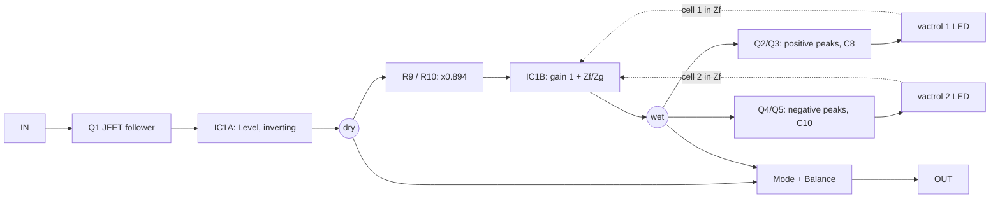

# Compressor research: Dinosaural OTC-201 (Aion Convex)

Research for an optical-compressor block in Ducky, modelled on the Dinosaural OTC-201 Opticompressor through its clone, the Aion FX Convex, and the spec of the block built from it (M11: `daisy/src/dsp/compressor.h`, covered by `tests/compressor_test.cpp` against `tools/comp_reference.py`, which is appendix B). The document covers how the circuit works, a vactrol model fitted to the datasheet, what a SPICE model of the circuit does, and a reduced DSP model with a Python reference implementation (appendix B) that was checked against SPICE. What M11 decided is under "Settings (as built)" and "Fitting it into Ducky"; the firmware's kernel is the reduced model in float32.

**Provenance of the numbers.** No pedal was measured. Four kinds of value appear, and each is marked:

- **schematic:** read from Aion's schematic or computed from its part values by hand;
- **datasheet:** read or digitised from the VTL5C4 datasheets;
- **SPICE:** from an ngspice-47 model of the schematic (netlist in appendix A) with generic transistor and op-amp models and the fitted vactrol. These are predictions, good for the shape of the behaviour and for regression targets, not for claims about a real unit;
- **model:** from the Python reference implementation of the reduced DSP model (appendix B), always quoted beside the SPICE value it should match.

## Summary

- **A variable-gain amplifier, not an attenuator.** The two photocells sit in the feedback path of a non-inverting op-amp stage, in parallel with the Sustain pot. The stage's gain is `1 + Zf/Zg`, so it runs from Sustain's maximum (up to +20.8 dB) down to unity and never below. Compression only ever removes gain the stage itself added.
- **Sustain is gain, and therefore threshold.** The side chain reads the stage's output and starts to act when that output reaches about 0.47 V peak (SPICE). More Sustain means a quieter input reaches that level: the input threshold moves from about 415 mV peak at 10 % to 59 mV peak at 100 %. Above threshold every Sustain setting lands on the same output curve.
- **The curve is convex.** About 5–6:1 just above threshold, 3:1 further up, and 1:1 again once the gain has fallen to unity (inputs near 1 V peak). Hard hits pass at unity instead of being squashed.
- **Two detectors, two vactrols.** One complementary transistor pair conducts on positive output peaks and drives one VTL5C4's LED, a mirrored pair does the same for negative peaks. No rectifier diodes; the threshold is a base-emitter voltage.
- **Level-dependent treble.** The gain stage's ground leg has a shelf (874 Hz / 1.94 kHz), so the added gain is up to 4 dB larger at 3 kHz than at 100 Hz. The emphasis shrinks with the gain, so quiet notes and decaying tails are brighter than loud ones.
- **Timing comes from the photocells.** Attack about 5–15 ms with the op-amp clipping the first cycle or two at high Sustain; release starts after about 50 ms and then recovers at roughly 16 dB/s (SPICE).
- **Clean in steady state.** Harmonic distortion below 0.1 % (SPICE): the character is dynamics and tone, not saturation.
- **Parallel blend built in.** Balance crossfades between the dry signal and the compressed one, or acts as a volume on the compressed signal alone.
- **Largest unknown:** the photocells work at 4–500 µA of LED current, below the range the datasheet charts. The static curve barely depends on that; the release rate does.
- **A reduced model exists and tracks SPICE.** Three one-pole sections, two detector halves and four slow states per block reproduce the SPICE static curve within 0.11 dB, its step responses within 0.4 dB and its gain on 6 s of guitar within 0.07 dB RMS ("Agreement with SPICE"). That shows the reduction is faithful to the netlist; it says nothing more about a real pedal than the netlist does.

## Sources

| Source | Used for |
|---|---|
| [Aion FX Convex project page](https://aionfx.com/project/convex-parallel-compressor/) and [build document 1.0.5](https://aionfx.com/app/files/docs/convex_documentation.pdf) | Schematic (page 7), parts list, control descriptions |
| [Aion tracing journal](https://aionfx.com/news/tracing-journal-dinosaural-otc-201-opticompressor/) and [OTC-201 schematic v1.1](https://aionfx.com/app/files/schematics/otc201_schematic.pdf) | The original's differences; measured transistor hFE |
| [PerkinElmer VTL5C3/VTL5C4 datasheet](https://aionfx.com/app/files/datasheets/xvive-vtl5c3-vtl5c4.pdf) (Aion's copy) | Single-cell VTL5C4 table and curves; everything in "VTL5C4 model" |
| [Xvive 5C4/2 datasheet](https://eadn-wc04-3257698.nxedge.io/audio/wp-content/uploads/sites/2/2021/11/Xvive-5C4-2-Data-Sheet.pdf) | Cross-check. It is the dual-cell part's sheet; the Convex uses the single-cell VTL5C4 |
| Eichas and Zölzer, [Modeling of an optocoupler-based audio dynamic range control circuit](https://www.hsu-hh.de/ant/wp-content/uploads/sites/699/2017/10/Eichas-Modeling-of-an-optocoupler-based-audio-dynamic-range-control-circuit-99480W.pdf) (SPIE 2016) | A grey-box model of another photocell-in-feedback guitar compressor (John Hollis' Flatline, VTL5C2): a measured static curve, attack and release times, one filter |

Not read (the downloads timed out), listed as further reading on vactrol models: Parker and D'Angelo, "A Digital Model of the Buchla Lowpass-Gate" (DAFx-13); Najnudel and Müller, "Power-Balanced Dynamic Modeling of Vactrols: Application to a VTL5C3/2" (DAFx23).

## The pedal's controls

| Control | Part | Function |
|---|---|---|
| Sustain | 100 kΩ linear pot | The gain stage's feedback resistor, 0–100 kΩ: maximum gain and so the threshold |
| Balance | 10 kΩ pot | Mode SB: crossfade from dry (CCW) to compressed (CW). Mode Z: volume of the compressed signal |
| Mode | SPDT toggle | Signal Blend (SB) or Direct (Z). Internal on the original |
| Level ("Axematch") | SPDT centre-off toggle | Gain ahead of the compressor: −3 dB, 0, +3 dB |
| Footswitch | | Buffered bypass on the original; the Convex adds an internal true-bypass option |

## Circuit



All part numbers are the Convex's. Voltages assume 9 V at the jack.

### Supply and bias (schematic, SPICE operating point)

| Rail | How | Value |
|---|---|---|
| VA | 9 V through D1 (1N5817) | about 8.7 V. The original uses a P-MOSFET (BSP315) instead, so about 9.0 V |
| VD | VA through R25 100 Ω, C14 100 µF: the op-amp and JFET supply | about 8.4 V |
| VB | R26 10 k over R27 1k8 + R28 8k2, C16 10 µF | VA / 2 = 4.35 V: the signal reference for both op-amp halves |
| VC | the tap between R27 and R28, C17 10 µF | 0.41 VA = 3.57 V: the JFET's gate bias |

The audio path is single-supply around VB. With a TL072 on 8.4 V the outputs swing about +2.5 V / −2.85 V around VB (assuming 1.5 V from each rail; not from a measurement).

### Input buffer: Q1

- RPD 2M2 to ground, R1 10 k, C1 33 nF into the gate of Q1 (J113), R2 1 M to VC, D2/D3 clamps to VA and ground. The high-pass corner of C1 into R2 is 4.8 Hz; the input impedance is about 690 kΩ (RPD ∥ R2).
- Q1 is a source follower (drain VD, R3 10 k to ground; source at 4.7 V, 0.47 mA). C2 470 nF couples it to the Level stage: a 33 Hz high-pass into R5 (49 Hz in the +3 dB position, where the load is 7 kΩ).
- Follower gain into that load: 0.94 (−0.56 dB, SPICE, with a typical J113 model). J113s spread widely, so a real one may sit anywhere from about 0.90 to 0.97 (estimate).

### Level stage: IC1A

An inverting amplifier around VB: R5 10 k in, R8 10 k with C3 330 pF (48 kHz) in the feedback. The Level switch moves R6 13 k:

| Position | Network | Gain |
|---|---|---|
| centre | R8 / R5 | ×1.00 |
| boost | R4 10 k + R6 13 k in parallel with R5 | ×1.435 by the resistors, ×1.415 (+3.0 dB) in SPICE with the follower's output resistance |
| cut | R6 13 k + R7 10 k in parallel with R8 | ×0.697 (−3.2 dB in SPICE) |

Its output is the **dry** signal, inverted. D4/D5 clamp it to the rails. It feeds two places: the gain stage, and through R23 180 Ω, C12 1 µF and R24 39 k the dry end of the Balance pot (and the buffered-bypass output).

### Gain stage: IC1B

- **Input:** R9 39 k to pin 5, then C4 220 nF and R10 330 k to ground. With the effect on, C4's lower end floats on R10, so the stage sees the dry signal times 330/(330 + 39) = **0.894** above 2 Hz. The footswitch pole that lights the LED grounds that node ("FX GND") in its other position, read here as bypass: C4 then shunts the input to ground (an 18 Hz low-pass), so the compressed path is muted while bypassed and the side chain goes dark.
- **Ground leg `Zg`** (pin 6 to VB): R11 10 k in parallel with R12 8k2 + C5 10 nF. 10 kΩ at low frequencies, 4.5 kΩ at high: a shelf with its zero at 874 Hz and its pole at 1.94 kHz.
- **Feedback `Zf`** (pin 7 to pin 6): the Sustain pot as a rheostat (0–100 kΩ), both photocells and C6 330 pF, all in parallel.

$$G(s) = 1 + \frac{Z_f}{Z_g},\qquad \frac{1}{Z_f} = \frac{1}{R_{sus}} + \frac{1}{R_{cell1}} + \frac{1}{R_{cell2}} + sC_6,\qquad \frac{1}{Z_g} = \frac{1}{R_{11}} + \frac{sC_5}{1 + sR_{12}C_5}$$

Stage gain in dB against the resistive part of the feedback `Rf` (schematic, computed):

| `Rf` | 100 Hz | 400 Hz | 1 kHz | 2 kHz | 3 kHz | 5 kHz | 10 kHz | 20 kHz |
|---|---|---|---|---|---|---|---|---|
| 100 kΩ | 20.9 | 21.4 | 23.1 | 24.6 | 24.8 | 23.8 | 20.1 | 14.9 |
| 50 kΩ | 15.6 | 16.1 | 17.7 | 19.6 | 20.2 | 20.2 | 18.5 | 14.6 |
| 25 kΩ | 10.9 | 11.3 | 12.7 | 14.5 | 15.2 | 15.7 | 15.3 | 13.3 |
| 10 kΩ | 6.0 | 6.3 | 7.3 | 8.6 | 9.3 | 9.8 | 9.9 | 9.6 |
| 5 kΩ | 3.5 | 3.7 | 4.3 | 5.3 | 5.8 | 6.2 | 6.4 | 6.3 |
| 2 kΩ | 1.6 | 1.7 | 2.0 | 2.5 | 2.8 | 3.0 | 3.1 | 3.2 |
| 1 kΩ | 0.8 | 0.9 | 1.0 | 1.3 | 1.5 | 1.6 | 1.7 | 1.7 |

- At full gain the response peaks 4 dB above its low-frequency value at 2.7 kHz and C6 then rolls it off (its pole is at 4.8 kHz for 100 kΩ and moves up as `Rf` falls).
- As `Rf` falls the emphasis shrinks towards nothing: at unity gain the stage is flat.
- Sustain fully counter-clockwise (by the usual pin numbering) shorts the feedback: the stage is a unity follower and the photocells do nothing.

### Side chain: two peak detectors

Both read the gain stage's output (pin 7), so this is a feedback compressor.

| | Positive half | Negative half |
|---|---|---|
| Coupling | C7 33 nF, R13 4k7, R14 100 k to ground | C9 33 nF, R17 4k7, R18 100 k to VA |
| Pair | Q2 NPN (BC549C) driving Q3 PNP (BC307B) | Q4 PNP (BC307B) driving Q5 NPN (BC549C) |
| Emitter resistor | R16 180 Ω to ground | R19 180 Ω to VA |
| Reservoir | C8 10 µF from the LED's cathode to ground | C10 10 µF from the LED's anode to ground |
| LED feed | VA, R15 2k2, LED 1, C8 | C10, LED 2, R20 2k2, ground |

- **Each pair is a compound (Sziklai) transistor** with its base biased at the rail it conducts towards, so it is off at rest. Its emitter follows the base less one base-emitter drop, and the 180 Ω resistor turns that voltage into current: about `(0.955·v − 0.5 V) / 180 Ω` while the output `v` is beyond the threshold (0.955 is R14 against R13). The first transistor carries only 1/β of the current, so the drop is small: 0.40 V at 10 µA, 0.52 V at 1 mA.
- **Coupling:** C7 into R13 + R14 is a 46 Hz high-pass, so the lowest notes are detected a little less (0.7 dB more output at 82 Hz than at 330 Hz, SPICE).
- **Reservoir and LED:** the positive pair pulls current out of C8, lowering the LED's cathode; the LED and R15 then refill it from VA. The negative pair is the mirror image: it charges C10, which drains through LED 2 and R20. The LED current is the voltage across the 2k2 resistor, so it follows the reservoir.
  - Charging has no time constant of its own: the pair is a current source of up to several mA into 10 µF (0.1 V per 0.5 ms at 2 mA).
  - Draining is R15 × C8 = 22 ms while the LED conducts well, and slower as the LED current falls towards zero (the LED's own resistance rises).
  - The LED current cannot exceed about (VA − 1.5 V − 0.9 V) / 2k2 ≈ 2.9 mA.
- **Cells:** each LED lights its own cell, and both cells sit in parallel across the Sustain pot. Their conductances add, so an asymmetric waveform is governed by its larger half.

### Output, Mode and Balance

- **Wet:** pin 7 through R21 180 Ω and C11 1 µF, R22 39 k to ground, to the clockwise end of the Balance pot. The pot loads that node: in Mode Z its 10 kΩ goes to ground, so C11 sees 8 kΩ and the output high-pass is about 20 Hz (−0.2 dB at 82 Hz). D6/D7 clamp the op-amp output to the rails (protection only).
- **Mode SB:** the pot's counter-clockwise end is the dry signal: `out = (1 − x)·dry + x·wet`, with `x` the wiper's position along the track.
- **Mode Z:** the counter-clockwise end is grounded: `out = x·wet`.
- **Polarity:** dry and wet are in phase with each other, and both are inverted against the input.
- **Taper:** the trace of the original lists Balance as 10 kΩ linear; Aion's document changed it to audio taper in revision 1.0.3 while its text says the centre is 50/50. An audio taper puts `x` near 0.1–0.15 at noon. Unresolved.

### Response from jack to output (schematic, computed)

Gain in dB from the jack to the output in Mode Z with Balance full up and Level at centre, for a fixed feedback resistance `Rf`: the buffer and its 33 Hz coupling, the 0.894 divider, the gain stage and the 20 Hz output coupling. `Rf` 100 kΩ is Sustain at maximum below threshold; a smaller `Rf` is less Sustain or more compression.

| Hz | `Rf` 100 kΩ | 50 kΩ | 25 kΩ | 10 kΩ | 2 kΩ | 0 (unity) | Dry |
|---|---|---|---|---|---|---|---|
| 20 | +10.5 | +5.3 | +0.6 | −4.3 | −8.7 | −10.3 | −9.3 |
| 30 | +14.3 | +9.0 | +4.3 | −0.5 | −5.0 | −6.5 | −5.6 |
| 50 | +17.1 | +11.9 | +7.2 | +2.3 | −2.1 | −3.7 | −2.7 |
| 82 | +18.5 | +13.2 | +8.5 | +3.6 | −0.8 | −2.4 | −1.4 |
| 120 | +19.0 | +13.7 | +9.0 | +4.1 | −0.3 | −1.9 | −1.0 |
| 200 | +19.3 | +14.1 | +9.3 | +4.4 | 0.0 | −1.7 | −0.7 |
| 400 | +19.8 | +14.5 | +9.8 | +4.8 | +0.1 | −1.5 | −0.6 |
| 800 | +21.0 | +15.7 | +10.7 | +5.4 | +0.4 | −1.5 | −0.5 |
| 1200 | +22.0 | +16.7 | +11.7 | +6.1 | +0.6 | −1.5 | −0.5 |
| 2000 | +23.1 | +18.1 | +13.0 | +7.1 | +1.0 | −1.5 | −0.5 |
| 3000 | +23.3 | +18.7 | +13.7 | +7.8 | +1.3 | −1.5 | −0.5 |
| 4000 | +22.9 | +18.8 | +14.0 | +8.1 | +1.4 | −1.5 | −0.6 |
| 6000 | +21.4 | +18.4 | +14.1 | +8.3 | +1.5 | −1.6 | −0.6 |
| 8000 | +19.9 | +17.7 | +13.9 | +8.3 | +1.5 | −1.6 | −0.6 |
| 12000 | +17.0 | +15.9 | +13.2 | +8.1 | +1.4 | −1.8 | −0.8 |
| 16000 | +14.7 | +14.1 | +12.2 | +7.8 | +1.2 | −1.9 | −1.0 |
| 20000 | +12.7 | +12.4 | +11.1 | +7.4 | +1.0 | −2.2 | −1.2 |

- Every curve is 3 dB down (against 400 Hz) near 45 Hz, whatever the gain.
- At 100 kΩ the peak is +3.5 dB over 400 Hz at 2.7 kHz and the response is 3 dB under 400 Hz again at 12 kHz. The peak moves to 3.9, 5.3 and 7.2 kHz at 50, 25 and 10 kΩ, and the top-end roll-off leaves the audio band.

### Original, clone, successor

| | OTC-201 (trace) | Convex | ThorpyFX Fat General |
|---|---|---|---|
| Polarity protection | BSP315 P-MOSFET | 1N5817 | not traced |
| Supply caps C13/C14 | 47 µF | 100 µF | |
| Transistors | BC549C (hFE 417, 427), BC307B (hFE 257, 266) | 2N5088, 2N3906 | |
| Mode switch | internal | on the face | |
| Bypass | buffered | buffered or true (internal switch) | |
| Extra | | | a Treble control, otherwise "basically the same circuit" (Aion) |

## VTL5C4 model

### Datasheet

| | PerkinElmer VTL5C4 | Xvive 5C4/2 |
|---|---|---|
| On resistance | 1.2 kΩ at 1 mA, 125 Ω at 10 mA, 75 Ω at 40 mA (dark adapted) | 1.3 kΩ at 0.5 mA, 300 Ω at 5 mA (after a week dark) |
| Off resistance | 400 MΩ minimum, 10 s after turn-off | "400 KΩ" (inconsistent with its own decay line; read as a misprint) |
| Turn-on | 6 ms to 63 % of the final on-resistance | 6 ms to 63 % of the final conductance at 16 mA |
| Turn-off | 1.5 s maximum to 100 kΩ | 1.5 s to 1 MΩ |
| LED | 1.65 V typical at 20 mA | "1 mA at 1.6–1.8 V" |
| Slope R(0.5 mA) / R(5 mA) | 18.7 | 4.3 from its table |

PerkinElmer's note 1: "At 1.0 mA and below, units may have substantially higher resistance than shown in the typical curves."

### Resistance against LED current (datasheet, digitised)

From PerkinElmer's "Output Resistance vs. Input Current" at 25 °C. Curve 1 is after 24 hours dark, curve 2 after 24 hours at 40 mA. The response-time curves below were taken in curve 2's condition.

| LED mA | 0.3 | 0.5 | 1 | 2 | 3 | 5 | 10 | 20 | 40 |
|---|---|---|---|---|---|---|---|---|---|
| Curve 1 (dark adapted), Ω | 6100 | 2880 | 1165 | 515 | 330 | 209 | 128 | 91 | 75 |
| Curve 2 (light adapted), Ω | — | 4800 | 1670 | 650 | 420 | 263 | 156 | 103 | 80 |

Fits of `R(n) = Rmin + A · n^(−p)` (`n` in mA, least squares in log R over 0.3–40 mA):

| | `Rmin` | `A` | `p` | RMS error |
|---|---|---|---|---|
| Curve 1 | 70 Ω | 1124 Ω | 1.34 | 3.2 % |
| Curve 2 (the model's) | 75 Ω | 1711 Ω | 1.42 | 7.1 % |

The pedal runs the cells at 0.004–0.5 mA (below), where the fit is an extrapolation: 45 kΩ at 0.1 mA, 250 kΩ at 0.03 mA, 1.2 MΩ at 0.01 mA for curve 2.

### Dynamics (datasheet, digitised and fitted)

The cell's state is `n`, the steady LED current (mA) that would give its present resistance: `R = R(n)` at all times. PerkinElmer's "Response Time" curves (turn-on and turn-off at 10 and 40 mA), mapped from resistance to `n` through curve 2:

| Turn-off from 40 mA, ms | 20 | 40 | 75 | 115 | 175 | 250 | 350 | 450 | 550 | 690 |
|---|---|---|---|---|---|---|---|---|---|---|
| R | 400 Ω | 620 Ω | 1.0 k | 1.7 k | 3.0 k | 5.7 k | 11 k | 21 k | 38 k | 80 k |
| `n`, mA | 3.16 | 2.09 | 1.44 | 0.99 | 0.68 | 0.45 | 0.29 | 0.20 | 0.13 | 0.08 |

- **Decay.** The local time constant grows as the cell darkens (about 50 ms near 2.6 mA, 300 ms near 0.1 mA), and the 10 mA and 40 mA curves come within 20 % of each other after 50 ms. A linear plus a bimolecular term fits both curves from 20 ms on within 5.7 % RMS in `n`:

  $$\frac{dn}{dt} = -(n - I)\left(\frac{1}{\tau_s} + k\,n\right)\quad (I < n),\qquad \tau_s = 0.43\ \text{s},\quad k = 6.0\ \text{mA}^{-1}\text{s}^{-1}$$

  It reaches 100 kΩ after about 0.8 s (the digitised curve: about 0.74 s) and 1 MΩ after about 1.5 s, which agrees with both datasheets' turn-off lines. The first 20 ms after a 10–40 mA drive fall faster than the fit; the pedal never drives the LEDs that hard.
- **Rise.** At 10 mA `n` climbs about 0.9 mA per ms and at 40 mA about 4 mA per ms: roughly a one-pole approach,

  $$\frac{dn}{dt} = \frac{I - n}{\tau_{on}}\quad (I \ge n),\qquad \tau_{on} \approx 10\ \text{ms}$$

  (26–27 % RMS in `n` against both curves; 6 ms and 15 ms are clearly worse). There is no data below 10 mA, and photocells are generally slower at low light.
- **LED** (from PerkinElmer's "Input Characteristics": 2 mA at 1.50 V, 20 mA at 1.62 V, 50 mA at 1.72 V): a diode with `Is` 2.1e-22 A, emission coefficient 1.32, series resistance 2.3 Ω.
- **Not modelled:** light-history drift between curves 1 and 2, temperature (about 1 %/°C), unit spread, the cell's own voltage non-linearity and noise.

## Simulated behaviour (SPICE)

The appendix A netlist: the whole audio path and both side chains, VA 8.7 V, the vactrol model above (curve 2, `τon` 10 ms). Sine inputs at the jack, Level at 0 dB, levels in volts peak. Ducky's input reaches 0 dBFS at +4.5 dBu (1.84 V peak, `docs/FIRMWARE.md` "Input calibration"), which the dBFS column uses.

### Static curve

Steady state after 1.5 s at 330 Hz. Wet output in mV peak, with its gain against the jack in dB in brackets; S is the Sustain pot's resistance in percent of 100 kΩ.

| In, mV | dBu | dBFS | Dry | S 10 | S 25 | S 50 | S 75 | S 100 |
|---|---|---|---|---|---|---|---|---|
| 10 | −40.8 | −45.3 | 9 | 17 (+4.7) | 30 (+9.6) | 52 (+14.4) | 74 (+17.4) | 96 (+19.7) |
| 20 | −34.8 | −39.3 | 19 | 34 (+4.7) | 60 (+9.6) | 104 (+14.4) | 148 (+17.4) | 192 (+19.6) |
| 50 | −26.8 | −31.3 | 47 | 86 (+4.7) | 152 (+9.6) | 262 (+14.4) | 372 (+17.4) | 473 (+19.5) |
| 100 | −20.8 | −25.3 | 94 | 171 (+4.7) | 303 (+9.6) | 502 (+14.0) | 553 (+14.9) | 569 (+15.1) |
| 200 | −14.8 | −19.3 | 187 | 342 (+4.7) | 553 (+8.9) | 612 (+9.7) | 627 (+10.0) | 634 (+10.0) |
| 316 | −10.8 | −15.3 | 296 | 533 (+4.5) | 646 (+6.2) | 676 (+6.6) | 685 (+6.7) | 689 (+6.8) |
| 501 | −6.8 | −11.3 | 470 | 695 (+2.8) | 745 (+3.4) | 761 (+3.6) | 767 (+3.7) | 769 (+3.7) |
| 1000 | −0.8 | −5.3 | 936 | 1007 (+0.1) | 1021 (+0.2) | 1026 (+0.2) | 1027 (+0.2) | 1028 (+0.2) |
| 1585 | +3.2 | −1.3 | 1481 | 1427 (−0.9) | 1431 (−0.9) | 1432 (−0.9) | 1433 (−0.9) | 1433 (−0.9) |

| Sustain | Gain below threshold | Input for 1 dB of reduction | Largest reduction |
|---|---|---|---|
| 0 % | −1.5 dB (0.94 × 0.894, flat) | none | 0 |
| 10 % | +4.7 dB | 415 mV (−12.9 dBFS) | 6.0 dB |
| 25 % | +9.6 dB | 208 mV (−18.9 dBFS) | 11.0 dB |
| 50 % | +14.4 dB | 114 mV (−24.2 dBFS) | 15.7 dB |
| 75 % | +17.4 dB | 78 mV (−27.4 dBFS) | 18.8 dB |
| 100 % | +19.7 dB | 59 mV (−29.8 dBFS) | 21.0 dB |

- **Threshold:** the LEDs start to conduct when the wet output reaches about 0.47 V peak (−11.9 dBFS). The 1 dB points all sit at 0.51–0.63 V of output.
- **Ratio at Sustain 100 %:** 5.0:1 from 63 to 100 mV, 6.0:1 from 100 to 316 mV, 2.9:1 from 316 mV to 1 V, 1.4:1 from 1 to 1.6 V, 1.1:1 above.
- **Ceiling:** between threshold and a 1 V input the wet output moves from 0.47 V to 1.03 V, 6.8 dB for up to 26 dB of input.
- **Above the range:** past about 1.5 V of input the stage is at unity and the wet signal is the input less 0.9 dB.
- **The linear pot is not linear in dB:** half of the gain range is in the first quarter of the rotation.

### Inside the loop (Sustain 100 %, 330 Hz)

| Wet, mV peak | LED 1 / LED 2, µA | Cell 1 / cell 2 | Feedback `Rf` |
|---|---|---|---|
| 473 | 3.8 / 0.0 | 4.7 M / — | 98 k |
| 519 | 14 / 6 | 690 k / 2.3 M | 84 k |
| 569 | 37 / 21 | 179 k / 396 k | 55 k |
| 634 | 81 / 57 | 58 k / 97 k | 27 k |
| 689 | 128 / 98 | 31 k / 45 k | 15 k |
| 769 | 207 / 171 | 15 k / 20 k | 8.0 k |
| 1028 | 520 / 473 | 4.2 k / 4.8 k | 2.2 k |
| 1433 | 1089 / 1034 | 1.5 k / 1.6 k | 0.79 k |

The LEDs run at tens to hundreds of µA and the cells at kilohms to megohms. The two halves differ because the two pairs' thresholds differ in the generic transistor models; a real unit's halves will differ too, by its own tolerances.

### Frequency

Sustain 100 %:

| | 82 Hz | 110 Hz | 330 Hz | 1 kHz | 3 kHz |
|---|---|---|---|---|---|
| Gain below threshold, dB against the jack | 18.7 | 19.0 | 19.7 | 21.5 | 23.1 |
| Input at which the LEDs start, mV | 63 | 63 | 50 | 40 | 32 |
| Wet at 100 mV in, mV | 616 | 593 | 569 | 585 | 610 |
| Wet at 316 mV in, mV | 740 | 714 | 689 | 708 | 746 |

Below threshold the response has the gain stage's tilt (4.4 dB from 82 Hz to 3 kHz, part of it the 33 Hz input high-pass). In compression the output is within 0.7 dB across the same range: the loop levels the output whatever the frequency, so the treble emphasis is heard on quiet material and on tails, and high notes start compressing at a lower input.

### Attack and release

A 330 Hz tone stepped up for 1 s and back; the gain is wet against dry, per cycle (3 ms resolution).

| Sustain, step | Gain before → during | 90 % of the reduction | Settled within 1 dB | Release: 25 / 50 / 75 / 90 % recovered |
|---|---|---|---|---|
| 100 %, 30 → 300 mV | 20.2 → 7.7 dB | 8 ms | 162 ms | 0.20 / 0.40 / 0.67 / 0.99 s |
| 100 %, 10 mV → 1 V | 20.2 → 0.8 dB | 11 ms | 11 ms | 0.33 / 0.59 / 0.90 / 1.23 s |
| 50 %, 30 → 300 mV | 14.9 → 7.5 dB | 14 ms | 102 ms | 0.17 / 0.33 / 0.58 / 0.88 s |

- **Attack:** the first cycle comes through at full gain. At Sustain 100 % the op-amp clips it (+2.51 / −2.66 V around VB in the first case; any step that would exceed about 2.5 V, so from silence to more than about 270 mV). The burst over-charges the reservoir, so the gain reaches its target within 3–5 cycles.
- **Overshoot:** in the +20 dB steps the gain then dips 2–3 dB below its final value (at Sustain 100 %, wet 0.49 V against a final 0.68 V) and takes 100–160 ms to come back. The step to 1 V has no dip because the gain is already at unity.
- **Release:** the gain holds for the first 50 ms (+0.1 to +0.5 dB) while the reservoir still feeds the LED, then rises at about 16 dB/s (1.8 dB at 100 ms, 8.9 dB at 500 ms, 16.5 dB at 1 s in the second case), and flattens as it nears the Sustain gain. The cell's resistance grows exponentially in time, which is a steady rate in dB.

Gain in dB (wet against dry) through the same three steps. The model column of "Agreement with SPICE" is checked against these.

| | 100 %, 30 → 300 mV | 100 %, 10 mV → 1 V | 50 %, 30 → 300 mV |
|---|---|---|---|
| Before | 20.2 | 20.2 | 14.9 |
| Cycle 1 (0–3 ms) | 19.4 | 9.3 (clipped) | 14.9 |
| Cycle 2 | 14.1 | 8.3 (clipped) | 14.7 |
| Cycle 3 | 8.2 | 3.3 | 12.3 |
| Cycle 4 | 6.0 | 1.7 | 9.3 |
| Cycle 5 | 5.1 | 1.1 | 7.4 |
| Cycle 6 | 4.8 | 0.8 | 6.5 |
| Lowest | 4.77 at 20 ms | 0.53 at 32 ms | 5.87 at 26 ms |
| 50 ms | 5.0 | 0.6 | 6.0 |
| 100 ms | 5.8 | 0.6 | 6.5 |
| 200 ms | 7.2 | 0.8 | 7.3 |
| 500 ms | 7.7 | 0.8 | 7.5 |
| After the step down: 20 ms | 7.8 | 0.9 | 7.6 |
| 50 ms | 8.2 | 1.2 | 7.9 |
| 100 ms | 9.0 | 1.8 | 8.5 |
| 200 ms | 10.9 | 3.4 | 9.8 |
| 500 ms | 15.4 | 8.9 | 12.6 |
| 1 s | 19.0 | 16.5 | 14.4 |
| 1.5 s | 20.0 | 19.4 | 14.8 |
| 2 s | 20.2 | 20.0 | 14.9 |
| Wet peaks, cycles 1–6, V | 2.58, 1.41, 0.72, 0.56, 0.51, 0.49 | 2.70, 2.42, 1.36, 1.14, 1.06, 1.03 | 1.55, 1.51, 1.16, 0.82, 0.66, 0.59 |
| Op-amp output extremes around VB, V | +2.51 / −2.66 | +2.51 / −2.84 | +1.67 / −1.49 |

### Detector transfer

A DC sweep of each pair alone: the current it takes from its reservoir against the drive `u` at its base (the output's excursion towards that pair, after the 46 Hz coupling and the 0.955 divider).

| `u`, V | 0.35 | 0.40 | 0.45 | 0.50 | 0.55 | 0.60 | 0.70 | 0.80 | 1.0 | 1.5 | 2.0 |
|---|---|---|---|---|---|---|---|---|---|---|---|
| Positive pair (Q2/Q3), µA | 0.4 | 5.4 | 41 | 151 | 327 | 538 | 1008 | 1507 | 2544 | 5217 | 7930 |
| Negative pair (Q4/Q5), µA | 0.1 | 1.5 | 15 | 78 | 217 | 407 | 858 | 1350 | 2379 | 5045 | 7757 |

- Both follow `u = 0.9·VT·ln(1 + i/I0) + R·i` (`VT` 25.85 mV) within 3 % of the current a sine delivers per cycle: `I0` 0.219 pA and `R` 180 Ω for the positive pair, 0.063 pA and 182 Ω for the negative.
- The 20 mV between the two thresholds comes from the generic transistor models (the PNP's saturation current is the lower). A real unit's mismatch is unknown.

### Distortion and sensitivity

| Check | Result |
|---|---|
| THD of the wet signal in steady state, 100 and 300 mV in, 80 Hz / 330 Hz / 1 kHz | 0.02–0.08 %, second harmonic, the same as the dry signal's: it is the JFET follower's. Third harmonic −68 dB at 80 Hz (probably reservoir ripple), below −90 dB at 330 Hz and 1 kHz |
| Dark-adapted cell (curve 1) instead of curve 2 | static curve within 0.6 dB; 90 % attack 8 ms; release 0.24 / 0.46 / 0.77 / 1.11 s |
| Cell rise `τon` 30 ms instead of 10 ms | 90 % attack 11 ms instead of 8 ms; release unchanged |
| Level switch | dry ×1.415 / ×0.69 against centre |
| Largest input before the Level stage clips at +3 dB | about 1.9 V peak, just above Ducky's full scale |

The loop overdrives the LEDs on an attack, which hides the cell's rise time. The static curve is set by the detector's threshold and transconductance and hardly by the cell. The release is the cell's decay law almost alone.

## DSP model

A reduced state model of the circuit, not a fitted gain curve: the audio path as three one-pole sections with a time-varying feedback conductance, and the side chain, reservoirs and cells as slow states updated once per block. Appendix B is a reference implementation of exactly this (Python, float64); where this section and the code differ, the code is what was checked.

### Conventions

- **Units:** volts inside. `kVfs` = 1.8395 V per unit sample (0 dBFS = +4.5 dBu, `docs/FIRMWARE.md` "Input calibration").
- **Polarity:** internal signals keep the circuit's polarity, so dry and wet are inverted against the input and each detector half sees the peaks it sees in the pedal. The output sign is flipped back, so the block does not invert (the pedal does).
- **Rates:** 48 kHz; the slow states step once per 24-sample block (`Tb` = 0.5 ms).
- **Filters:** TPT one-poles as in `daisy/src/dsp/filters.h`: `G = g/(1 + g)`, `g = tan(π f / fs)`; `a = (x − s)·G`, `lp = a + s`, `s = lp + a`, `hp = x − lp`.

### Constants

| Symbol | Value | From |
|---|---|---|
| `gB` | 0.9416 | Q1 follower into the Level stage (SPICE) |
| `fin` | 32.7 Hz; 46.2 Hz with Level at +3 dB | C2 into R5, or into R5 ∥ (R4 + R6) |
| `gL` | 0.697 / 1.0 / 1.413 | Level cut / centre / boost |
| `kdiv` | 0.894 | R10 / (R9 + R10) |
| `R11`, `R12`, `C5` | 10 kΩ, 8.2 kΩ, 10 nF (1941 Hz) | ground leg |
| `A2` | `2·C6·fs` = 31.68 µS | C6 330 pF, trapezoidal |
| Clip | −2.85 V, +2.50 V around VB | op-amp output, 1.5 V inside each rail of 8.37 V |
| `fdet`, `kdet` | 46.1 Hz, 0.955 | C7/C9 into R13 + R14; R14 / (R13 + R14) |
| Pair knee `V1`, `Δ` | positive 0.385 V, 0.120 V; negative 0.405 V, 0.135 V | fitted to "Detector transfer" |
| Pair slope `Rq` | 190 Ω | the same fit (180 Ω plus the rising base-emitter drop) |
| Reservoir `C`, `w0`, `wmax` | 10 µF, 0.95 V, 7.8 V | C8/C10; the netlist's resting point; VA − 0.9 V |
| LED | `RL` 2202.3 Ω, `nVT` 34.12 mV, `Is` 2.1e-22 A | R15/R20 + 2.3 Ω; "VTL5C4 model" |
| Cell dynamics | `τon` 10 ms, `τs` 0.43 s, `k` 6 /(mA·s) | "VTL5C4 model" |
| Cell resistance | `Rmin` 75 Ω, `A` 1711 Ω, `p` 1.42; `n` at least 1e-6 mA | curve 2 |
| `Rsus` | Sustain × 100 kΩ | linear pot |

### Per sample

| Step | Equation | From |
|---|---|---|
| Input | `v = kVfs · x` | calibration |
| Coupling | `hp = v − LP(v, fin)` | C2 |
| Dry | `vd = −gL · gB · hp` | Q1, IC1A |
| Stage input | `vp = kdiv · vd` | R9, R10 |
| Ground-leg current | `vc5 = LP(vp, 1941 Hz)`; `ig = vp / R11 + (vp − vc5) / R12` | R11, R12, C5 |
| Feedback conductance | `Gf` moves linearly towards the block's target, reaching it on the block's last sample | |
| Feedback | `vf = ((A2 − Gf′)·vf′ + ig + ig′) / (A2 + Gf)`, primes for the previous sample | C6, Sustain, cells |
| Wet | `vo = clamp(vp + vf, −2.85, +2.50)`, then `vf = vo − vp` | IC1B and its rails |
| Detector drive | `u = kdet · (vo − LP(vo, fdet))` | C7/C9, R13/R14 |
| Pair currents | `Q+ += q+(u) · T`, `Q− += q−(−u) · T` | Q2–Q5, R16/R19 |
| Mix | SB: `m = (1 − b)·vd + b·vo`; Z: `m = b·vo`; `y = −m / kVfs` | Mode, Balance |

`q(u) = (t² / (4Δ) + max(u − V1 − 2Δ, 0)) / Rq` with `t = clamp(u − V1, 0, 2Δ)`: zero below `V1`, a parabola over the next `2Δ`, then a straight line of slope `1/Rq` that meets the parabola with the same slope. It needs only `fmax`/`fmin`, no branch.

### Per block, for each half

In this order:

| Step | Equation |
|---|---|
| Reservoir | `w = min(w + (Q − iled · Tb) / C, wmax)`; `Q = 0` |
| LED current | `iled` solves `w = RL · i + nVT · ln(1 + i / Is)`: 3 Newton steps from the last value |
| Cell, rising | `n += Tb · (I − n) / τon` when `I > n` (`I` = `iled` in mA) |
| Cell, falling | `n −= Tb · (n − I) · (1/τs + k · n)` otherwise; then `n = max(n, 1e-6)` |
| Cell conductance | `Gcell = 1 / (Rmin + A · n^(−p))` |

Then `Gf target = 1/Rsus + Gcell+ + Gcell−`.

State: 3 filter states, `vf`, `ig′`, `Gf` and its target, and per half `w`, `iled`, `n`, `Q`. Reset: filter states 0, `w = w0`, `iled = 0`, `n` at its floor, `Gf = 1/Rsus`.

### Choices, and what each was checked against

- **Feedback pole, trapezoidal in conductance form.** Against the gain table: within 0.15 dB up to 5 kHz for every `Rf`; at 100 kΩ −0.6 dB at 8 kHz, −1.1 dB at 10 kHz and −4 dB at 16 kHz (the bilinear warp; smaller at lower `Rf`). Backward Euler is already 1.0 dB low at 5 kHz. Once `Gf` exceeds `A2` (`Rf` below 32 kΩ) the pole is negative; the form stays stable there, and the 25, 10 and 2 kΩ rows were checked in that region.
- **Knee.** The parabolic knee gives the per-cycle current of the SPICE pairs within 8 % (positive) and, between 0.46 and 0.52 V of drive only, up to 26 % (negative). The static curve does not notice: the implicit form of "Detector transfer" (4 Newton steps per sample) changes the worst error from 0.11 dB to 0.10 dB. A hard knee at 0.5 V delivers nothing up to 0.50 V of drive and a third too little at 0.56 V.
- **Block order.** Charge first, then the LED from the new reservoir voltage, then the cell. Solving the LED before adding the charge delays the cell by a block and deepened the attack dip by 1 dB.
- **`Gf` ramp.** Linear over the following block, so the gain has no steps. Jumping to the target instead tracks SPICE's attack 0.2 dB closer but steps the gain 2,000 times a second.
- **Clipping** breaks the op-amp's loop; clamping `vo` and resetting `vf = vo − vp` reproduces SPICE's clip levels and recovery.
- **Sustain at 0** bypasses the feedback (`vf = 0`): the wet signal is the dry one times 0.894, −1.54 dB against the jack, flat.
- **No delay-free loop:** `Gf` depends on the output only through block-rate states.
- **Silence:** `n` sits on its floor (`Gcell` under 1e-11 S) and `w` creeps down: 1.20 V 1 s after a tone, 1.15 V after 4 s, 1.09 V after 20 s (the netlist: 1.20 V and 1.15 V at 1 s and 3.9 s). After a long silence the first note has to lift `w` by 0.3 V (3 µC) before the LED conducts; the steps above start from that state.
- **Artefacts of the block rate:** with a 330 Hz tone (not a divisor of the 2 kHz block rate) the wet signal carries inharmonic components at −71 dB (300 mV in) and −76 dB (100 mV). At 80 Hz and 1 kHz there are none. The third harmonic at 80 Hz, 300 mV is −68.1 dB against SPICE's −67.9 dB: the reservoir's ripple, which belongs to the circuit.
- **float32:** checked at M11. The kernel in float32 (conductances in S, charges in C, libm `log1pf` and `powf`) follows the float64 reference within 4.4e-6 of full scale on the three steps and 5.4e-7 on a synthetic DI (`tests/compressor_test.cpp`), so neither scaling nor tables were needed.

### Agreement with SPICE

The reference implementation against the appendix A netlist. It measures the reduction, not the pedal.

| Test | Result |
|---|---|
| Static curve at 330 Hz: 5 Sustain settings × 9 levels, 10 mV to 1.6 V | worst error 0.11 dB |
| 100 mV at 82 Hz, 110 Hz, 1 kHz, 3 kHz, Sustain 100 % | +0.04, +0.05, +0.08, +0.10 dB |
| Level switch, 10 mV in: dry / wet in mV | boost 13.18 / 135.5 (SPICE 13.3 / 136.0); centre 9.37 / 96.3 (9.4 / 96.1); cut 6.53 / 67.1 (6.5 / 67.0) |
| Steps, gain per cycle, first 30 ms | within 0.40, 0.21, 0.21 dB (the three steps in table order) |
| Steps, 30 ms to 1 s | within 0.33, 0.05, 0.13 dB |
| Steps, release from 20 ms on | within 0.09, 0.02, 0.09 dB |
| Steps, time to 50 % and 90 % of the reduction | the same cycle as SPICE in all three |
| Steps, lowest gain | 4.44 (SPICE 4.77), 0.49 (0.53), 5.74 (5.87) dB |
| Steps, output extremes | +2.50 / −2.68, +2.50 / −2.85, +1.66 / −1.50 V (SPICE +2.51 / −2.66, +2.51 / −2.84, +1.67 / −1.49) |
| Guitar DI, 6 s (`renders/stimuli/guitar_di.wav` from 0.8 s, scaled to 0.53 V peak), Sustain 100 %: low-frequency stage gain, which SPICE moves between 4.5 and 20.8 dB | RMS difference 0.07 dB, 99th percentile 0.20 dB, largest 0.75 dB |
| The same at Sustain 50 % (5.5 to 15.6 dB) | RMS 0.03 dB, 99th percentile 0.10 dB, largest 0.25 dB |
| Guitar DI, wet level in 10 ms windows | RMS difference 0.08 dB (100 %) and 0.04 dB (50 %), largest 0.25 dB |
| Guitar DI, wet waveform error against the wet signal | −28.5 dB (100 %), −29.3 dB (50 %) |

The waveform error is mostly not the compressor: the dry path alone differs by −30.8 dB. Adding back the sub-audio high-passes the model omits brings the dry error to −35 dB, and a further 0.3 samples of delay (C3 and the op-amp) to −40 dB.

### What it leaves out

| Left out | Why |
|---|---|
| C1/R2 (4.8 Hz), C4/R10 (2 Hz), C3 (48 kHz), D2–D7 | outside the audio band or protection only |
| The output coupling (about 20 Hz with the Balance pot's load) | −0.2 dB at 82 Hz |
| The JFET's 0.02–0.07 % second harmonic | below 0.1 % |
| Pair saturation | needs less than about 0.9 V across a pair; the reservoir node stays more than 2.5 V from the pair's emitter for inputs up to 1.84 V |
| The TL072's input common-mode limit | its typical range ends 3 V above the negative rail, so a real one may misbehave when pin 5 swings more than about 1.3 V below VB (a hot input with Level at +3 dB); not characterised |
| Supply sag, temperature, unit spread, cell voltage non-linearity and noise | no data |

### Cost (measured, M11)

- **Per sample:** about 50 float operations and one division: three one-poles, the feedback update, two clamps, two knees. The division stays: ramping `1 / (A2 + Gf)` was not needed.
- **Per block:** per half, 3 Newton steps with a logarithm each and one `pow`, plus a `pow` for Sustain and one for Balance's taper; no tables.
- **Measured (Seed 1.2, `APP=bench`):** 7,108 cycles a block on average, 30.0 permille of the block period at most, with Sustain, Level and Balance moving every 5 ms and noise driving the side chain into compression and the clamp (the guess was 10–20). The chain with an IR, the gate, the EQ at its worst and the compressor: 657.4 permille against 850. Live: 31 permille more with the compressor on than off.

### Settings (as built)

The parameters `comp_enable`, `comp_sustain`, `comp_level`, `comp_mode` and `comp_balance` (`daisy/src/params.h`, ids 16–20; `docs/MIDI.md` "Parameters"):

| Setting | Range | Maps to |
|---|---|---|
| Enabled | off / on (default off) | off is the input, untouched (bit-exact, after a 20 ms crossfade); turned on, the stage restarts from rest |
| Sustain | 0 to +20.8 dB, linear (default +15.6 dB) | the stage's gain `g`: `Rsus = 10 kΩ · (10^(g/20) − 1)`; 0 dB shorts the feedback |
| Level | −3 / 0 / +3 dB (a toggle down, middle, up) | `gL`, and `fin` at +3 dB |
| Mode | blend (SB) / direct (Z) | the mix equation |
| Balance | 0–100 % of the knob's rotation (default 100 %) | `b = (81^v − 1) / 80`, an audio taper: 0.1 at noon |

Sustain, the Level stage's gain and corner and the two mix weights glide with the knobs' 20 ms time constant and ramp across each block, so moving a setting does not click.

### Alternative: a grey-box model

Eichas and Zölzer's approach for a similar circuit: a generic feed-forward compressor with a static curve, attack and release times and one filter, fitted to input/output measurements. Here that would be the static table plus a constant-dB/s release. It is cheaper, but it loses what distinguishes this circuit: the gain-dependent treble, the convex return to unity, the two-stage release and the attack overshoot would each need its own special case.

## Fitting it into Ducky

- **Position (built):** it is a guitar-level pedal, so between the input jack and the input trim, ahead of the model. The noise gate's detector reads the raw jack and is unaffected.
- **Calibration (open):** the model works in volts, and Ducky knows its input scale only from datasheets (+4.5 dBu at 0 dBFS, not measured). An error there moves every threshold by the same number of dB.
- **Levels into the amp model:** a compressed signal sits at 0.5–1.0 V peak (−11 to −5 dBFS) whatever the guitar, and quiet playing arrives up to 20 dB hotter. Knob 1 follows the compressor and can trim it.
- **Noise (not yet heard):** up to +20 dB on everything below threshold, the input noise included (−84 dBFS with nothing plugged in, `docs/ROADMAP.md` M4), ahead of a high-gain model.
- **Controls (built):** the settings ("Settings (as built)") are global parameters (`docs/ROADMAP.md` M9), set from the editor's Compressor tab and `tools/pedal.ts param` or from a knob or switch assigned to them; no slot format bump, and the settings record stays version 2.
- **Which controls to keep (decided):** all five. Level matters: Ducky has no other gain ahead of the compressor. Sustain is in dB of stage gain, not the pot's percent. Balance takes the audio taper.
- **CPU (measured):** 30.0 permille; the bench chain is at 657.4 against the 850 ceiling ("Cost").
- **Off state (decided):** bit-exact bypass, as the gate's disabled state and the EQ's bells at 0 dB are, so the load depends on the setting (31 permille live).
- **Meter:** STATUS carries the largest drop of the stage's low-frequency gain below Sustain's since the previous STATUS (`docs/MIDI.md` STATUS `comp cut`), which the editor's Compressor tab shows.
- **Latency:** none; nothing in the model looks ahead.

## Validation plan

1. **Host tests of the C++ against the reference implementation** (appendix B), which is deterministic: the same input must give the same output within float32 rounding. Then the behaviour targets below, which also catch a mistake shared by both.
2. **Reference renders from the netlist** (appendix A), as the NAM engine has its reference renders. Done once for the Python model ("Agreement with SPICE"); the same stimuli and tolerances apply to the firmware's kernel.
3. **A real unit:** only a built Convex (or measured VTL5C4s at 10–500 µA) settles the cell's low-current law and with it the release rate. Measurements worth taking: LED current and cell resistance against output level, the static curve at three Sustain settings, a step response, the response below threshold.

| Target | Reference | Tolerance |
|---|---|---|
| Stage response at fixed `Rf` (hold `Gf`, sweep a sine) | the gain-stage table | ±0.2 dB up to 5 kHz |
| Gain below threshold per Sustain | "Static curve", second table | ±0.1 dB |
| Static curve, 330 Hz, after 1.5 s | "Static curve", first table | ±0.25 dB |
| Step responses | the step table | ±0.5 dB in the first 30 ms, ±0.2 dB after |
| Clip levels | +2.50 / −2.85 V | ±0.02 V |
| Sustain 0 | −1.54 dB, flat | ±0.05 dB |
| Mode SB at Balance 50 % | the mean of dry and wet | exact |
| 20 s of silence, then ±1e-40 | `Gf` within 1e-9 S of `1/Rsus`; no NaN, no subnormal | as the engine's test |
| Disabled, if the off state is a bypass | output equals input | bit-exact |

## Unknowns

| Unknown | Affects | Evidence so far |
|---|---|---|
| Cell resistance below 0.3 mA | release rate, knee shape | extrapolated; the datasheet warns about this range; Xvive's table reads lower than PerkinElmer's curve at 0.5 mA |
| Cell decay at low light, light history | release rate | fitted from turn-off curves that start at 10 and 40 mA |
| Cell rise below 10 mA | attack | no data; the loop hides a 3× change |
| Transistor and LED models | threshold (±30 mV is ±0.5 dB of ceiling), the halves' mismatch | generic models |
| The two detector halves' mismatch | which polarity compresses first | 20 mV in the generic models; unknown in a unit |
| TL072 clip levels and common-mode behaviour at 8.4 V | attack transients, hot inputs | assumed 1.5 V from each rail |
| Balance taper | blend law | trace and clone disagree |
| Ducky's input scale | all thresholds | datasheet-derived, not measured |

## Appendix A: SPICE netlist

ngspice-47. `RSUS` is the Sustain pot; the Level switch adds `R4 a lv 10k` and `R6 lv inv1 13k` (boost) or `R6 inv1 lv 13k` and `R7 lv dry 10k` (cut). Outputs: `wet` and `dryo` (the two ends of the Balance pot), cell states `v(xv1.n)` and `v(xv2.n)`, LED currents `i(v.xv1.vs)` and `i(v.xv2.vs)`.

| Reference | How it was run |
|---|---|
| Static table | `.tran 20u 1.5 1.38 20u` per level, the last 100 ms measured |
| Steps | input `Bin in 0 V = ((time<1) ? LO : ((time<2) ? HI : LO))*sin(2*pi*330*time)`; `tran 5.2083u 5`, the output resampled to 48 kHz with `linearize` |
| Guitar | the stimulus upsampled 4× (band-limited) into a text file read by XSPICE's `filesource` (`a1 %v([in]) fsrc`), `tran 5.2083u 6`. A million-point inline `PWL` source did not finish in 20 minutes |
| Detector transfer | Q2/Q3/R16 and Q4/Q5/R19 alone, the reservoir node held at 7.0 V (1.7 V for the negative pair), `dc` sweep of the base |

```spice
* Dinosaural OTC-201 / Aion Convex, audio path and side chain (bypass switching omitted)
.param VSUP=8.7 RSUS=100k
* vactrol (VTL5C4) fit, n = cell state in "equivalent steady LED mA"
.param TON=0.01 TS=0.43 KB=6.0 RMIN=75 AA=1711 PP=1.42

.model D1N914 D(Is=2.52n Rs=0.568 N=1.752 Cjo=4p M=0.4 Tt=20n Bv=100)
.model VLED D(Is=2.1e-22 N=1.32 Rs=2.3)
.model J113 NJF(Beta=9.109m Rd=1 Rs=1 Lambda=6m Vto=-1.382 Is=205.2f Cgd=4.57p Cgs=5.9p)
.model BC549C NPN(Is=7.049f Vaf=59.59 Bf=493.2 Ise=99.2f Ne=1.829 Ikf=.1542 Nk=.5 Br=2.886 Isc=7.371p Nc=1.508 Ikr=5.426 Rc=1.175 Cjc=5.5p Mjc=.3132 Vjc=.4924 Cje=11.5p Mje=.6558 Vje=.5 Tr=10n Tf=420.3p)
.model BC307B PNP(Is=1.02f Vaf=38 Bf=260 Ise=20f Ne=1.6 Ikf=.1 Br=4 Rc=1 Cjc=6p Cje=12p Tr=10n Tf=600p)

* op-amp: one pole, 3 MHz, output held 1.5 V inside each rail
.subckt OPAMP inp inn out vcc vee
Gm 0 x inp inn 1m
Rp x 0 200Meg
Cp x 0 53p
Bcl x 0 I = 0.1*(max(v(x)-((v(vcc)-v(vee))/2-1.5),0) + min(v(x)+((v(vcc)-v(vee))/2-1.5),0))
Bo o1 0 V = (v(vcc)+v(vee))/2 + v(x)
Ro o1 out 100
.ends

* vactrol: LED a-k, cell c1-c2, state v(n) in mA
.subckt VACT a k c1 c2
Vs a a1 0
D1 a1 k VLED
Cn n 0 1
Rn n 0 1e12
Bn 0 n I = (i(Vs)*1e3 > v(n)) ? (i(Vs)*1e3 - v(n))/{TON} : -(v(n) - i(Vs)*1e3)*(1/{TS} + {KB}*v(n))
Bc c1 c2 I = v(c1,c2)/({RMIN} + {AA}*pwr(max(v(n),1e-5), -{PP}))
Rd c1 c2 100Meg
.ends

* supply
VA va 0 {VSUP}
R25 va vd 100
C14 vd 0 100u
R26 va vb 10k
C16 vb 0 10u
R27 vb vc 1.8k
R28 vc 0 8.2k
C17 vc 0 10u
Iq vd 0 2.8m

* input buffer
Vin in 0 SIN(0 0.1 330)
RPD in 0 2.2Meg
R1 in n1 10k
C1 n1 g 33n
D2 g va D1N914
D3 0 g D1N914
R2 g vc 1Meg
J1 vd g s J113
R3 s 0 10k
C2 s a 470n

* level (Axematch) stage, inverting
R5 a inv1 10k
R8 inv1 dry 10k
C3 inv1 dry 330p
XU1A vb inv1 dry vd 0 OPAMP
D4 dry va D1N914
D5 0 dry D1N914

* compressor gain stage
R9 dry p 39k
C4 p fx 220n
R10 fx 0 330k
XU1B p inv2 out vd 0 OPAMP
R11 inv2 vb 10k
R12 inv2 x5 8.2k
C5 x5 vb 10n
C6 out inv2 330p
RSUST out inv2 {RSUS}
XV1 a1 k1 out inv2 VACT
XV2 l2 c20 out inv2 VACT
D6 out va D1N914
D7 0 out D1N914

* side chain 1: positive half-waves, NPN/PNP compound, sinks from C8
C7 out b2a 33n
R13 b2a b2 4.7k
R14 b2 0 100k
Q2 c2 b2 e2 BC549C
Q3 e2 c2 k1 BC307B
R16 e2 0 180
C8 k1 0 10u
R15 va a1 2.2k

* side chain 2: negative half-waves, PNP/NPN compound, sources into C10
C9 out b4a 33n
R17 b4a b4 4.7k
R18 b4 va 100k
Q4 c4 b4 e4 BC307B
R19 va e4 180
Q5 e4 c4 l2 BC549C
C10 l2 0 10u
R20 c20 0 2.2k

* outputs (before the Balance pot)
R21 out o1 180
C11 o1 wet 1u
R22 wet 0 39k
R23 dry d1 180
C12 d1 dryo 1u
R24 dryo 0 39k

.options reltol=1e-4 abstol=1e-10 vntol=1e-7 method=gear
.tran 20u 1.5 1.38 20u
.end
```

## Appendix B: reference implementation

The model of "DSP model", as it was checked against SPICE. `step` takes one input sample (full scale 1.0) and returns the output sample, and the dry and wet signals in volts.

```python
# Reduced model of the Dinosaural OTC-201 / Aion Convex: reference implementation.
# float64, 48 kHz, 24-sample blocks. Internal signals are volts with the circuit's polarity.
import math

FS = 48000.0
T = 1.0 / FS
NB = 24                       # samples per block
TB = NB * T
KVFS = 1.8395                 # volts per unit sample: 0 dBFS = +4.5 dBu
R11, R12, C5, C6 = 10e3, 8.2e3, 10e-9, 330e-12
A2 = 2.0 * C6 * FS            # C6 as a trapezoidal conductance: 31.68 uS
CLIP_LO, CLIP_HI = -2.85, 2.50


def one_pole(fc):             # TPT one-pole: G = g / (1 + g), g = tan(pi fc / fs)
    g = math.tan(math.pi * fc / FS)
    return g / (1.0 + g)


class Half:
    """One detector pair, its reservoir, LED and cell."""

    def __init__(self, v1, d):
        self.v1, self.d = v1, d   # knee start and half-width, volts
        self.w = 0.95             # volts across the LED and its 2k2 (long silence)
        self.i = 0.0              # LED current, amps
        self.n = 1e-6             # cell state, mA
        self.q = 0.0              # charge collected this block, coulombs

    def pair(self, u):            # pair current for a base drive u: quadratic knee, then 1/190 ohm
        t = min(max(u - self.v1, 0.0), 2.0 * self.d)
        return (t * t / (4.0 * self.d) + max(u - self.v1 - 2.0 * self.d, 0.0)) / 190.0

    def block(self):              # once per block: returns the cell's conductance
        self.w = min(self.w + (self.q - self.i * TB) / 10e-6, 7.8)
        self.q = 0.0
        i = max(self.i, 1e-12)    # LED: w = 2202.3 i + 34.12 mV ln(1 + i / 2.1e-22)
        for _ in range(3):
            f = 2202.3 * i + 0.03412 * math.log1p(i / 2.1e-22) - self.w
            i = max(i - f / (2202.3 + 0.03412 / (i + 2.1e-22)), 1e-15)
        self.i = i
        led = i * 1e3             # mA
        if led > self.n:
            self.n += TB * (led - self.n) / 0.010
        else:
            self.n -= TB * (self.n - led) * (1.0 / 0.43 + 6.0 * self.n)
        self.n = max(self.n, 1e-6)
        return 1.0 / (75.0 + 1711.0 * self.n ** -1.42)


class Otc201:
    def __init__(self, sustain=1.0, level=0, mode="Z", balance=1.0):
        self.gl = {-1: 0.697, 0: 1.0, 1: 1.413}[level]
        self.g_in = one_pole(46.2 if level == 1 else 32.7)            # C2 into the Level stage
        self.g_c5 = one_pole(1.0 / (2.0 * math.pi * R12 * C5))        # 1941 Hz
        self.g_det = one_pole(1.0 / (2.0 * math.pi * 33e-9 * 104.7e3))  # 46.1 Hz
        self.s_in = self.s_c5 = self.s_det = 0.0
        self.on = sustain > 0.0
        self.g_sus = 1.0 / max(sustain * 100e3, 1.0)
        self.pos = Half(0.385, 0.120)     # Q2/Q3: positive output peaks
        self.neg = Half(0.405, 0.135)     # Q4/Q5: negative output peaks
        self.gf = self.gf_target = self.g_sus
        self.vf = self.ig = 0.0
        self.k = 0
        self.mode, self.b = mode, balance

    def step(self, x):
        v = KVFS * x
        a = (v - self.s_in) * self.g_in                 # input high-pass
        lp = a + self.s_in
        self.s_in = lp + a
        vd = -self.gl * 0.9416 * (v - lp)               # dry: buffer and Level stage, inverted
        vp = 0.894 * vd                                 # pin 5
        a = (vp - self.s_c5) * self.g_c5                # C5's voltage
        vc5 = a + self.s_c5
        self.s_c5 = vc5 + a
        ig = vp / R11 + (vp - vc5) / R12                # current in the ground leg
        gf0 = self.gf
        self.gf += (self.gf_target - self.gf) / (NB - self.k)   # ramp to the block's target
        if self.on:                                     # C6 dvf/dt = ig - Gf vf, trapezoidal
            vf = ((A2 - gf0) * self.vf + ig + self.ig) / (A2 + self.gf)
        else:
            vf = 0.0
        vo = min(max(vp + vf, CLIP_LO), CLIP_HI)        # pin 7
        self.vf, self.ig = vo - vp, ig
        a = (vo - self.s_det) * self.g_det              # detector coupling
        lp = a + self.s_det
        self.s_det = lp + a
        u = 0.955 * (vo - lp)
        self.pos.q += self.pos.pair(u) * T
        self.neg.q += self.neg.pair(-u) * T
        self.k += 1
        if self.k == NB:
            self.k = 0
            self.gf_target = self.g_sus + self.pos.block() + self.neg.block()
        mix = (1.0 - self.b) * vd + self.b * vo if self.mode == "SB" else self.b * vo
        return -mix / KVFS, vd, vo                      # output sample, dry and wet in volts
```
