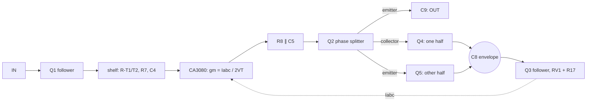

# Compressor research: MXR Dyna Comp / Ross Compressor (OTA)

The second compressor type in Ducky (`comp_type` OTA, beside the OTC-201 of `docs/compressor-spec.md`): a reduced model of the CA3080 compressor in the MXR Dyna Comp and the Ross Compressor, and the spec of the block built from it (`daisy/src/dsp/ota_compressor.h`, covered by `tests/ota_compressor_test.cpp` against `tools/ota_reference.py`, which is appendix B). The document covers how the circuit works, what an ngspice model of it does, and the reduced DSP model, checked against that netlist.

**Provenance of the numbers.** No pedal was measured. Three kinds of value appear, and each is marked:

- **schematic:** read from the schematic or computed from its part values by hand;
- **SPICE:** from the ngspice-47 netlist of appendix A, with the LTspice standard-library 2N3904 and 1N914 and a behavioural CA3080. These are predictions, good for the shape of the behaviour and for regression targets, not for claims about a real unit;
- **model:** from the Python reference implementation of the reduced model (appendix B), always quoted beside the SPICE value it should match.

## Summary

- **A gain cell steered by its own output.** The CA3080 is a transconductance amplifier: its gain is proportional to the current into its bias pin. The side chain reads the gain cell's output, so it is a feedback compressor, and it acts by pulling the bias current down.
- **Sensitivity is gain, and therefore threshold.** The Sensitivity pot sets the bias current's ceiling, so the gain below threshold: +12.2 dB at its minimum, +37.5 dB at its maximum (SPICE, at 330 Hz). Above threshold every setting lands on the same output, about 0.42–0.45 V peak (−12.4 dBFS).
- **Hard ceiling.** The output hardly moves once the circuit compresses: at full Sensitivity it rises 0.6 dB for 34 dB of input (10 mV to 500 mV).
- **Fast attack, very slow release.** The detector discharges C8 within 4 cycles of a step at full Sensitivity, 12 at the middle; R13 recharges it with a 1.5 s time constant. A 30 mV signal that follows a loud one comes back over seconds, the Dyna Comp's "sustain".
- **Treble on the way in.** The OTA's input has a shelf (1.06 kHz / 9.0 kHz): above 1 kHz the drive rises towards 18.6 dB more than at low frequencies, so treble reaches the OTA's non-linearity first.
- **A reduced model exists and tracks SPICE.** Three one-poles, the OTA's tanh, a trapezoidal load, two piecewise-linear detector halves and the envelope, all per sample: within 0.23 dB of the SPICE static curve and within 1.06 dB per cycle on the steps ("Agreement with SPICE").

## Sources

| Source | Used for |
|---|---|
| ElectroSmash, [MXR Dyna Comp Analysis](https://electrosmash.mas-effects.com/mxr-dyna-comp-analysis.html) (archive) | The bill of materials and part names, the 2.5 V bias, the input filter, the phase splitter |
| Cushychicken, [`mxr-dyna-comp.asc`](https://github.com/Cushychicken/ltspice-guitar-pedals/blob/master/mxr-dyna-comp/mxr-dyna-comp.asc), drawn after R.G. Keen's Geofex `dynacomp.gif` | The connectivity of appendix A |
| LTspice standard library | The 2N3904 and 1N914 models |

## The pedal's controls

| Control | Part | Ducky |
|---|---|---|
| Sensitivity | RV1, 500 kΩ, in series with R17 27 kΩ to the CA3080's bias pin | `comp_sustain`, as the pot's rotation ("Settings (as built)") |
| Output | RV2, 50 kΩ: the output's volume | `comp_balance` in Direct mode |
| (none) | | `comp_level`: −3 / 0 / +3 dB ahead of the circuit; `comp_mode` Blend: a dry / compressed crossfade |

## Circuit



Part names follow ElectroSmash's BOM. Voltages assume 9 V.

### Bias and input (schematic, SPICE operating point)

- **Bias:** R15 56 k over R16 22 k, C11 10 µF: 2.54 V unloaded, 2.50 V with R2 and Q1's base on it.
- **Input:** C1 10 nF and R1 10 k into Q1's base, R2 1 M to the bias. Q1 is an emitter follower (R3 10 k): 0.97 V at its emitter.
- **Coupling into the OTA:** C2 1 µF into the inverting input. The inputs sit at 4.64 V: R5 470 k from the supply into the tap between two 1 kΩ resistors (Rt1, Rt2 in appendix A), R4 and R6 1 M to ground.
- **Gain into the OTA** (SPICE AC): 0.9224 at 1 kHz, 3 dB down at 41.8 Hz (C1 and C2 together).

### The OTA's input shelf

The non-inverting input reaches ground through R7 15 k ∥ C4 10 nF and C3 1 µF; the inverting input reaches it through Rt1 and Rt2. The differential drive is the inverting input's signal times

$$\frac{v_{inv} - v_{ninv}}{v_{inv}} = \frac{2k}{2k + Z},\qquad Z = R_7 \parallel \frac{1}{sC_4}$$

that is 2/17 = 0.1176 (−18.6 dB) at low frequencies, a zero at 1061 Hz (R7 C4) and a pole at 9019 Hz (C4 with 2 k ∥ 15 k). SPICE agrees with that one-pole shelf within 0.14 dB at 100 Hz, 1 kHz, 5 kHz and 10 kHz (the residue at 100 Hz is C3).

### Gain cell: CA3080

- **Transconductance:** `i = Iabc · tanh((v+ − v−) / 2VT)`, 2VT = 51.7 mV at 27 °C. The small-signal gain is `Iabc / 2VT`.
- **Bias current:** Q3 follows the envelope C8 (`venv`), and its emitter drives RV1 + R17 into the bias pin, which sits a junction above ground: `Iabc ≈ (venv − Voff) / Rs` with Rs = RV1 + R17.
- **Load:** R8 150 k ∥ C5 1 nF to the bias, and Q2's base. The pole is at 1.06 kHz with R8 alone.
- **At rest** (no signal) C8 sits at 8.6–9.0 V and Iabc is 14.9 µA at minimum Sensitivity, 64.6 µA at the middle of the model's taper and 273 µA at maximum (SPICE).

### Phase splitter and detector

- **Q2:** an emitter follower with equal resistors on both sides (R9, R10 10 k). Its emitter carries the signal to the output (C9 50 nF into R14 10 k + RV2 50 k: a 53 Hz high-pass) and to one detector half; its collector, inverted, to the other.
- **The collector swings more than the emitter:** the emitter also feeds C9's 60 kΩ, so its current is larger than R10's alone and the collector's swing is 1.155 times the emitter's (SPICE, 1 kHz).
- **Each half:** a 10 nF coupling (C6, C7) into the base of a grounded-emitter NPN (Q4, Q5), with 1 MΩ (R11, R12) and a 1N914 (D1, D2) to ground. The diode clamps the base's negative swing, so the capacitor charges to the signal's negative peak and the base sees the whole peak-to-peak swing; the transistor conducts on the top of it.
- **Envelope:** both collectors pull C8 10 µF down; R13 150 k recharges it from 9 V (τ = 1.5 s), less Q3's base current.

## SPICE

The netlist of appendix A, ngspice-47, `.temp 27`, with `.options reltol=1e-4 abstol=1e-10 vntol=1e-7 method=gear`.

| Run | How |
|---|---|
| AC | `ac dec 200 1 100k`, Sensitivity at the middle |
| Envelope forced | the "forced" variant: Q4, Q5, C8 and R13 removed, `Venv env 0 DC v`, RV1 = 0 |
| Detector half | Q2 replaced by `Bdrv e2 0 V = A*sin(2*pi*330*time)`, `env` held at 5 V by a source in place of R13, C8 removed |
| Static curve | `SIN(0 a 330)`, `tran 5u 1.5 1.49 5u`; half the peak-to-peak of V(o1) over the last 3 cycles |
| Steps | `Bin in 0 V = ((time>=0.1 && time<0.5) ? 0.3 : 0.03)*sin(2*pi*330*time)`, `tran 5u 1.0 0 5u`; gain of V(o1) over V(in), peak to peak per 330 Hz cycle |

V(o1) is C9's far side: exactly the model's `wet` (Direct mode, Balance 1: the kernel's output is `−wet / kVfs`).

### Static curve

Wet output in mV peak after 1.5 s at 330 Hz, with its gain against the jack in dB in brackets. Sustain is the model's position `s` (the Sensitivity taper, "Settings (as built)").

| In, mV | dBFS | s 0 | s 0.5 | s 1 |
|---|---|---|---|---|
| 2 | −59.3 | 8.15 (+12.2) | 35.32 (+24.9) | 149.40 (+37.5) |
| 5 | −51.3 | 20.37 (+12.2) | 88.28 (+24.9) | 363.11 (+37.2) |
| 10 | −45.3 | 40.74 (+12.2) | 176.50 (+24.9) | 420.87 (+32.5) |
| 20 | −39.3 | 81.44 (+12.2) | 349.05 (+24.8) | 438.69 (+26.8) |
| 50 | −31.3 | 202.86 (+12.2) | 426.82 (+18.6) | 448.26 (+19.1) |
| 100 | −25.3 | 376.00 (+11.5) | 441.05 (+12.9) | 451.29 (+13.1) |
| 200 | −19.3 | 421.19 (+6.5) | 446.65 (+7.0) | 452.17 (+7.1) |
| 500 | −11.3 | 433.28 (−1.2) | 445.36 (−1.0) | 448.91 (−0.9) |

- **Ceiling:** 0.42–0.45 V peak whatever the setting; the detector's threshold sets it (each half's base sees the whole swing and conducts from about 0.95 V peak to peak).
- **Ratio:** at full Sensitivity the output rises 0.6 dB from 10 to 500 mV of input: nearly a limiter.
- **Sensitivity's range:** 25.3 dB of gain below threshold, linear in dB with the model's taper.

### Steps

Gain in dB, V(o1) over V(in), per 330 Hz cycle: 30 mV, 300 mV from 0.1 s to 0.5 s, 30 mV to 1.0 s. Both start from rest at 0 s, so the 30 mV before the step is still being compressed by the start's first cycles (C8 recovers at τ = 1.5 s).

| | s 1 | s 0.5 |
|---|---|---|
| Before (the cycle ending at 0.1 s) | 23.68 | 23.68 |
| Cycle 1 after 0.1 s | 15.83 | 16.30 |
| Cycle 2 | 11.25 | 16.62 |
| Cycle 3 | 6.47 | 16.04 |
| Cycle 5 | 3.99 | 13.41 |
| Cycle 10 | 3.56 | 6.60 |
| 0.2 s | 3.55 | 3.48 |
| 0.4 s | 3.55 | 3.47 |
| 0.51 s (10 ms after the step down) | 6.65 | 5.09 |
| 0.55 s | 11.76 | 6.89 |
| 0.6 s | 15.82 | 8.70 |
| 0.7 s | 20.38 | 11.23 |
| 0.9 s | 23.39 | 14.67 |
| 50 % / 90 % of the reduction, cycle | 2 / 4 | 5 / 12 |

- **Attack:** a few cycles at full Sensitivity, 12 cycles (36 ms) at the middle, where the smaller bias current slows the loop.
- **Clipping on the attack:** the first loud cycle drives Q2 into saturation (the OTA's node stops about 2.7 V above its rest) and the OTA's output clamp (1.2 V below).
- **Release:** C8 recharges through R13, 1.5 s; the gain recovers by 20 dB in the first 0.4 s at full Sensitivity.

### Detector transfer

The detector-half variant: mean collector current of Q5 over 0.9–1.0 s against the drive's amplitude `A` at Q2's emitter.

| `A`, V | 0.35 | 0.40 | 0.45 | 0.50 | 0.60 | 0.70 | 0.80 | 1.0 | 1.5 | 2.0 |
|---|---|---|---|---|---|---|---|---|---|---|
| Q5, µA | 0.022 | 0.46 | 6.44 | 31.7 | 116 | 210 | 309 | 516 | 1059 | 1617 |
| model, µA | | | 6.49 | 31.1 | 126 | 222 | 319 | 513 | 1002 | 1493 |

The base swings between −0.30 and −0.44 V (the diode, at a few µA) and +0.60 to +0.72 V (the base junction).

## DSP model

A reduced state model of the circuit: the audio path as three one-poles and a trapezoidal load around the OTA's tanh, and the side chain as two piecewise-linear detector halves and a forward-Euler envelope, every state per sample. Appendix B is a reference implementation of exactly this (Python, float64); where this section and the code differ, the code is what was checked.

### Conventions

- **Units:** volts inside, AC (about each node's operating point). `kVfs` = 1.8395 V per unit sample (0 dBFS = +4.5 dBu, `docs/FIRMWARE.md` "Input calibration"), as in the OTC.
- **Polarity:** internal signals keep the circuit's polarity: the wet signal is inverted against the input, the dry one is not. The mix flips the wet signal back, so the block does not invert.
- **Rates:** 48 kHz; every state per sample.
- **Filters:** TPT one-poles as in `daisy/src/dsp/filters.h`: `G = g/(1 + g)`, `g = tan(π f / fs)`; `a = (x − s)·G`, `lp = a + s`, `s = lp + a`, `hp = x − lp`.

### Constants

| Symbol | Value | From |
|---|---|---|
| `KBUF` | 0.92238 | **SPICE:** AC V(inv)/V(in) at 1 kHz |
| `FIN` | 41.81 Hz | **SPICE:** where that response is 3 dB under its 1 kHz value |
| `K0` | 2k/(2k + 15k) = 0.11764706 | **schematic:** the shelf at low frequencies |
| `FP` | 9018.9 Hz | **schematic:** C4 with 2k ∥ 15k; the zero `K0·FP` = 1061 Hz is R7 C4. **SPICE** check: within 0.14 dB at 100 Hz, 1, 5 and 10 kHz |
| `2VT` | 0.051704 V | **schematic:** 27 °C |
| `RL` | 134.5 kΩ | **SPICE:** the forced variant at 7 V, AC V(e2)/V(in) at 330 Hz is 0.87 dB under the model's small-signal prediction with R8 = 150 kΩ (the input high-pass included); 134.5 kΩ closes it: R8 ∥ 1.3 MΩ, Q2's base |
| `C5` | 1 nF | **schematic** |
| `KE` | 0.98120 | **SPICE:** AC V(e2)/V(ota) at 1 kHz |
| `KC` | 1.1552 | **SPICE:** AC V(c2)/V(e2) at 1 kHz |
| `FOUT` | 53.05 Hz | **schematic:** C9 into R14 + RV2 = 60 kΩ |
| `CLIP_LO`, `CLIP_HI` | −1.244 V, +2.944 V | **SPICE:** the forced variant at 2.5 V (Iabc 49 µA, RV1 = 0), 1 V peak at 330 Hz: extremes of V(ota) less its operating point over 0.5–1 s |
| `VOFF` | 1.1499 V | **SPICE:** forced variant swept 1.5–8.5 V, least-squares intercept of `venv` against `Iabc · 27k` where Iabc > 5 µA (slope 1.018) |
| `BETA_F` | 109.32 | **SPICE:** Q3's `ic/ib` at `venv` = 7 V |
| `C7`, `G0` | 10 nF, 1/(1 MΩ) | **schematic:** C6/C7, R11/R12 |
| `BETA_D`, `VBE`, `RBE`, `VD` | 149.6, 0.399 V, 268 Ω, 0.543 V | **model:** fitted to "Detector transfer" (below) |
| `RD` | 25 Ω | **schematic:** the 1N914's slope at milliamps, not fitted |
| `VCC`, `R13`, `C8` | 9 V, 150 kΩ, 10 µF | **schematic** |
| `VSAT` | 0.1 V | **schematic:** the lowest C8 reaches with Q4/Q5 saturated |
| `gl` | 0.70794578 / 1.0 / 1.41253754 | Ducky's Level: −3 / 0 / +3 dB |

**The detector fit.** Nelder–Mead over (`VBE`, ln `RBE`, `VD`, `BETA_D`), minimising Σ(ln model − ln SPICE)² of the mean collector current at `A` ∈ {0.45, 0.5, 0.6, 0.7, 0.8, 1.0, 1.5, 2.0} V, the model's half driven like Q5 for 1 s and averaged over 0.9–1.0 s. The fit is flat in `RBE` below about 600 Ω: at these drives the base is a hard clamp and the current is the charge `C7` passes per cycle, `BETA_D · C7 · f · (2A − VBE − VD)`.

### Per sample

| Step | Equation | From |
|---|---|---|
| Input | `v = kVfs · x` | calibration |
| Dry | `vq = KBUF · gl · (v − LP(v, FIN))` | Q1's emitter |
| Drive | `vd = K0 · LP(vq, FP) + (vq − LP(vq, FP))` | the shelf; the OTA's inverting input |
| Bias current | `Iabc = max(venv − VOFF, 0) / Rs` | Q3, RV1 + R17 |
| OTA | `i = −Iabc · tanh(vd / 2VT)` | CA3080 |
| Load | `vo = ((A6 − GLD)·vo′ + i + i′) / (A6 + GLD)`, `A6 = 2·C5·fs`, `GLD = 1/RL`; then `vo = clamp(vo, CLIP_LO, CLIP_HI)` | R8 ∥ C5, trapezoidal; Q2's saturation and the output clamp |
| Splitter | `ve = KE · vo`; the collector is `−KC · ve` | Q2 |
| Halves | top driven by `−KC · ve`, bottom by `ve`: `ic = Σ BETA_D · max(vb − VBE, 0) / RBE` | Q4, Q5 |
| Envelope | `venv = max(venv + (T/C8)·((VCC − venv)/R13 − ic − Iabc/BETA_F), VSAT)` | C8, R13, Q3's base |
| Wet | `wet = ve − LP(ve, FOUT)` | C9 into R14 + RV2 |
| Mix | Blend: `y = ((1 − b)·vq − b·wet) / kVfs`; Direct: `y = −b·wet / kVfs` | `comp_mode`, Balance |

`tanh` is the (7, 6) Padé form clamped to ±1 (one division). Each half solves its base node by backward Euler, exactly: with `u = vs − vc` and `a = T/C7`, the node equation `vb + a·(G0·vb + f(vb)) = u` is piecewise linear in `vb` (the diode below `−VD`, slope `1/RD`; the base above `VBE`, slope `1/RBE`), so

`vb = clamp(u, U2, U1)·IK0 + max(u − U1, 0)·IK1 + min(u − U2, 0)·IK2`, `vc = vs − vb`,

with `IK0 = 1/(1 + a·G0)`, `IK1 = 1/(1 + a·(G0 + 1/RBE))`, `IK2 = 1/(1 + a·(G0 + 1/RD))`, `U1 = VBE·(1 + a·G0)`, `U2 = −VD·(1 + a·G0)`. Every select is a min or a max.

State: three filter states (`FIN`, `FP`, `FOUT`), the load's `vo` and `i′`, `venv`, and `vc` per half. Reset: everything 0, `venv` at rest: `venv0 = (VCC/R13 + VOFF·g)/(1/R13 + g)` with `g = 1/(Rs · BETA_F)`.

### Choices, and what each was checked against

- **The collector's larger swing (`KC`).** Without it, both halves see the emitter's swing, need about 0.7 dB more output to collect the same current, and the static curve is 0.7–1.0 dB loud above threshold.
- **The detector's constants are fitted, not measured.** `BETA_D` at Ic = 100 µA is 100.0 (SPICE), but the halves conduct in pulses of 0.3–7 mA, where the 2N3904's β is 120–167; and the 1N914 clamps at 0.30–0.44 V at the few µA it carries, not at 0.6 V. With `BETA_D` 100 and `VD` 0.6 fixed, the best (`VBE`, `RBE`) sits on the grid's edge (0.45 V, 500 Ω), 4.5–17.5 dB under SPICE's current, and the static curve is 1.9 dB loud.
- **The high clip at Q2's saturation.** At 8 V on C8 (Iabc 250 µA) the OTA pushes Q2's base through saturation, to +3.70 V (low −1.29 V); at the tens of µA it carries in compression, Q2 holds the node at +2.84 V (31 µA) to +3.01 V (67 µA). +2.944 V (49 µA) puts the first loud cycle at the middle setting 0.7 dB from SPICE instead of 1.75.
- **Per sample, not per block.** The envelope and the halves are cheap (no logarithm, no Newton), and the attack lasts a few cycles: a block-rate side chain would add 0.5 ms of lag to a loop that settles in 4 cycles (12 ms).
- **The envelope by forward Euler.** `T/C8 · (1/R13)` is 1.4e-5: far inside stability.
- **No delay-free loop:** `Iabc` uses the previous sample's `venv`.
- **float32:** checked. The kernel follows the float64 reference within 4.8e-7, 4.8e-7 and 1.2e-6 of full scale on the three steps, 6.0e-7 on a synthetic DI and 0.00016 mV on the static curve (`tests/ota_compressor_test.cpp`). Two changes from a literal transcription got it there, neither of which changes the equations: the envelope is held as `venv − VOFF` (what `Iabc` reads, a few tenths of a volt in compression), and it is summed with compensation (Kahan). Held as `venv` and summed plainly, the kernel was up to 2.6e-5 off; held as `venv − VOFF`, 8.7e-6, but a plain sum still drops each step below half of the envelope's last place, which near rest stalled it about 30 mV short of `venv0` (the meter at 0.996 after 20 s of silence). A half's current is taken from `u − U1` rather than from `vb − VBE`, which carries the rounding of `U1 · IK0` against `VBE`.

### Agreement with SPICE

The reference implementation against the appendix A netlist, at the SPICE runs' settings. It measures the reduction, not the pedal.

| Test | Result |
|---|---|
| Static curve, 3 settings × 8 levels (2–500 mV) | worst 0.23 dB; below threshold −0.11 dB (s 0), −0.02 dB (s 0.5), +0.03 dB (s 1) |
| Steps, per cycle, first 30 ms after each edge | within 1.06 dB (s 1, cycle 3), 0.70 dB (s 0.5) |
| Steps, from 30 ms on | within 0.73 dB (s 1, 50–100 ms after the step down), 0.19 dB (s 0.5) |
| Steps, 50 % / 90 % of the reduction | cycles 2 / 4 (SPICE 2 / 4) and 6 / 12 (5 / 12) |
| Steps, gain at 0.4 s | 3.38 dB (SPICE 3.55), 3.29 dB (3.47) |
| Kernel (float32) against the reference | max abs diff 4.8e-7, 4.8e-7, 1.2e-6 (steps), 6.0e-7 (DI); static curve 0.00016 mV; the static curve against SPICE worst 0.233 dB, the steps within the tolerances above |

Model static curve, mV peak (the SPICE table's points):

| In, mV | s 0 | s 0.5 | s 1 |
|---|---|---|---|
| 2 | 8.05 | 35.24 | 149.86 |
| 5 | 20.12 | 88.10 | 359.51 |
| 10 | 40.23 | 176.17 | 417.49 |
| 20 | 80.42 | 347.66 | 429.11 |
| 50 | 200.45 | 420.84 | 436.53 |
| 100 | 370.75 | 430.81 | 439.34 |
| 200 | 418.02 | 436.08 | 441.38 |
| 500 | 430.83 | 440.80 | 445.71 |

Model steps, dB, in the SPICE table's rows from cycle 1: 15.99, 10.70, 5.42, 3.65, 3.39, 3.38, 3.38, 6.98, 12.49, 16.54, 20.98, 23.19 (s 1); 17.00, 17.32, 16.46, 13.94, 6.41, 3.30, 3.29, 4.91, 6.77, 8.64, 11.24, 14.70 (s 0.5).

### What it leaves out

| Left out | Why |
|---|---|
| The CA3080's own transistors: input offset, output resistance, the bias pin's junction | the netlist's CA3080 is behavioural on purpose: an ideal `tanh` transconductor, its bias pin one junction above V−, its output clamped 1 V inside each rail. A real 3080's spread (offset, gm per µA) is unknown here |
| Hiss | the CA3080's input noise at high Sensitivity is the Dyna Comp's known flaw; not modelled |
| C1/R2 and C2 as separate corners, C3 (11 Hz), C11 | folded into `FIN`, or below the audio band |
| Q2's saturation as a function of Iabc | one clip level at 49 µA (above) |
| The halves' loading of the splitter | the top half's base current through R9 lowers the collector's peaks a little (1.13 against 1.155 in compression) |
| Q3's and the bias pin's junction voltage against current | `VOFF` fixed; the sweep's slope is 1.018 |
| Supply sag, temperature, unit spread | no data |

### Cost (measured)

- **Per sample:** about 60 float operations and one division (the tanh): three one-poles, the trapezoidal load, three clamps, two detector halves (each a clamp and two one-sided terms, no division), the envelope with its compensated sum. No logarithm, exponential or Newton step.
- **Per tick:** a `pow` for Sustain's `1/Rs` and a division for `Iabc` at rest when Sustain moves, a `pow` for Balance's taper when it moves, and the meter's division.
- **Measured (Seed 1.2, `APP=bench`):** 7,540 cycles a block on average, 32.5 permille of the block period at most, on the OTC's bench settings (Sustain, Level and Balance moving every 5 ms, noise driving it into compression and the clamps). The OTC's: 7,105 and 30.7. The bench's whole chain, with both compressors on every block: 594.8 permille against 850 (`docs/MEASUREMENTS.md` "Bench").
- **Live** (the xfade build, a model and no IR, playing): 793 / 800 permille with the OTA on, 791 / 798 with the OTC, 763 / 801 off; 836 at most in the second holding a switch from OTC to OTA, when both run for 20 ms (`docs/MEASUREMENTS.md` "Compressor").

### Settings (as built)

The parameters `comp_type`, `comp_mode`, `comp_sustain`, `comp_level` and `comp_balance` (`daisy/src/params.h`; `docs/MIDI.md` "Parameters"):

| Setting | Range | Maps to |
|---|---|---|
| Type | OTC / OTA (`comp_type`, global, default OTC) | OTA runs this model; OTC runs `docs/compressor-spec.md`'s |
| Mode | Off / Blend / Direct | as on the OTC |
| Sustain | 0–100 % of the Sensitivity pot's rotation | `Rs = (RV1max + R17)·(R17/(RV1max + R17))^s`, RV1max 500 kΩ, R17 27 kΩ: RV1 = 500 kΩ at 0, 92.29 kΩ at 0.5, 0 at 1; the gain below threshold moves linearly in dB over 25.8 dB |
| Level | −3 / 0 / +3 dB | `gl`, ahead of the circuit |
| Balance | 0–100 % of the knob's rotation | as on the OTC: `b = (81^v − 1) / 80` |

The taper is Ducky's choice, not a claim about the real pot. The editor and `tools/pedal.ts` show Sustain in dB with the OTC and in % with the OTA.

**The type switch.** The OTC (`daisy/src/dsp/compressor.h`) runs first and the OTA on its output, in place; each runs only while `comp_type` picks it, and the other is a bit-exact bypass. A switch fades the outgoing type out (20 ms, keeping its last mix) while the incoming one starts from rest and fades in over the same 20 ms, so for those 20 ms both run in series. Covered by `OtaCompressor.TypeSwitchHasNoClick`: no sample-to-sample step past 1.25 × the steady signal's either way, and the outgoing kernel bit-exact from 20.5 ms after the switch.

## Appendix A: SPICE netlist

ngspice-47, `.temp 27`. `<stimulus>` is the input source; `{Rsens}` is RV1 for the setting. Outputs: V(o1) (wet), V(env) (C8), `i(v.xu1.vs)` (Iabc).

```spice
* Dyna Comp / Ross core
V9 vcc 0 9
R15 vcc vb 56k
R16 vb 0 22k
C11 vb 0 10u
Vin in 0 <stimulus>
C1 in n1 10n
R1 n1 b1 10k
R2 b1 vb 1Meg
Q1 vcc b1 e1 Q2N3904
R3 e1 0 10k
C2 e1 inv 1u
R4 inv 0 1Meg
Rt1 inv tm 1k
Rt2 tm ninv 1k
R5 vcc tm 470k
R6 ninv 0 1Meg
R7 ninv n7 15k
C4 ninv n7 10n
C3 n7 0 1u
XU1 ninv inv ota abc 0 CA3080B
R8 ota vb 150k
C5 ota vb 1n
Q2 c2 ota e2 Q2N3904
R9 vcc c2 10k
R10 e2 0 10k
C6 c2 bt 10n
R11 bt 0 1Meg
D1 0 bt D1N914
Q4 env bt 0 Q2N3904
C7 e2 bb 10n
R12 bb 0 1Meg
D2 0 bb D1N914
Q5 env bb 0 Q2N3904
R13 vcc env 150k
C8 env 0 10u
Q3 vcc env e3 Q2N3904
RV1 e3 s1 {Rsens}
R17 s1 abc 27k
C9 e2 o1 50n
R14 o1 out 10k
RV2 out 0 50k
.subckt CA3080B inp inn out abc vee
Vs abc a 0
Dabc a vee DABC
Bo vee out I = I(Vs)*tanh((V(inp)-V(inn))/0.051704)
Dhi out h DCL
Vh h vee 7.4
Dlo l out DCL
Vl l vee 1.6
.model DABC D(Is=6.734f N=1)
.model DCL D(Is=1e-14 N=1)
.ends
.model Q2N3904 NPN(Is=6.734f Xti=3 Eg=1.11 Vaf=74.03 Bf=416.4 Ne=1.259 Ise=6.734f Ikf=66.78m Xtb=1.5 Br=.7371 Nc=2 Isc=0 Ikr=0 Rc=1 Cjc=3.638p Mjc=.3085 Vjc=.75 Fc=.5 Cje=4.493p Mje=.2593 Vje=.75 Tr=239.5n Tf=301.2p Itf=.4 Vtf=4 Xtf=2 Rb=10)
.model D1N914 D(Is=2.52n Rs=.568 N=1.752 Cjo=4p M=.4 tt=20n)
```

## Appendix B: reference implementation

The model of "DSP model", as it was checked against SPICE. `Ota.step` takes one input sample (full scale 1.0) and returns the output sample, and the dry signal and Q2's emitter in volts.

```python
# Reduced model of the MXR Dyna Comp / Ross Compressor: reference implementation.
# float64, 48 kHz, every state per sample. Internal signals are AC volts with the circuit's polarity.
import math

FS = 48000.0
T = 1.0 / FS
KVFS = 1.8395                 # volts per unit sample: 0 dBFS = +4.5 dBu
VT2 = 0.051704                # the CA3080's 2 VT
KBUF, FIN = 0.92238, 41.81    # Q1 into the OTA's inverting input: gain, input high-pass (Hz)
K0, FP = 2.0 / 17.0, 9018.9   # the input shelf: low-frequency gain, pole (Hz)
RL, C5 = 134.5e3, 1e-9        # the OTA's load: R8 with Q2's base, C5
KE, KC = 0.98120, 1.1552      # Q2: emitter over the OTA's output, collector over emitter
FOUT = 53.05                  # C9 into R14 + RV2
CLIP_LO, CLIP_HI = -1.244, 2.944
VCC, R13, C8, VSAT = 9.0, 150e3, 10e-6, 0.1
VOFF, BETA_F = 1.1499, 109.32  # Q3 and the bias pin: offset (V), Q3's beta
BETA_D, VBE, RBE = 149.6, 0.399, 268.0  # detector transistor: beta, knee (V), base slope (ohm)
VD, RD = 0.543, 25.0          # clamp diode: knee (V), slope (ohm)
C7, G0 = 10e-9, 1.0 / 1e6     # detector coupling: C6/C7, R11/R12
A6 = 2.0 * C5 * FS            # C5 as a trapezoidal conductance: 96 uS
GLD = 1.0 / RL
A = T / C7
IK0 = 1.0 / (1.0 + A * G0)
IK1 = 1.0 / (1.0 + A * (G0 + 1.0 / RBE))
IK2 = 1.0 / (1.0 + A * (G0 + 1.0 / RD))
U1 = VBE * (1.0 + A * G0)
U2 = -VD * (1.0 + A * G0)


def one_pole(fc):             # TPT one-pole: G = g / (1 + g), g = tan(pi fc / fs)
    g = math.tan(math.pi * fc / FS)
    return g / (1.0 + g)


def tanh(x):                  # Pade (7, 6), clamped to +-1
    x2 = x * x
    y = x * (135135.0 + x2 * (17325.0 + x2 * (378.0 + x2))) / (135135.0 + x2 * (62370.0 + x2 * (3150.0 + 28.0 * x2)))
    return min(max(y, -1.0), 1.0)


class Half:
    """One detector transistor (Q4 or Q5) behind its coupling capacitor and clamp diode."""

    def __init__(self):
        self.vc = 0.0             # volts across C6 or C7

    def step(self, vs):           # vs drives the coupling; returns the collector current
        u = vs - self.vc          # C7 dvc/dt = G0 vb + f(vb), vb = vs - vc: backward Euler, solved exactly
        vb = min(max(u, U2), U1) * IK0 + max(u - U1, 0.0) * IK1 + min(u - U2, 0.0) * IK2
        self.vc = vs - vb
        return BETA_D * max(vb - VBE, 0.0) / RBE


class Ota:
    def __init__(self, sustain=1.0, level=1, mode="direct", balance=1.0):
        self.g_in, self.g_sh, self.g_out = one_pole(FIN), one_pole(FP), one_pole(FOUT)
        self.inv_rs = 1.0 / ((500e3 + 27e3) * (27e3 / 527e3) ** sustain)  # RV1 + R17
        self.gl = (0.70794578, 1.0, 1.41253754)[level]                       # Level -3, 0, +3 dB
        g = self.inv_rs / BETA_F
        self.venv = (VCC / R13 + VOFF * g) / (1.0 / R13 + g)                # C8 at rest
        self.iabc_rest = (self.venv - VOFF) * self.inv_rs
        self.s_in = self.s_sh = self.s_out = self.vo = self.i_prev = 0.0
        self.top, self.bottom = Half(), Half()
        self.mode, self.b = mode, balance

    def step(self, x):
        v = KVFS * x
        a = (v - self.s_in) * self.g_in                 # input high-pass
        lp = a + self.s_in
        self.s_in = lp + a
        vq = KBUF * self.gl * (v - lp)                  # dry: Q1's emitter
        a = (vq - self.s_sh) * self.g_sh                # input shelf
        lp = a + self.s_sh
        self.s_sh = lp + a
        vd = K0 * lp + (vq - lp)                        # OTA drive, inverting input
        iabc = max(self.venv - VOFF, 0.0) * self.inv_rs
        i = -iabc * tanh(vd / VT2)
        vo = ((A6 - GLD) * self.vo + i + self.i_prev) / (A6 + GLD)  # C5 dvo/dt = i - vo / RL, trapezoidal
        self.vo = min(max(vo, CLIP_LO), CLIP_HI)
        self.i_prev = i
        ve = KE * self.vo                               # Q2's emitter; its collector is -KC ve
        ic = self.top.step(-KC * ve) + self.bottom.step(ve)
        self.venv = max(self.venv + (T / C8) * ((VCC - self.venv) / R13 - ic - iabc / BETA_F), VSAT)
        a = (ve - self.s_out) * self.g_out              # output coupling
        lp = a + self.s_out
        self.s_out = lp + a
        wet = ve - lp
        y = ((1.0 - self.b) * vq - self.b * wet) / KVFS if self.mode == "blend" else -self.b * wet / KVFS
        return y, vq, ve                                # output sample, dry and Q2's emitter in volts
```
